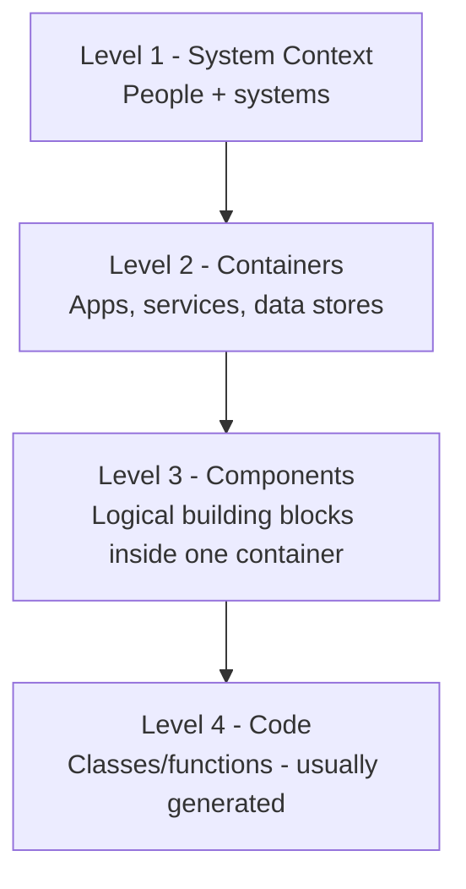
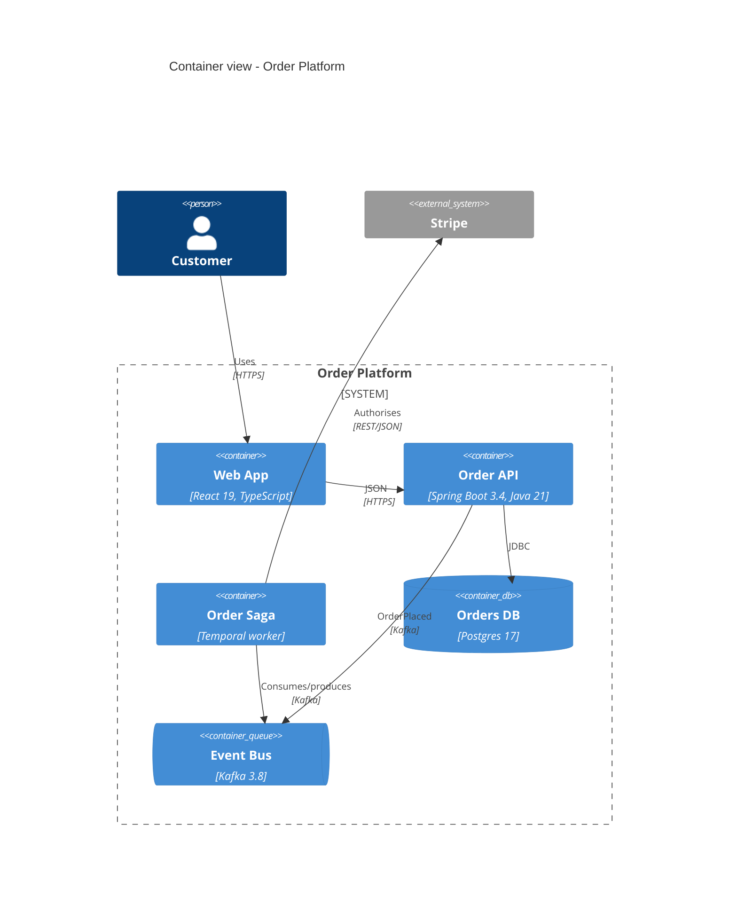
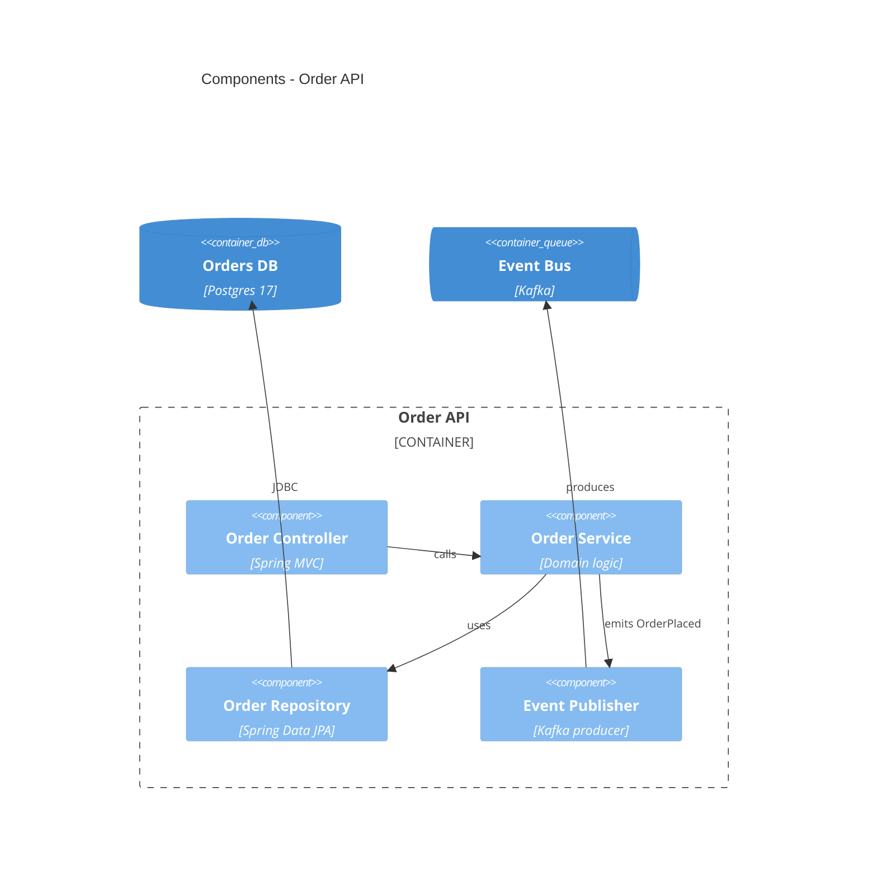

# C4 Model Diagram

Simon Brown's C4 model gives you four consistent zoom levels for software architecture. This skill standardises notation, picks the right tooling per level, and prevents the most common mistake: mixing levels in a single diagram.

## Stack Baseline (2026)
| Concern | Recommended |
|---|---|
| Canonical source | Structurizr DSL (`workspace.dsl`) |
| In-line rendering | Mermaid 11+ (`C4Context`, `C4Container`, `C4Component`) |
| Code level (L4) | Generated UML from code (PlantUML, IDE) - rarely hand-drawn |
| Storage | `docs/architecture/workspace.dsl` + per-view `.mmd` |
| CI | `structurizr-cli export -workspace workspace.dsl -format mermaid` |
| Notation rules | c4model.com - "Notation" section |

## The four levels


| Level | Audience | Frequency | Owner |
|---|---|---|---|
| L1 Context | Everyone | Reviewed quarterly | Architect |
| L2 Container | Engineers + PMs | Updated per release | Tech lead |
| L3 Component | Engineers | On significant change | Component owner |
| L4 Code | Engineers | Generated | Tooling |

## When to Use
- New service or system: produce L1 + L2 before any code.
- Onboarding: walk an engineer L1 -> L2 -> L3 of their service.
- Refactor proposal: L3 of current vs target.
- Skip L4 unless the audience explicitly needs it.

## Prerequisites
- One named system in scope.
- Container boundaries match deployable units.
- Components are logical groupings inside a container, not classes.

## Instructions

### 1. Structurizr DSL - single source of truth
```
workspace "Order Platform" {
  model {
    customer = person "Customer"
    order = softwareSystem "Order Platform" {
      web   = container "Web App"        "React 19"        "TypeScript"
      api   = container "Order API"      "Spring Boot 3.4" "Java 21"
      saga  = container "Order Saga"     "Temporal worker" "Java 21"
      db    = container "Orders DB"      "Postgres 17"     "RDBMS" { tags "Database" }
      bus   = container "Event Bus"      "Kafka 3.8"       "Streaming" { tags "Queue" }
    }
    payments = softwareSystem "Stripe" { tags "External" }

    customer -> web "Uses" "HTTPS"
    web -> api "JSON over" "HTTPS"
    api -> db "Reads/writes" "JDBC"
    api -> bus "Publishes OrderPlaced" "Kafka"
    saga -> bus "Consumes/produces" "Kafka"
    saga -> payments "Authorises" "REST/JSON"
  }
  views {
    systemContext order "L1" { include * autoLayout }
    container     order "L2" { include * autoLayout }
    theme default
  }
}
```

### 2. Level 2 - Containers (Mermaid)


### 3. Level 3 - Components (inside Order API)


### 4. Authoring rules
- One zoom level per diagram - never mix.
- Every element labelled with name + type + technology.
- Every relationship has a verb and protocol.
- Containers map to deployable units (process, lambda, pod, page).
- Components are logical, not files; do not chase code.

## Common Pitfalls
| Pitfall | Symptom | Fix |
|---|---|---|
| Mixed levels | Containers and components on one diagram | Split per level |
| Class diagram in disguise | L3 with 50 boxes mirroring packages | Group into <=10 logical components |
| No technology labels | Reader cannot infer stack | Add tech to every container |
| Drift | DSL says one thing, reality another | Review on every release; CI-fail on missing labels |
| Tooling lock-in | Only renderable in one tool | Keep `.dsl` source; export Mermaid for inline docs |

## Output Format
- `docs/architecture/workspace.dsl` (canonical).
- Per-view `.mmd` exports embedded in arc42 sections 3, 5, 6.
- PNG/SVG only for slides; regenerated, never hand-edited.
- Reviewed each release; date stamped in view title.

## Authoritative References
- Simon Brown, C4 Model - https://c4model.com
- Structurizr DSL reference - https://docs.structurizr.com/dsl
- Structurizr CLI - https://docs.structurizr.com/cli
- Mermaid C4 syntax - https://mermaid.js.org/syntax/c4.html
- arc42 8.x sections 3, 5, 6 - https://docs.arc42.org
- ISO/IEC/IEEE 42010:2022.
