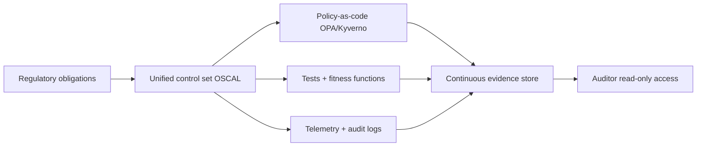

# Compliance Framework

Compliance fails when it lives in spreadsheets disconnected from running systems. A modern framework expresses each control as code (policy, test, telemetry) so audit evidence is a query, not a fire drill. Map once to a unified control set, satisfy many regimes.

## Stack Baseline (2026)
| Concern | Recommended |
| --- | --- |
| Unified control set | SCF (Secure Controls Framework) or OSCAL profile |
| ISMS | ISO/IEC 27001:2022 + 27002:2022 controls |
| Service trust | SOC 2 (TSC 2017, 2022 points of focus) |
| Privacy | GDPR, UK GDPR, CCPA/CPRA, LGPD |
| Health | HIPAA Security Rule, HITRUST CSF v11 |
| AI | EU AI Act (in force 2024, full apply 2026), NIST AI RMF 1.0 |
| Cloud | CIS Benchmarks, CSA CCM 4 |
| Policy-as-code | OPA + Conftest, Kyverno, Cloud Custodian |
| Evidence automation | Drata, Vanta, Anecdotes; OSCAL JSON |
| SDLC | NIST SP 800-218 SSDF, OWASP SAMM 2 |

## When to Use
- Pursuing first SOC 2 or ISO 27001 certification.
- Entering EU market with AI features (AI Act high-risk path).
- Multi-regime program (SOC 2 + ISO + HIPAA) needing dedup.
- Continuous compliance for a regulated platform.

## Prerequisites
- Asset inventory and data classification.
- IaC for cloud resources (Terraform / Crossplane).
- Centralized identity (OIDC/SSO) and audit logging.
- Risk register with owners.

## Instructions



1. **Map once.** Build a unified control catalog (OSCAL) covering ISO 27001:2022 Annex A, SOC 2 TSC, GDPR Art. 32, HIPAA Security Rule, EU AI Act Annex IV. Cross-reference each technical control to the regimes it satisfies.
2. **Express as code.** For each control specify: preventive policy (OPA/Kyverno), detective test (CI check, Cloud Custodian), and evidence telemetry (CloudTrail, audit log).
3. **Wire into pipelines.** Conftest in CI for IaC; admission policies in clusters; scheduled posture scans (Steampipe, Prowler, ScoutSuite).
4. **Continuous evidence.** Stream policy decisions and telemetry into an evidence lake (e.g. S3 + Athena, or Drata/Vanta). Tag each artifact with control id.
5. **Risk + exceptions.** Any deviation requires a time-bound, owner-assigned exception ticket linked to the risk register.
6. **AI Act addendum.** For high-risk AI: maintain technical documentation (Annex IV), risk management, data governance, logging, human oversight, post-market monitoring.

```rego
# OPA: ISO 27001 A.8.24 - cryptography in transit
package compliance.iso27001
deny[{ "control": "A.8.24", "msg": msg }] {
  input.resource_type == "aws_lb_listener"
  input.protocol == "HTTP"
  msg := "Listener must use HTTPS/TLS 1.2+"
}
```

```yaml
# control mapping (excerpt)
- id: CTRL-ENC-TRANSIT
  description: All external traffic uses TLS 1.2+
  satisfies: [ISO27001:A.8.24, SOC2:CC6.7, HIPAA:164.312(e)(1), GDPR:Art32]
  preventive: opa/transit-encryption.rego
  detective:  prowler check_elb_https
  evidence:   cloudtrail+config-rule:elb-tls-listener
  owner: platform-security
```

## Common Pitfalls
| Pitfall | Mitigation |
| --- | --- |
| One spreadsheet per regime | Unify via OSCAL / SCF |
| Annual audit scramble | Continuous evidence pipeline |
| Policies in docs, not enforced | Every control has prevent + detect + evidence |
| Exceptions never expire | Mandatory expiry; auto-reopen ticket |
| AI Act treated as legal-only | Engineering owns Annex IV docs + logging |

## Output Format
- OSCAL component definition + control catalog in repo.
- Policy bundle (OPA/Kyverno) versioned and signed.
- Evidence dashboard with control coverage and pass rate.
- Exception register with owners and expiry dates.

## Authoritative References
- ISO/IEC 27001:2022 and 27002:2022.
- AICPA Trust Services Criteria (SOC 2), 2017 with 2022 PoF.
- Regulation (EU) 2016/679 (GDPR); Regulation (EU) 2024/1689 (AI Act).
- HIPAA Security Rule, 45 CFR Part 164 Subpart C.
- NIST SP 800-53 Rev 5, NIST SP 800-218 SSDF, NIST AI RMF 1.0.
- OSCAL 1.1; OWASP SAMM 2; CSA CCM 4.
