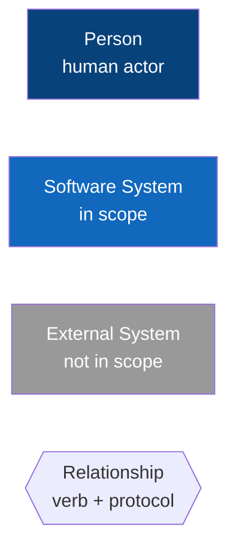
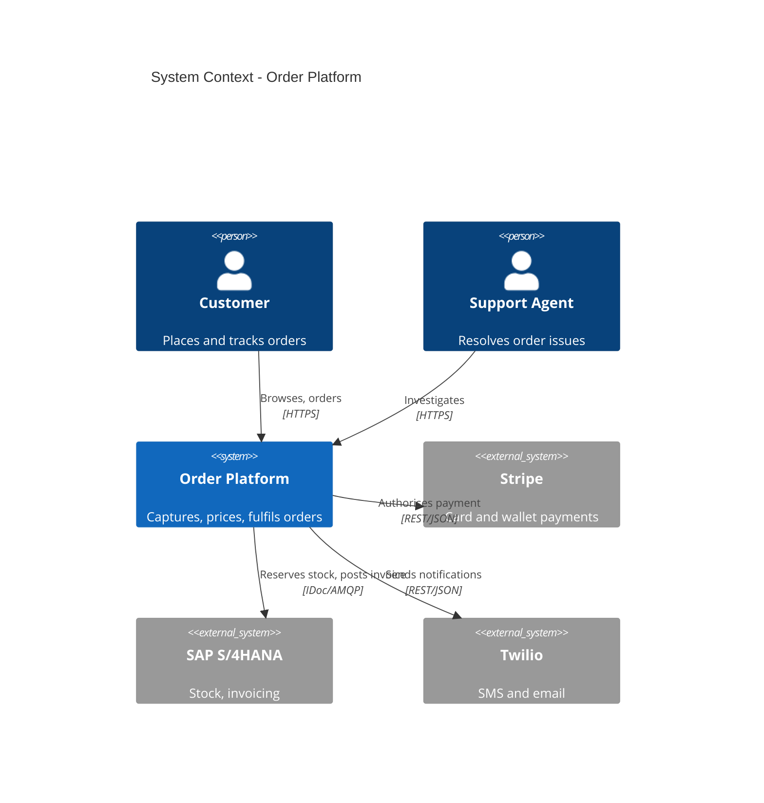

# Context Diagram

The System Context diagram is the single picture that answers "what is this system, who uses it, and what does it touch?" - the prerequisite for every other architecture artefact. This skill follows Simon Brown's C4 Level 1 conventions and renders in Mermaid for diff-friendly review.

## Stack Baseline (2026)
| Concern | Recommended |
|---|---|
| Notation | C4 model Level 1 (System Context) - c4model.com |
| Tooling | Mermaid 11+ `C4Context`, or Structurizr DSL for canonical source |
| Storage | `docs/architecture/context.mmd` or `workspace.dsl` |
| Rendering | GitHub/Backstage TechDocs native, or `structurizr-cli export` |
| Boundaries | One "system in scope" per diagram - no exceptions |
| Iconography | Plain shapes; colour for in-scope vs external only |

## When to Use
- First page of every arc42 / architecture document.
- New team onboarding to an existing system.
- Scoping a discovery, RFP, or vendor evaluation.
- Before discussing internals - never substitute for L2/L3.

## Prerequisites
- Agreed name and one-line purpose for the system.
- List of human roles that interact with it.
- List of external systems it depends on or serves.
- Owner identified (who maintains this diagram).

## Instructions

### 1. The four element types


### 2. Mermaid C4 example


### 3. Structurizr DSL (canonical alternative)
```
workspace "Order Platform" {
  model {
    customer = person "Customer"
    csr      = person "Support Agent"
    order    = softwareSystem "Order Platform"
    payments = softwareSystem "Stripe" { tags "External" }
    erp      = softwareSystem "SAP S/4HANA" { tags "External" }
    customer -> order "Browses, orders" "HTTPS"
    order    -> payments "Authorises payment" "REST/JSON"
    order    -> erp "Reserves stock" "IDoc/AMQP"
  }
  views {
    systemContext order { include * autoLayout }
  }
}
```

### 4. Authoring rules
- Exactly **one** system in scope (filled, primary colour).
- Every relationship has a verb and a protocol.
- No technology stacks, no databases, no internals - that is L2.
- Legend in the corner if any non-default styling is used.
- Date and version in the title.

## Common Pitfalls
| Pitfall | Symptom | Fix |
|---|---|---|
| Multiple in-scope systems | Reader cannot tell what we own | Split into one diagram per system |
| Showing internals | Microservices on L1 | Move to Container (L2) diagram |
| Unlabelled arrows | "What does that line mean?" | Verb + protocol on every arrow |
| Missing humans | Only systems shown | Add every persona that initiates a flow |
| Stale | Diagram older than the system | Owner + review date in metadata |

## Output Format
- `docs/architecture/context.mmd` (or `.dsl`) committed in repo.
- Embedded in arc42 section 3.1 (Context and Scope).
- PNG/SVG exported only for slide decks.
- Reviewed at least quarterly; review date stamped in title.

## Authoritative References
- Simon Brown, C4 model - https://c4model.com/diagrams/system-context
- Structurizr DSL - https://docs.structurizr.com/dsl
- Mermaid C4 - https://mermaid.js.org/syntax/c4.html
- arc42 8.x section 3 - https://docs.arc42.org/section-3/
- ISO/IEC/IEEE 42010:2022 - Architecture description.
