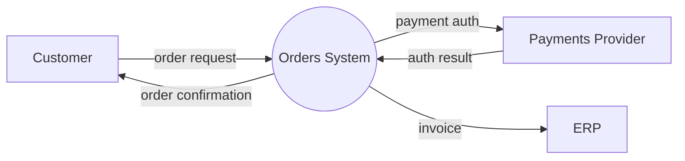
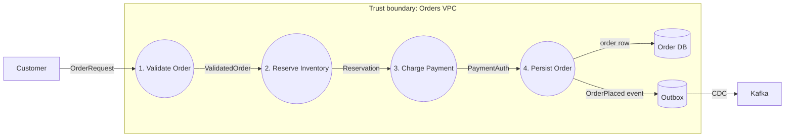
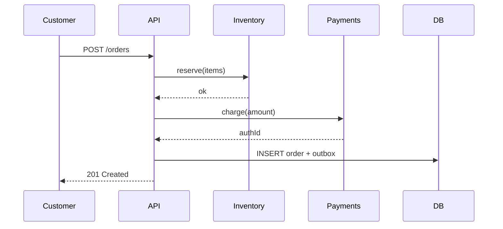

# Data Flow Diagram

A DFD answers: where does data come from, where does it go, what transforms it, and where does it rest. Combine classic DFD notation with Mermaid sequences and trust boundaries to make it useful for both architecture and security.

## Stack Baseline (2026)
| Concern | Recommended |
|---|---|
| Notation | DeMarco / Yourdon DFD, Gane-Sarson |
| Tooling | Mermaid 10, draw.io, Structurizr DSL, PlantUML |
| Threat modeling | Microsoft Threat Modeling Tool, OWASP pytm, IriusRisk |
| Lineage backing | OpenLineage 1.x, OpenMetadata, DataHub |
| Async contracts | AsyncAPI 3.0 |
| Sync contracts | OpenAPI 3.1, gRPC + Buf |
| Repo format | Diagrams-as-code in Git, reviewed via PR |

## When to Use
- Onboarding documentation for a system or domain.
- Driving STRIDE / LINDDUN threat modeling.
- Designing CDC, ETL, or event flows before build.
- Regulatory submissions (GDPR Article 30, PCI scope).

## Prerequisites
- List of external entities, processes, data stores, and data flows.
- Trust boundary map (network, tenancy, regulatory).
- Naming convention for processes (`verb-noun`) and stores (`noun`).

## Instructions

### 1. Use canonical DFD elements
| Symbol | Meaning |
|---|---|
| Rectangle | External entity (user, third-party system) |
| Circle / rounded rectangle | Process (transforms data) |
| Open rectangle / two parallel lines | Data store |
| Arrow | Data flow, labeled with the data |
| Dashed line | Trust boundary |

### 2. Draw Level 0 (context diagram)

One process. One sentence purpose. All external entities.

### 3. Decompose to Level 1

Number processes hierarchically: 1, 1.1, 1.2 in deeper levels.

### 4. Add a sequence view for time

DFD shows the *what*; sequence shows the *when*.

### 5. Mark trust boundaries and classifications
Annotate every flow that crosses a boundary with: protocol, auth, encryption, PII tags. This is the input STRIDE expects.

### 6. Reconcile with live lineage
For data platform DFDs, generate the operational view from OpenLineage and diff against the design DFD. Investigate every undocumented flow.

### 7. Store as code, review via PR
Keep Mermaid sources beside the service code. Require diagram updates as part of any flow-changing PR.

## Common Pitfalls
| Pitfall | Why it hurts | Mitigation |
|---|---|---|
| Mixing control flow with data flow | Confuses readers and threat models | DFDs show data only; use sequence for control |
| Skipping Level 0 | No shared scope | Always draw a context diagram first |
| Unlabeled arrows | Useless for threat modeling | Label every flow with payload + classification |
| One mega-diagram | Unreadable | Decompose by process number |
| No trust boundaries | STRIDE impossible | Mark every boundary explicitly |
| Diagram drift | Doc lies | Diagrams-as-code + PR gate |
| Inventing notation | Reviewer confusion | Stick to DeMarco/Yourdon or Gane-Sarson |

## Output Format
Deliver: Level 0 context diagram, Level 1 decomposition, optional Level 2 per complex process, accompanying sequence diagrams, trust boundary list, data classification per flow, and a STRIDE table linked from each boundary crossing.

## Authoritative References
- DeMarco, *Structured Analysis and System Specification*
- Microsoft Threat Modeling - https://learn.microsoft.com/security/engineering/threat-modeling
- OWASP pytm - https://owasp.org/www-project-pytm/
- Mermaid flowchart syntax - https://mermaid.js.org/syntax/flowchart.html
- Structurizr DSL - https://docs.structurizr.com/dsl
