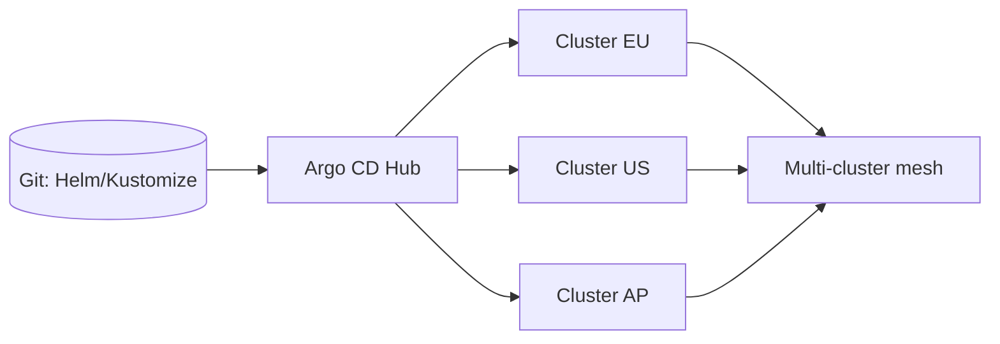

# Deployment Topology

Deployment topology is how change reaches production safely. Match the strategy to the blast radius, the rollback cost, and the signal you can trust within your error budget.

## Stack Baseline (2026)
| Concern | Recommended |
| --- | --- |
| Progressive delivery | Argo Rollouts 1.7, Flagger 1.38 |
| GitOps | Argo CD 2.13 (ApplicationSets), Flux 2.4 |
| Multi-cluster | Argo CD ApplicationSet + cluster generator, Cluster API, Karmada, Open Cluster Management |
| Traffic shaping | Istio / Gateway API, Linkerd, NGINX Gateway Fabric |
| Feature flags | OpenFeature, LaunchDarkly, Unleash, Statsig |
| Analysis | Prometheus + Argo Analysis, Datadog, Honeycomb |

## When to Use
- Choosing between blue/green, canary, or shadow for a new service.
- Replacing kubectl rollouts with progressive delivery + automated analysis.
- Federating workloads across clusters/regions for resilience or scale.
- Rollouts cause incidents because rollback is slow or signals are weak.

## Prerequisites
- SLOs and error budgets defined per service.
- Reliable golden signals (latency, errors, saturation, traffic) in metrics.
- GitOps in place or planned.

## Instructions

### 1. Choose a strategy per service

| Strategy | When | Cost | Rollback |
| --- | --- | --- | --- |
| Rolling | Stateless, low risk | $ | Re-deploy previous |
| Blue/Green | DB schema-compatible, fast cutover | $$ (2x infra) | Flip router |
| Canary | Want gradual exposure + analysis | $$ | Halt + abort |
| Shadow | Validate behavior on real traffic | $$ | N/A (no user impact) |
| Feature flag | Decoupled deploy from release | $ | Toggle off |

### 2. Define analysis gates
Automated rollback on SLO breach beats manual judgment. Bind metrics to rollout steps; abort on any failure.

```yaml
apiVersion: argoproj.io/v1alpha1
kind: Rollout
spec:
  strategy:
    canary:
      steps:
        - setWeight: 5
        - pause: { duration: 5m }
        - analysis: { templates: [{ templateName: success-rate }] }
        - setWeight: 25
        - pause: { duration: 10m }
        - setWeight: 50
        - analysis: { templates: [{ templateName: latency-p99 }] }
        - setWeight: 100
```

### 3. Multi-cluster topology



Hub-and-spoke with ApplicationSets generates one Application per cluster from a single template. Use cluster labels for region/tier targeting.

### 4. Coordinate database/schema changes
Expand-migrate-contract: deploy backward-compatible schema, then code, then remove old columns. Never couple a destructive migration to a canary that can roll back.

### 5. Decouple deploy from release with flags
Ship dark code behind OpenFeature flags. Roll out infrastructure-style changes progressively; toggle features per cohort.

### 6. Define rollback budgets
A canary that aborts in 2 minutes after 0.5% error rate spike is cheaper than one that takes 30 minutes. Set max-bad-time per tier.

### 7. Cell-based topology for scale
Partition users into cells; deploy to one cell first. Caps blast radius even with 100% rollout per cell.

## Common Pitfalls
| Pitfall | Why it bites | Mitigation |
| --- | --- | --- |
| Canary without analysis | Same risk as rolling, more complexity | Bind AnalysisTemplates, fail closed |
| Schema migration tied to canary | Can't roll back | Expand/contract pattern |
| Single global cluster | Region failure = total outage | Multi-cluster + GitOps |
| Manual `kubectl apply` in prod | Drift, no audit | GitOps only, deny direct apply |
| 100-step canary | Slow, no clear signal | 3-4 weight steps with strong analysis |

## Output Format
- Strategy decision matrix per service.
- Rollout manifests with analysis templates.
- Cluster topology diagram and ApplicationSet config.
- Rollback runbook and post-deploy verification checklist.

## Authoritative References
- Argo Rollouts and Argo CD ApplicationSets docs.
- Flagger progressive delivery patterns.
- Google SRE Workbook: "Canarying Releases".
- AWS Well-Architected DevOps Guidance (2025).
- "Accelerate" (Forsgren, Humble, Kim) deployment metrics.
