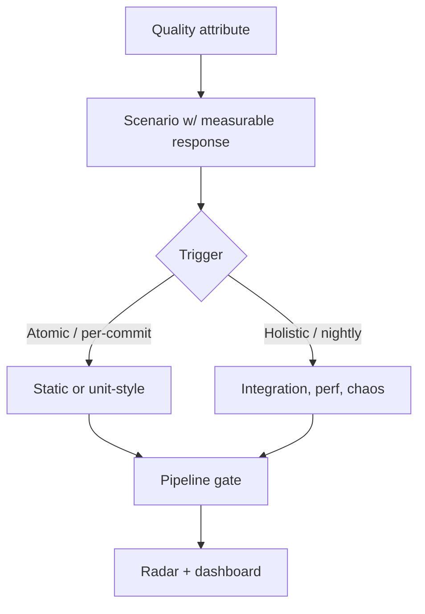

# Fitness Function Design

Fitness functions are objective, automated checks that protect architectural characteristics (security, performance, modularity, cost) the same way unit tests protect behavior. They convert prose NFRs into executable guardrails so evolutionary architecture remains safe.

## Stack Baseline (2026)
| Concern | Recommended |
| --- | --- |
| Structural (JVM/.NET) | ArchUnit 1.3, NetArchTest, Modulith |
| Structural (poly) | dependency-cruiser, Steampipe, Konveyor Tackle |
| Policy-as-code | Open Policy Agent (Rego), Conftest, Kyverno, Gatekeeper |
| Performance budgets | k6 thresholds, Lighthouse CI, Sitespeed.io |
| Security | OWASP ZAP, Semgrep, OpenSSF Scorecard, Trivy |
| Chaos / resilience | Chaos Mesh, AWS FIS, Litmus |
| Reference | Ford/Parsons/Kua, *Building Evolutionary Architectures* 2e |

## When to Use
- Defining or revising NFRs / quality attribute scenarios (ATAM/SAAM).
- Onboarding a service to a paved road or platform.
- Detected drift: production characteristic regressed silently.
- Migrations (modular monolith to services, cloud, runtime upgrade).

## Prerequisites
- Quality attribute scenarios with measurable thresholds.
- CI pipeline able to fail builds on policy violation.
- Owner per characteristic (security, SRE, platform, domain).

## Instructions



1. **Map** each characteristic to one or more scenarios with stimulus, environment, and measurable response.
2. **Classify** each function on the Ford matrix: atomic vs holistic, triggered vs continuous, static vs dynamic, mandatory vs informational.
3. **Implement** the cheapest viable check first (static > unit > integration > chaos). Promote to mandatory only when stable.
4. **Wire** into CI/CD or admission control. Mandatory functions must block merge or deploy.
5. **Publish** results to a fitness dashboard (Backstage TechInsights, Grafana). Review quarterly; retire obsolete functions.

```java
// ArchUnit: enforce hex architecture in payments
@AnalyzeClasses(packages = "com.acme.payments")
class PaymentsArchitectureTest {
  @ArchTest
  static final ArchRule domain_has_no_framework_deps =
      noClasses().that().resideInAPackage("..domain..")
          .should().dependOnClassesThat().resideInAnyPackage("org.springframework..", "jakarta..");
}
```

```rego
# OPA: every workload must declare a cost-center label
package kubernetes.admission
deny[msg] {
  input.request.kind.kind == "Deployment"
  not input.request.object.metadata.labels["cost-center"]
  msg := "cost-center label required (FinOps fitness function)"
}
```

```js
// k6 performance budget
export const options = {
  thresholds: {
    http_req_duration: ['p(95)<300'],
    http_req_failed:   ['rate<0.001']
  }
};
```

## Common Pitfalls
| Pitfall | Mitigation |
| --- | --- |
| Vague NFR ("must be fast") | Require scenario with numeric threshold |
| Functions only run nightly | Promote critical ones to per-commit |
| Flaky checks ignored | Quarantine, fix or retire within one sprint |
| Policy sprawl | Keep a registry; one owner per function |
| No business linkage | Tag each function to a quality attribute and stakeholder |

## Output Format
- `fitness-functions/` directory in repo: ArchUnit tests, Rego policies, k6 scripts, Lighthouse budgets.
- Registry (`fitness-functions.yaml`) listing id, characteristic, type, owner, severity.
- Dashboard tile per characteristic with pass/fail trend.

## Authoritative References
- Ford, Parsons, Kua, *Building Evolutionary Architectures*, 2e, O'Reilly, 2023.
- ArchUnit 1.3 user guide; NetArchTest docs.
- Open Policy Agent + Conftest documentation, 2026.
- ISO/IEC 25010:2023 product quality model.
- ThoughtWorks Tech Radar Vol. 31 (Fitness Functions = Adopt).
