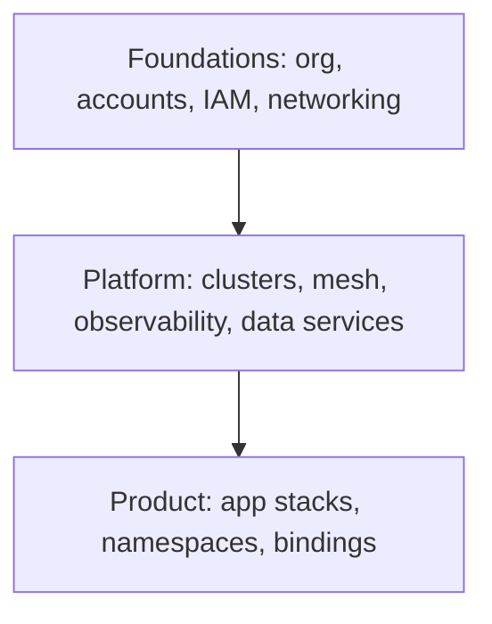

# Infrastructure as Code Patterns

Good IaC is boring: small modules, isolated state, signed releases, and a deterministic promotion path. Bad IaC is a 4000-line root module with 50 environments and a `terraform apply` Slack channel.

## Stack Baseline (2026)
| Concern | Recommended |
| --- | --- |
| Declarative IaC | OpenTofu 1.8+, Terraform 1.9+, Pulumi 3.130+ |
| K8s-native | Crossplane v2, Cluster API, Argo CD ApplicationSets |
| Policy as code | OPA/Conftest, Sentinel, Checkov, KICS, Trivy IaC |
| State backend | S3 + DynamoDB lock, Terraform Cloud, Spacelift, env0 |
| Module registry | Private registry (TFC, Spacelift, Pulumi), OCI artifacts |
| Drift detection | driftctl, Spacelift drift, Crossplane reconciliation, AWS Config |
| Secrets | SOPS, External Secrets Operator, Vault, cloud-native KMS |

## When to Use
- Splitting a monolith Terraform repo into platform + product modules.
- Migrating Terraform -> OpenTofu, or hybridizing with Crossplane.
- Establishing golden modules and a paved-road platform.
- Drift, blast-radius, or apply-time issues hurting team velocity.

## Prerequisites
- Source control with PR-based workflow and CI runners.
- Cloud account/project structure (see `cloud-architecture`).
- A decision on push (CI) vs pull (Crossplane/ArgoCD) reconciliation.

## Instructions

### 1. Layer the codebase



Each layer is a separate state; lower layers expose outputs via remote state, SSM, or Crossplane XRDs.

### 2. State isolation
One state per (layer, environment, region). Never one global state. Lock with DynamoDB / GCS object lock / TFC.

```hcl
terraform {
  required_version = ">= 1.9"
  backend "s3" {
    bucket         = "tf-state-platform-prod-eu-west-1"
    key            = "platform/eks/terraform.tfstate"
    region         = "eu-west-1"
    dynamodb_table = "tf-locks"
    encrypt        = true
  }
}
```

### 3. Compose with thin root modules
Roots wire inputs; logic lives in versioned modules pinned by semver tag. No inline resources in roots beyond providers and module blocks.

```hcl
module "vpc" {
  source  = "app.terraform.io/acme/vpc/aws"
  version = "4.2.1"
  cidr    = var.cidr
  azs     = var.azs
}
```

### 4. Policy and supply chain
Run Conftest/OPA on plans; sign module releases with cosign; SBOM modules via Syft. Block applies that fail policy or have unsigned modules.

### 5. Pick push vs pull
Push (Atlantis, Spacelift, GH Actions) for foundations/platform. Pull (Crossplane, ACK, Config Connector) for product self-service so devs PR a Claim and the operator reconciles.

```yaml
apiVersion: database.acme.io/v1alpha1
kind: PostgresInstance
metadata: { name: orders-prod }
spec:
  size: medium
  region: eu-west-1
  compositionRef: { name: aurora-serverless-v2 }
```

### 6. Detect and remediate drift
Schedule daily plan-only runs; alert on diff. For Crossplane, reconciliation is continuous. Treat drift as an incident, not a chore.

### 7. Promote via artifacts, not branches
Tag a module version, promote that version through dev -> stage -> prod via per-env tfvars. Avoid long-lived per-env branches.

## Common Pitfalls
| Pitfall | Why it bites | Mitigation |
| --- | --- | --- |
| One giant state | Slow plans, huge blast radius | Split by layer/env/region |
| Floating module versions | Non-reproducible builds | Pin semver, cosign-sign releases |
| Manual cloud edits | Permanent drift | Deny console writes, alert via Config/Crossplane |
| Secrets in tfvars | Leak via state files | External Secrets Operator, SOPS, KMS |
| `count` for env switches | Diff churn, brittle | `for_each` with maps, separate roots |

## Output Format
- Repo layout diagram with layers and state boundaries.
- Module catalog (name, version, owner, inputs, outputs).
- Policy bundle (OPA rules) and CI pipeline definition.
- Drift report dashboard and remediation SLA.

## Authoritative References
- OpenTofu and Terraform 1.9 release notes.
- Crossplane v2 documentation; AWS Controllers for Kubernetes.
- HashiCorp "Terraform: Up & Running" 4th ed (2025).
- CNCF App Delivery TAG IaC whitepaper.
- SLSA v1.1 supply chain framework.
