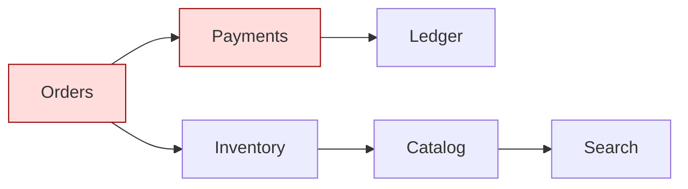

# Maintainability Assessment

Maintainability is measurable. Combine ISO 25010 sub-characteristics with concrete metrics and automated fitness functions so erosion is visible per pull request.

## Stack Baseline (2026)

| Concern | Recommended |
| --- | --- |
| Quality model | ISO/IEC 25010:2023 maintainability sub-chars (modularity, reusability, analyzability, modifiability, testability) |
| Code metrics | SonarQube 10.x, CodeScene, lizard, radon, cloc |
| Architecture fitness | ArchUnit (JVM), ts-arch, Conftest, Structurizr DSL |
| Coupling/cohesion | Modularity matrix, propagation cost, abstractness vs instability (Martin) |
| Hotspot analysis | git churn x complexity (CodeScene) |
| Docs | C4 model, ADRs (MADR), Backstage TechDocs |
| Testability | Mutation testing (PIT, Stryker), coverage per change |

## When to Use
- Refactor proposal needs evidence.
- New domain boundary or service extraction.
- Repeated incidents trace back to the same modules.
- Onboarding time grows with codebase.

## Prerequisites
- Source access with full git history.
- CI capable of running static analysis and architecture tests.
- Defined module/service boundaries (current state).

## Instructions

### 1. Map maintainability sub-characteristics to metrics
| Sub-characteristic | Metric (target) |
| --- | --- |
| Modularity | Module coupling < 0.3, fan-in/fan-out balanced |
| Reusability | Duplicated code < 3% |
| Analyzability | Cyclomatic complexity p95 < 10, cognitive complexity < 15 |
| Modifiability | Change failure rate < 15%, lead time < 1 day |
| Testability | Mutation score > 70% on core domain |

### 2. Compute architecture coupling

Build a dependency graph (e.g., from compile graph or `madge`/`depcruise`/`jdeps`). Flag cycles, hubs, and untyped boundaries.

### 3. Encode boundaries as fitness functions
```java
// ArchUnit: domain must not depend on infrastructure
@AnalyzeClasses(packages = "com.acme.checkout")
class LayeringTest {
  @ArchTest
  static final ArchRule layers = layeredArchitecture().consideringAllDependencies()
      .layer("Domain").definedBy("..domain..")
      .layer("App").definedBy("..app..")
      .layer("Infra").definedBy("..infra..")
      .whereLayer("Domain").mayNotAccessAnyLayer()
      .whereLayer("App").mayOnlyAccessLayers("Domain")
      .whereLayer("Infra").mayOnlyAccessLayers("App","Domain");
}
```

```rego
# Conftest: forbid cross-bounded-context imports in TS
package main
deny[msg] {
  some f
  input[f].imports[_] == "@acme/payments/internal"
  not startswith(f, "packages/payments/")
  msg := sprintf("%s imports payments internals", [f])
}
```

### 4. Run hotspot analysis
Combine `git log --numstat` with complexity to find files that are both complex and churned: prioritize them for refactor over equally complex but stable code.

### 5. Stress-test modifiability with change scenarios
Pick 3-5 plausible upcoming changes (new payment method, new region, swap DB). Walk the dependency graph: count touched modules, public-API breaks, migration steps. Assign a modifiability score per option.

### 6. Improve and gate
- Extract bounded contexts at high-coupling seams.
- Introduce anti-corruption layers when integrating legacy.
- Add fitness rules to CI to prevent regression.
- Track metrics over time on a quality dashboard.

### 7. Document with C4 + ADRs
Keep a current C4 L1/L2 in the repo (Structurizr DSL). Each significant maintainability decision gets an MADR.

## Common Pitfalls
| Pitfall | Why it bites | Mitigation |
| --- | --- | --- |
| Coverage as a quality proxy | High coverage, low value | Mutation score on core domain |
| Refactoring stable code | High effort, low payoff | Hotspot-driven refactor |
| Architecture diagrams diverge from code | Decisions made on fiction | Generate diagrams from code; fitness tests |
| One giant module owned by no one | Change paralyzes team | Bounded contexts + CODEOWNERS |
| Linting without architecture rules | Catches style, not structure | Add ArchUnit / Conftest gates |

## Output Format
- `docs/quality/maintainability-report.md` with metrics and trends
- `architecture/structurizr.dsl` C4 model
- ArchUnit/Conftest tests in CI with required pass
- Hotspot list with refactor backlog
- ADRs for boundary changes

## Authoritative References
- [ISO/IEC 25010:2023](https://www.iso.org/standard/78176.html)
- [Building Evolutionary Architectures, 2nd ed.](https://evolutionaryarchitecture.com/)
- [ArchUnit](https://www.archunit.org/)
- [Structurizr DSL](https://docs.structurizr.com/dsl)
- [CodeScene Hotspots](https://codescene.com/)
- [Robert C. Martin - OO Design Quality Metrics](https://wiki.c2.com/?CouplingAndCohesionMetrics)
