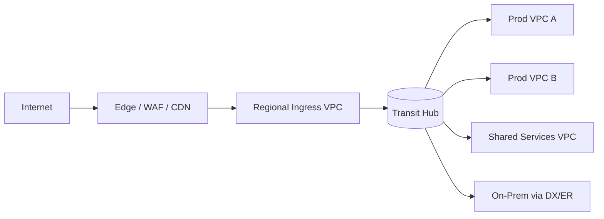

# Network Topology

Network topology drives blast radius, latency, cost, and security posture. Design it before workloads land; retrofitting CIDR plans, transit hubs, or mesh data planes is painful and expensive.

## Stack Baseline (2026)
| Concern | Recommended |
| --- | --- |
| Cloud backbone | AWS Cloud WAN, Azure Virtual WAN, GCP Network Connectivity Center |
| Transit | Transit Gateway / vWAN hubs with BGP, Megaport / Equinix for cross-cloud |
| In-cluster mesh | Istio ambient (ztunnel + waypoint) or Linkerd 2.16 |
| L4/L7 dataplane | Cilium 1.16 with eBPF, Gateway API v1.2 |
| Private connectivity | PrivateLink, Private Service Connect, Azure Private Link |
| DNS | Route 53 Resolver / Cloud DNS with split-horizon, DoH for clients |
| IPAM | AWS VPC IPAM, Infoblox, Netbox |

## When to Use
- Greenfield landing zone or new region rollout.
- Adopting service mesh, Gateway API, or eBPF networking.
- Consolidating VPN/Direct Connect/ExpressRoute into a transit fabric.
- Resolving CIDR exhaustion, asymmetric routing, or east-west bottlenecks.

## Prerequisites
- Inventory of workloads, traffic patterns (N-S vs E-W), and compliance zones.
- IP address plan owner and IPAM tool selected.
- Decision on cloud account/subscription strategy (see `cloud-architecture`).

## Instructions

### 1. Map traffic and trust zones
Classify flows: internet ingress, partner/B2B, internal east-west, admin/management, data egress. Each zone gets distinct CIDR, route table, and policy posture.



### 2. Allocate CIDR with IPAM
Reserve non-overlapping /16 per region per environment; carve /20 per VPC. Never reuse RFC1918 ranges that overlap on-prem or partners.

```hcl
resource "aws_vpc_ipam_pool_cidr" "prod_eu_west_1" {
  ipam_pool_id = aws_vpc_ipam_pool.prod.id
  cidr         = "10.40.0.0/14"
}
```

### 3. Choose transit pattern
Hub-and-spoke for centralized inspection; full-mesh only when latency demands it. Use Cloud WAN / vWAN segments to enforce isolation across spokes.

### 4. Design the mesh data plane
Prefer Istio ambient mode: ztunnel handles L4 mTLS per-node; waypoint proxies handle L7 policy per-namespace. Cuts sidecar overhead 60-90%.

```yaml
apiVersion: gateway.networking.k8s.io/v1
kind: Gateway
metadata: { name: edge, namespace: ingress }
spec:
  gatewayClassName: istio
  listeners:
    - name: https
      port: 443
      protocol: HTTPS
      tls: { mode: Terminate, certificateRefs: [{ name: wildcard-tls }] }
```

### 5. Enforce segmentation with eBPF
Cilium NetworkPolicy + ClusterMesh for cross-cluster identity. Use Hubble for flow observability instead of packet capture.

### 6. Private service exposure
Default to PrivateLink/PSC over VPC peering. Peering breaks transitivity and explodes route table cardinality.

### 7. Validate paths and failure modes
Run `aws ec2 network-insights-path`, Azure Network Watcher, or `cilium connectivity test`. Inject AZ failure with FIS/Chaos Mesh and verify BGP convergence.

## Common Pitfalls
| Pitfall | Why it bites | Mitigation |
| --- | --- | --- |
| Overlapping CIDRs | Blocks future peering / M&A | Central IPAM, /14 region pools |
| Sidecar everywhere | CPU/memory tax, upgrade pain | Adopt ambient mesh, scope sidecars to L7-needy namespaces |
| VPC peering sprawl | Non-transitive, route limits | Transit Gateway or Cloud WAN segments |
| Single egress NAT | SNAT port exhaustion | Multi-AZ NAT or VPC Lattice / PrivateLink |
| Flat security groups | Lateral movement | Identity-based policy via mesh + Cilium |

## Output Format
- Topology diagram (mermaid or draw.io) with zones, CIDRs, and transit hops.
- IPAM allocation table and route table matrix.
- Policy intent table: source identity -> destination -> port -> action.
- Failure-mode runbook (AZ loss, transit hub loss, mesh control-plane loss).

## Authoritative References
- AWS Cloud WAN and Hybrid Networking guides (2025-2026).
- Azure Virtual WAN and Cloud Adoption Framework networking.
- GCP Network Connectivity Center reference architectures.
- Istio ambient mode docs; Cilium 1.16 release notes.
- Kubernetes Gateway API v1.2 specification.
