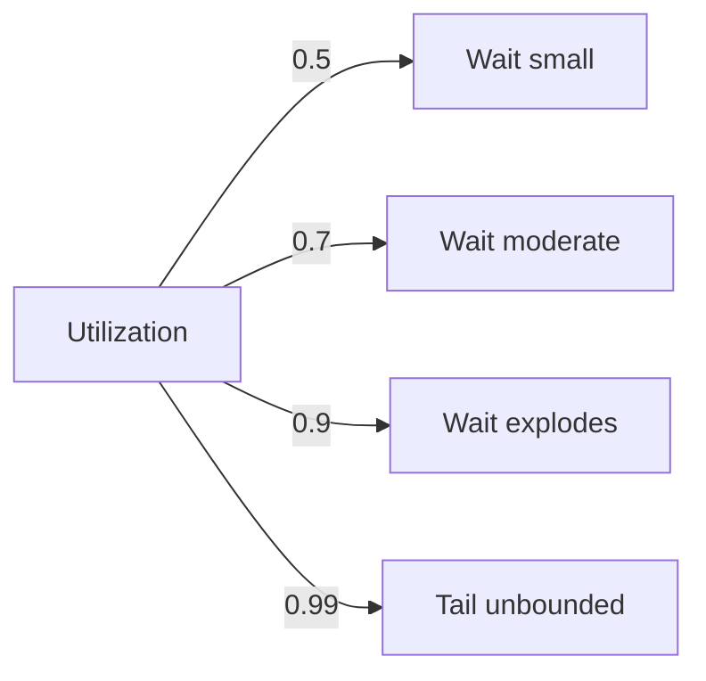

# Performance Modeling

Average latency lies. Reason about queues, percentiles, and budgets, then prove the design with controlled load tests before users do it for you.

## Stack Baseline (2026)

| Concern | Recommended |
| --- | --- |
| Theory | Little's Law, M/M/c, M/G/1, USL |
| Latency budget | Percentile budgets per hop, tail-tolerant design |
| Load testing | k6 0.55, Gatling 3.13, Locust, wrk2 |
| Profiling | Continuous profiling (Pyroscope, Parca, Datadog) |
| Tracing | OpenTelemetry 1.x with exemplars to metrics |
| Caching | Read-through, write-back; CDN edge compute |
| Concurrency | Async I/O, virtual threads (Java 21+), Tokio, Goroutines |
| Shedding | Adaptive concurrency (Netflix concurrency-limits), token bucket |

## When to Use
- Defining new SLO or tightening existing one.
- p99 or p99.9 violates target while p50 is fine.
- Adding a synchronous hop to a hot path.
- Capacity planning for a launch.

## Prerequisites
- Production traces with span timings per hop.
- Histogram metrics (not pre-aggregated averages).
- Reproducible load test environment matching prod topology.

## Instructions

### 1. Decompose the latency budget
Total p99 budget = sum of independent hop p99s with margin. Allocate per hop and track variance.

```
Client p99 = 300 ms
  edge      30 ms
  auth      10 ms
  service   60 ms
  cache     5 ms
  db        80 ms
  network   25 ms
  margin    90 ms (30%)
```

### 2. Apply Little's Law and queueing
```
L = lambda * W
For M/M/c with rho = lambda / (c*mu):
  W_q grows non-linearly as rho -> 1; keep utilization <= 0.7 for tail control.
```



### 3. Design for tail tolerance
- Hedged requests after p95.
- Request coalescing for popular keys.
- Backup requests with cancellation.
- Concurrency limits per dependency.

### 4. Implement adaptive load shedding
```go
// Netflix concurrency-limits style: AIMD limiter
limiter := limit.NewAIMDLimit("checkout", 100, 0.9)
if !limiter.TryAcquire() {
    http.Error(w, "overloaded", http.StatusServiceUnavailable)
    metrics.Shed.Inc()
    return
}
defer limiter.Release(time.Since(start), err)
```

### 5. Validate with percentile-honest tests
```js
// k6 with constant arrival rate (open model) avoids coordinated omission
import http from 'k6/http';
export const options = {
  scenarios: {
    steady: { executor: 'constant-arrival-rate',
              rate: 2000, timeUnit: '1s', duration: '20m',
              preAllocatedVUs: 1000, maxVUs: 4000 }
  },
  thresholds: {
    http_req_duration: ['p(95)<150', 'p(99)<300', 'p(99.9)<800'],
    http_req_failed:  ['rate<0.001']
  }
};
export default () => http.post('https://api.acme.io/v1/checkout', payload);
```

### 6. Profile continuously, link to traces
- Enable continuous profiler in prod with low overhead.
- Emit OTel exemplars so a slow histogram bucket links to one trace.
- Track top-N flame graph deltas across releases.

### 7. Establish a performance regression gate
CI rejects PRs that worsen p99 of key endpoints by >10% on a fixed scenario; baseline updated per release.

## Common Pitfalls
| Pitfall | Why it bites | Mitigation |
| --- | --- | --- |
| Closed-loop load tests | Hides queueing behavior (coordinated omission) | Use open-model arrival rate |
| Average latency targets | Misses tail that drives UX | Percentile budgets per hop |
| Utilization > 80% as design point | Queue waits dominate | Plan for <= 70% with headroom |
| Retry storms on slow dependencies | Amplifies overload | Budgeted retries + circuit breaker |
| Profiling only in staging | Production patterns differ | Continuous prod profiling |

## Output Format
- `docs/performance/budget-<journey>.md` with per-hop p99
- `tests/perf/k6-<journey>.js` and CI threshold gates
- ADR for shedding/hedging policies
- Profiling dashboard links per service
- Postmortem template with latency breakdown

## Authoritative References
- [Google SRE Workbook - Eliminating Toil & Performance](https://sre.google/workbook/table-of-contents/)
- [k6 Open vs Closed Models](https://grafana.com/docs/k6/latest/using-k6/scenarios/concepts/open-vs-closed/)
- [Tail at Scale - Dean & Barroso](https://research.google/pubs/the-tail-at-scale/)
- [OpenTelemetry Exemplars](https://opentelemetry.io/docs/specs/otel/metrics/data-model/#exemplars)
- [Netflix concurrency-limits](https://github.com/Netflix/concurrency-limits)
