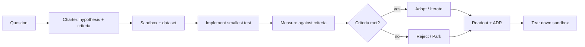

# Proof of Concept (POC) Plan

A POC is an experiment, not a prototype or a head start. Its only job is to answer a specific question cheaply enough that "no" is an acceptable outcome. Frame every POC as a hypothesis with falsifiable success criteria and a hard timebox - otherwise it becomes shadow product work.

## Stack Baseline (2026)
| Concern | Recommended |
| --- | --- |
| Framing | Hypothesis-driven (Lean Startup) + Cynefin context check |
| Timebox | 2-4 weeks; >6 weeks = split or scope cut |
| Environment | Throwaway sandbox; no shared production data |
| Data | Synthetic or anonymized representative dataset |
| Decision artifact | POC charter + readout deck + ADR |
| Outcome states | Adopt, Iterate, Reject, Park |

## When to Use
- Evaluating a vendor or OSS option as part of `build-vs-buy`.
- De-risking a novel architectural pattern (event sourcing, WASM edge, vector DB).
- Testing performance/cost assumptions under realistic load.
- Validating integration feasibility with a third-party API or legacy system.

## Prerequisites
- A specific question that a "no" answer would change behavior.
- Named owner (single accountable engineer) and sponsor.
- Budget for cloud spend and any vendor trial license.
- Representative dataset and one or two realistic workloads.
- Pre-agreed exit criteria signed by sponsor.

## Instructions



1. **Write the charter first.** One page: question, hypothesis, success criteria, timebox, owner, budget, what is explicitly out of scope.
2. **Place it on Cynefin.** Complicated -> POC may be unnecessary; Complex -> POC is the right tool; Chaotic -> stabilize first.
3. **Choose the smallest test.** Implement only what is needed to falsify the hypothesis. Resist building UI, auth, or polish.
4. **Provision a throwaway sandbox.** Tag resources for auto-teardown; never connect to production data.
5. **Run against representative load.** Use synthetic data shaped like production. Measure the metrics named in the charter, not vanity ones.
6. **Hold a readout at the timebox.** Present results against criteria; sponsor decides Adopt / Iterate / Reject / Park within 5 business days.
7. **Record the decision as an ADR.** Even rejection is valuable - link the POC artifacts so future teams do not repeat the experiment.
8. **Tear down.** Delete the sandbox, revoke vendor credentials, archive code in an `experiments/` repo marked read-only.

### POC Charter Template

```markdown
# POC: <Title>

- Owner: @handle    Sponsor: @handle
- Timebox: 2026-MM-DD -> 2026-MM-DD (max <N> weeks)
- Budget: $<X> cloud + <Y> engineer-days

## Question
<The one decision this POC informs.>

## Hypothesis
We believe <technology / approach> will <observable outcome>
under <conditions>, measured by <metric>.

## Success Criteria (falsifiable)
- p95 latency < 150 ms at 1k RPS on <dataset>
- Cost per million requests <= $X
- Integration with <system> works without code changes to <module>

## Out of Scope
- Production hardening, UI, multi-tenant isolation

## Decision Rule
If all criteria met -> Adopt and write replacement ADR.
If 1 criterion missed by <=10% -> Iterate once (max 1 week).
Otherwise -> Reject; archive findings.
```

### Load Test Snippet (k6)

```javascript
import http from 'k6/http';
import { check } from 'k6';

export const options = {
  stages: [{ duration: '5m', target: 1000 }, { duration: '15m', target: 1000 }],
  thresholds: { http_req_duration: ['p(95)<150'] },
};

export default function () {
  const r = http.post(__ENV.URL, JSON.stringify(payload()), { headers: { 'Content-Type': 'application/json' } });
  check(r, { 'status 200': (res) => res.status === 200 });
}
```

## Common Pitfalls
| Pitfall | Symptom | Mitigation |
| --- | --- | --- |
| POC turns into product | Polish, auth, UI creep | Charter explicitly bans them; archive code |
| No falsifiable criteria | "It worked, sort of" | Numeric thresholds signed by sponsor |
| Vendor-led POC | Demo on vendor data | Bring your own dataset and workload |
| Timebox slips silently | Multi-month "POC" | Hard stop at timebox; readout regardless |
| No teardown | Orphan resources, security risk | Auto-expiring tags; closure checklist |

## Output Format
- POC charter (1 page) committed to repo before work starts.
- Readout deck (5-10 slides) with metrics vs. criteria.
- ADR recording the decision and linking the experiment.
- Teardown checklist completed and signed off.

## Authoritative References
- Eric Ries, "The Lean Startup" - validated learning
- Cynefin framework, Dave Snowden - https://thecynefin.co
- ThoughtWorks Technology Radar Vol 31 (2026) - "Spike before you commit" (Adopt)
- Google SRE Workbook, Ch. "Eliminating Toil" - experiment hygiene
- k6 load testing - https://k6.io/docs
