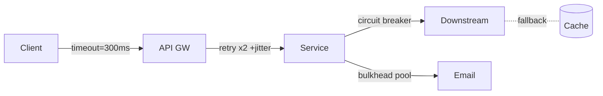

# Reliability Design

Reliability is engineered, not promised. Set numeric targets, enumerate failure modes, exercise them in production, and ensure the system degrades instead of collapses.

## Stack Baseline (2026)

| Concern | Recommended |
| --- | --- |
| Targets | SLOs per critical user journey, error budget policy |
| Redundancy | Multi-AZ default, multi-region for tier-1 |
| Data | Quorum writes, point-in-time restore, cross-region replication |
| Failure analysis | FMEA, failure mode catalog per service |
| Chaos | Litmus 3.x, Chaos Mesh 2.7, AWS FIS, Gremlin |
| Resilience patterns | Circuit breaker, bulkhead, retry+jitter, hedged requests |
| Traffic mgmt | Service mesh outlier detection, weighted failover |
| DR | Pilot-light, warm-standby, active-active; test quarterly |
| Standards | Google SRE workbook, AWS/Azure/GCP Well-Architected Reliability |

## When to Use
- New tier-1 service or revenue-critical journey.
- Post-incident: a class of failure recurred.
- Region or cloud expansion.
- Regulatory requirement on RTO/RPO.

## Prerequisites
- Defined critical user journeys and SLOs.
- Telemetry sufficient to detect and replay failures.
- CI/CD able to deploy independently per region/cell.

## Instructions

### 1. Translate availability target to budget
| Availability | Monthly downtime | Error budget (req-based, 1B req) |
| --- | --- | --- |
| 99.9% | 43m 49s | 1,000,000 |
| 99.95% | 21m 54s | 500,000 |
| 99.99% | 4m 23s | 100,000 |

### 2. Enumerate failure modes (FMEA)
```yaml
# fmea/checkout.yaml
- mode: primary DB AZ outage
  effect: writes fail in region
  detection: replication lag alert + 5xx spike
  RPN: severity*occurrence*detection = 8*3*2 = 48
  mitigation: multi-AZ Aurora, automated failover < 60s, app retry with jitter
- mode: cache stampede after eviction
  effect: DB CPU saturates
  RPN: 7*4*5 = 140
  mitigation: request coalescing, jittered TTL, stale-while-revalidate
```

### 3. Apply resilience patterns at boundaries


```java
// Resilience4j: bulkhead + circuit breaker + retry
var cb = CircuitBreaker.ofDefaults("payments");
var bh = Bulkhead.of("payments", BulkheadConfig.custom()
    .maxConcurrentCalls(50).maxWaitDuration(Duration.ofMillis(20)).build());
var retry = Retry.of("payments", RetryConfig.custom()
    .maxAttempts(3).intervalFunction(IntervalFunction
        .ofExponentialRandomBackoff(50, 2.0)).build());
Supplier<Response> call = () -> client.charge(req);
Response r = Decorators.ofSupplier(call)
    .withCircuitBreaker(cb).withBulkhead(bh).withRetry(retry).get();
```

### 4. Design for graceful degradation
- Read-only mode when writes fail.
- Serve cached/stale content (with explicit headers).
- Disable non-essential features via feature flags during overload.
- Asynchronous fallback paths (queue + retry).

### 5. Architect multi-region
Pick the strongest model the data allows:
- Active-active with conflict-free types (CRDTs) or single-writer-per-key.
- Active-passive with measured RTO/RPO and tested failover.

### 6. Run chaos experiments as code
```yaml
# AWS FIS experiment - pod kill + AZ network blackhole
apiVersion: chaos.aws/v1
experiment:
  name: checkout-az-blackhole
  hypothesis: SLO holds when AZ-A is unavailable for 10m
  steady-state: { slo: checkout_availability >= 0.999 over 30m }
  actions:
    - aws:network:disrupt-az: { az: us-east-1a, duration: PT10M }
  abort: { slo_burn_rate: > 14x for 5m }
```

### 7. Practice and verify DR
Run game-days quarterly: regional failover, restore from backup, key rotation, dependency outage. Track RTO/RPO actuals vs. target; treat misses as incidents.

## Common Pitfalls
| Pitfall | Why it bites | Mitigation |
| --- | --- | --- |
| Retries without jitter | Synchronized stampede | Exponential backoff + full jitter |
| Unbounded queues | Latency explodes, OOM | Bounded with shed policy |
| Untested failover | Silent dependency on primary | Quarterly game-days, automated |
| Single control plane | Same outage affects DR tooling | Independent break-glass tooling |
| Health checks too shallow | Unhealthy pods still serve | Deep checks + outlier detection |

## Output Format
- `docs/reliability/slo/<journey>.md`
- `docs/reliability/fmea/<service>.yaml`
- `chaos/experiments/*.yaml` with hypothesis and abort criteria
- ADR for region topology and consistency model
- Runbooks: failover, restore, degrade, recover

## Authoritative References
- [Google SRE Workbook](https://sre.google/workbook/table-of-contents/)
- [AWS Well-Architected Reliability Pillar](https://docs.aws.amazon.com/wellarchitected/latest/reliability-pillar/welcome.html)
- [Azure Well-Architected Reliability](https://learn.microsoft.com/azure/well-architected/reliability/)
- [Principles of Chaos Engineering](https://principlesofchaos.org/)
- [Resilience4j](https://resilience4j.readme.io/)
