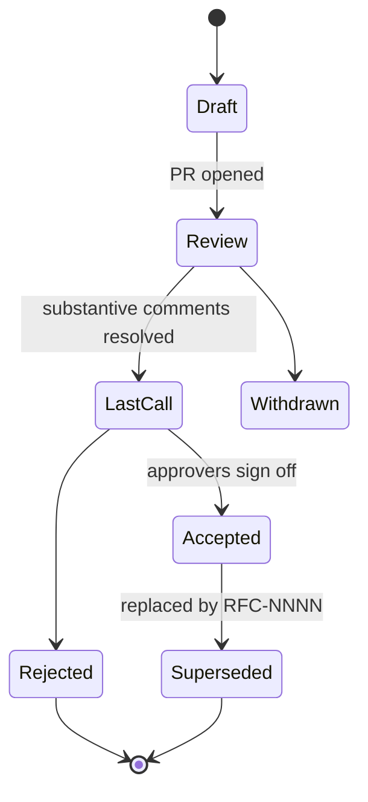

# RFC Template

RFCs convert architecture debate into a written, reviewable, citable record. This skill gives you an IETF-style template, a timeboxed review workflow, and a decision log that closes the loop with ADRs.

## Stack Baseline (2026)
| Concern | Recommended |
|---|---|
| Format | Markdown in repo (`/rfcs/NNNN-slug.md`) |
| Numbering | Zero-padded, monotonic, never reused |
| Review tool | Pull Request with CODEOWNERS for `/rfcs/` |
| Status states | Draft, Review, Last Call, Accepted, Rejected, Superseded |
| Timebox | 5 working days Review + 2 days Last Call (default) |
| Decision link | ADR (MADR 4.0) created on Accepted |
| Inspiration | IETF RFC 7322, Rust RFCs, Python PEP, Oxide RFD |

## When to Use
- Change touches >1 team or service boundary.
- Cost, risk, or reversibility is non-trivial.
- Decision needs to outlive the people in the room.

Skip RFC for: bug fixes, library upgrades inside one service, prototypes behind a feature flag.

## Prerequisites
- Problem statement crisp enough for one sentence.
- A Sponsor (the architect/EM who will drive it to decision).
- A Shepherd (a reviewer who ensures process is followed).
- Identified stakeholders and approvers (CODEOWNERS).

## Instructions

### 1. Lifecycle


### 2. Template (`/rfcs/NNNN-slug.md`)
```markdown
---
rfc: NNNN
title: <Short title>
status: Draft
sponsor: @handle
shepherd: @handle
created: YYYY-MM-DD
updated: YYYY-MM-DD
supersedes: []
superseded-by: null
---

# Summary
One paragraph. What and why.

# Motivation
Problem, evidence, who is affected. Link metrics.

# Guide-level explanation
How a developer/operator/user experiences the change.

# Reference-level explanation
Interfaces, data contracts, sequence diagrams, failure modes.
Include Mermaid C4 L2 + sequence diagrams.

# Drawbacks
Honest list. Operational cost, complexity, blast radius.

# Rationale and alternatives
At least two alternatives with a trade-off table.

# Prior art
Internal precedents, external references (RFCs, papers, vendor docs).

# Unresolved questions
Explicit list. Each must be closed before Last Call ends.

# Future possibilities
Out of scope but enabled.

# Decision log
| Date | Decision | By |
|------|----------|----|
```

### 3. Review workflow
| Day | Action | Owner |
|---|---|---|
| 0 | PR opened, status `Review` | Sponsor |
| 1-3 | Async comments, revisions | All |
| 4 | Review meeting (30 min, optional) | Sponsor |
| 5 | Status -> `Last Call`, comment freeze announced | Shepherd |
| 6-7 | Approvals collected | CODEOWNERS |
| 7 | Merge as `Accepted` or `Rejected`, open ADR | Sponsor |

### 4. From RFC to ADR
On `Accepted`, create an ADR that links back: ADRs are short, immutable decisions; RFCs are the deliberation. Never edit an Accepted RFC - supersede it.

## Common Pitfalls
| Pitfall | Symptom | Fix |
|---|---|---|
| No timebox | RFC open for 3 months | Enforce 5+2 day timebox |
| Missing alternatives | Only one option presented | Require >=2 in Rationale |
| Editing post-acceptance | History rewritten | Status `Superseded` + new RFC |
| No shepherd | Process drifts | Assign Shepherd at Draft |
| RFC as design doc | 40 pages, no decision | Scope to one decision per RFC |

## Output Format
- `/rfcs/NNNN-slug.md` merged on main.
- Linked ADR created in `/docs/adr/`.
- Announcement in the architecture channel with the merged-PR link.
- Index updated (`/rfcs/README.md`) listing all RFCs by status.

## Authoritative References
- IETF RFC 7322 - RFC Style Guide.
- Rust RFC process - https://github.com/rust-lang/rfcs
- Python PEP 1 - https://peps.python.org/pep-0001/
- Oxide RFD process - https://oxide.computer/blog/rfd-1-requests-for-discussion
- MADR 4.0 - https://adr.github.io/madr/
- arc42 8.x - https://arc42.org
