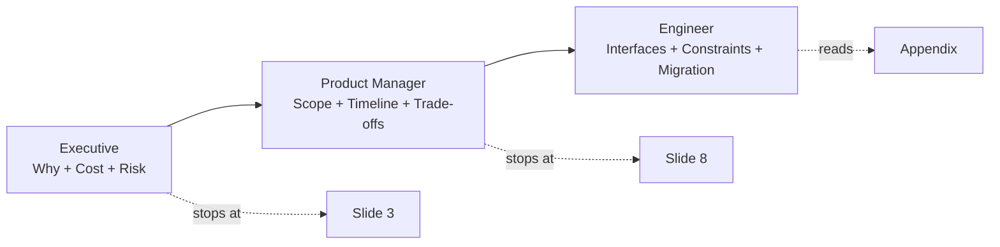

# Stakeholder Presentation

A single architecture story must land with three very different audiences in one sitting. This skill teaches you to layer the same content top-down (Minto Pyramid) so executives stop at slide 3, PMs at slide 8, and engineers go to the appendix.

## Stack Baseline (2026)
| Concern | Recommended |
|---|---|
| Structure | Minto Pyramid Principle (SCQA: Situation, Complication, Question, Answer) |
| Diagrams | C4 (Brown) Levels 1-2 for non-engineers, Level 3 in appendix |
| Slide tooling | Markdown + Marp / Slidev / Reveal.js with Mermaid 11+ rendering |
| Decision log | ADR (MADR 4.0) referenced, not pasted |
| Risk framing | Wardley Map for evolution, RAID log for delivery |
| Accessibility | WCAG 2.2 AA contrast, no red/green-only encoding |

## When to Use
- Quarterly architecture review boards (ARB) or TDA sessions.
- Funding requests, build-vs-buy decisions, vendor selection.
- Cross-team alignment when squads share a platform boundary.
- Pre-mortems and incident retrospectives with mixed audiences.

Do **not** use this skill for pure engineering deep-dives - use `c4-model-diagram` or `rfc-template` instead.

## Prerequisites
- An ADR or RFC capturing the decision (link, do not duplicate).
- C4 Level 1 (System Context) diagram already drafted.
- Named decision-maker and the one question they must answer.
- Known meeting length (target: half the allotted time for slides).

## Instructions

### 1. Map the audience

### 2. Apply SCQA on slide 1
- **Situation** - one sentence the audience already agrees with.
- **Complication** - the change forcing the decision.
- **Question** - the single question this deck answers.
- **Answer** - the recommendation, in one line.

### 3. Layer the deck
| Slide | Audience | Content |
|---|---|---|
| 1 | All | SCQA + recommendation |
| 2 | Exec | Cost, risk, timeline (3 numbers) |
| 3 | Exec | Decision asked of the room |
| 4-6 | PM | Scope, alternatives considered, trade-off matrix |
| 7-8 | PM | Roadmap milestones, dependencies |
| 9-N | Eng | C4 L2/L3, sequence diagrams, NFRs |
| Appendix | Eng | ADRs, benchmarks, raw data |

### 4. Trade-off matrix (always include)
| Option | Cost | Time-to-value | Operability | Lock-in | Score |
|---|---|---|---|---|---|
| A | $$ | 2 quarters | Medium | Low | 7/10 |
| B (recommended) | $ | 1 quarter | High | Medium | 9/10 |

### 5. Close with the ask
End on a slide titled "Decision requested" with a binary or ranked-choice question and the date a decision is needed.

## Common Pitfalls
| Pitfall | Symptom | Fix |
|---|---|---|
| Bottom-up narrative | Execs leave before the recommendation | Lead with the answer, not the journey |
| Diagram dump | One slide with 40 boxes | One C4 level per slide; hide detail in appendix |
| Hidden ask | Meeting ends with no decision | Explicit "Decision requested" slide |
| Mixed abstraction | Code on the same slide as cost | Separate audience tracks |
| Stale numbers | "approx 2024 figures" | Cite source and date on every metric |

## Output Format
- A markdown deck (Marp/Slidev) committed alongside the ADR.
- One PNG export of the C4 L1 diagram for email/Slack previews.
- A 150-word executive summary in the PR description.
- Decision recorded back into the ADR `Status` field within 5 working days.

## Authoritative References
- Barbara Minto, *The Pyramid Principle* (Pearson, latest reprint).
- Simon Brown, C4 Model - https://c4model.com
- arc42 template 8.x - https://arc42.org
- ISO/IEC/IEEE 42010:2022 - Architecture description.
- Marp - https://marp.app  |  Slidev - https://sli.dev
- MADR 4.0 - https://adr.github.io/madr/
- WCAG 2.2 - https://www.w3.org/TR/WCAG22/
