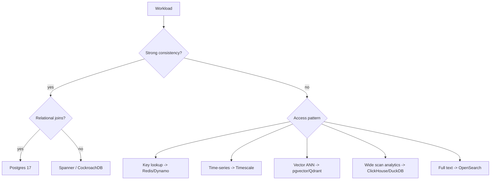

# Storage Selection

Pick storage by access pattern, consistency need, and cardinality of relationships, not by team familiarity. In 2026 the default stack is Postgres 17 plus one purpose-built engine per non-OLTP pattern, federated through a lakehouse.

## Stack Baseline (2026)
| Concern | Recommended |
|---|---|
| OLTP / general | Postgres 17 (logical replication, MERGE, SQL/JSON) |
| OLTP / Microsoft stack | SQL Server 2022 / Azure SQL (T-SQL, ledger tables, columnstore) |
| Embedded / edge / on-device | SQLite 3.46, libSQL, Turso (replicated SQLite) |
| Wide-column / massive write | ScyllaDB 6, Cassandra 5 |
| Document | MongoDB 8, Couchbase 7.6 |
| Key-value / cache | Redis 7.4, DragonflyDB, Valkey |
| Search | OpenSearch 2.14, Elasticsearch 8.14, Typesense |
| Graph | Neo4j 5, Memgraph, Apache AGE on Postgres |
| Vector | pgvector 0.7, Qdrant 1.10, Weaviate, Milvus 2.4 |
| Time-series | TimescaleDB, InfluxDB 3, QuestDB |
| Analytics | ClickHouse 24, DuckDB 1.0, StarRocks |
| Lakehouse | Apache Iceberg + Polaris REST catalog, Delta + Unity |
| Object | S3 / R2 / GCS with Iceberg manifests |

## When to Use
- New bounded context needs persistent state.
- Existing store shows lock contention, scan amplification, or schema friction.
- Adding semantic search, recommendations, or geospatial features.
- Designing CDC + lakehouse offload for analytics.

## Prerequisites
- Documented access patterns: read/write ratio, p99 latency target, payload size, query shapes.
- Consistency requirement (linearizable, read-your-writes, eventual).
- Data volume and growth model for 24 months.
- Tenancy and residency constraints (GDPR, DPDP, schrems).

## Instructions

### 1. Map workload to a CAP/PACELC quadrant


### 2. Quantify the access pattern
Record QPS, payload, selectivity, and join depth. Reject any engine whose published p99 at target QPS exceeds the SLO by >2x.

### 3. Prefer Postgres until proven insufficient
Postgres 17 covers JSONB, vectors (pgvector), time-series (Timescale), queues (`SKIP LOCKED`), and AGE for graph. Add a second engine only when a specific pattern dominates cost.

### 4. Define the system of record vs. derived stores
```sql
-- System of record: Postgres
CREATE TABLE orders (
  id uuid PRIMARY KEY,
  customer_id uuid NOT NULL,
  total_cents bigint NOT NULL,
  status text NOT NULL,
  created_at timestamptz NOT NULL DEFAULT now()
);

-- Derived: Debezium -> Kafka -> ClickHouse for analytics
-- Derived: outbox -> OpenSearch for search
```

### 5. Plan the replication path
Use Debezium 2.6 CDC into Kafka 3.7, land raw events in Iceberg via Estuary Flow or Kafka Connect, and materialize per-engine projections with Flink 2.0 or Materialize.

### 6. Validate with a load test
Run k6 or Gatling with production-shaped traffic for >=30 minutes. Capture p50/p95/p99, error rate, and storage IOPS before approving.

### 7. Document the decision in an ADR
Record: workload profile, candidates, benchmark results, operational cost, exit strategy. Link to the data contract and lineage entry in OpenLineage.

## Common Pitfalls
| Pitfall | Why it hurts | Mitigation |
|---|---|---|
| MongoDB for relational data | $lookup explodes, no FK | Use Postgres + JSONB columns |
| Elasticsearch as source of truth | No durability guarantees | Treat as derived index only |
| Redis for analytics | Single-thread scan kills latency | Use ClickHouse/DuckDB |
| Vector DB without filter strategy | ANN recall collapses with metadata filters | Pre-filter via SQL; HNSW + payload index |
| Multiple OLTP engines per service | Distributed transactions, dual writes | One SoR, derive the rest via CDC |
| Choosing by hype | Operational cost dominates | Score on TCO over 3 years |

## Output Format
Deliver an ADR containing: workload table, shortlist with scoring matrix, chosen engine, replication topology diagram, SLOs, and rollback plan. Attach load-test report and data contract reference.

## Related Skills
Once an engine is chosen, switch to implementation skills:
- [schema-design](../../../engineer/database-engineering/schema-design/SKILL.md), [index-design](../../../engineer/database-engineering/index-design/SKILL.md), [query-optimization](../../../engineer/database-engineering/query-optimization/SKILL.md) - relational patterns that apply to Postgres, MySQL, SQL Server, SQLite.
- [transaction-management](../../../engineer/database-engineering/transaction-management/SKILL.md), [data-integrity-patterns](../../../engineer/database-engineering/data-integrity-patterns/SKILL.md), [connection-pool-management](../../../engineer/database-engineering/connection-pool-management/SKILL.md) - operational concerns once the engine is live.
- [engineer-migration-strategy](../../../engineer/database-engineering/engineer-migration-strategy/SKILL.md) - schema evolution after the choice is made.
- [caching-strategy](../../system-design/caching-strategy/SKILL.md) - if the answer is "add a cache" rather than "pick a faster DB".
- [data-model-design](../data-model-design/SKILL.md) - conceptual/logical/physical modeling for the chosen engine.

## Authoritative References
- Martin Kleppmann, *Designing Data-Intensive Applications*, 2nd ed. (2025)
- Postgres 17 release notes - https://www.postgresql.org/docs/17/release-17.html
- Apache Iceberg spec v3 - https://iceberg.apache.org/spec/
- AWS Well-Architected - Data Analytics Lens (2025)
- Polyglot persistence, Fowler - https://martinfowler.com/bliki/PolyglotPersistence.html
