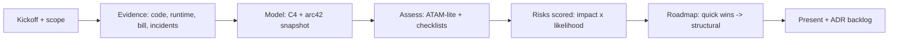

# System Audit

A system audit converts vague unease ("things feel slow / risky / expensive") into evidence-backed risks ranked by business impact. The output is a decision document, not a critique.

## Stack Baseline (2026)
| Concern | Recommended |
| --- | --- |
| Quality model | ISO/IEC 25010:2023 quality attributes |
| Evaluation method | ATAM-lite (SEI) for architecture trade-offs |
| Delivery metrics | DORA (lead time, deploy freq, CFR, MTTR) |
| Reliability | SRE SLO/SLI review, error budget burn |
| Security | OWASP ASVS 5.0, OWASP Top 10 (latest), threat model review |
| Cost | FinOps Foundation framework, unit economics per request |
| Documentation | arc42 + C4 snapshots, ADR archaeology |

## When to Use
- M&A or vendor due diligence.
- Pre-decision for re-platform, rewrite, or major investment.
- After repeated incidents or missed SLOs.
- Annual or pre-budget architecture health review.

## Prerequisites
- Read-only access to repos, runtime metrics, cloud bill, incident records.
- Stakeholder list: product, engineering, security, SRE, finance.
- Time-box (typically 2-4 weeks) and explicit audit scope.
- NDA / data-handling rules confirmed.

## Instructions



1. **Scope** the audit in writing: systems in/out, dimensions covered, deliverables, decision owner.
2. **Gather evidence** along six lenses: architecture, code/debt, security, reliability, operations, cost.
3. **Reconstruct** the architecture in C4 + arc42 if missing; capture the "as-built" vs "as-designed" gap.
4. **Assess** with checklists (ASVS, DORA, SRE, FinOps) and a half-day ATAM-lite for trade-offs.
5. **Score risks** as impact (1-5) x likelihood (1-5); group quick wins (<2 weeks) vs structural.
6. **Deliver** a written report + 60-min readout + ADR-ready remediation backlog.

```markdown
# Audit Report Template

## 1. Executive Summary (1 page)
Top 5 risks, top 3 quick wins, recommended investment band.

## 2. Scope & Method
Systems, time-box, evidence sources, limitations.

## 3. Findings by Lens
- Architecture (C4 + anti-patterns)
- Code & Debt (hotspots, churn vs complexity)
- Security (ASVS gaps, threat model deltas)
- Reliability (SLOs, error budgets, incident themes)
- Operations (DORA, on-call load, runbook coverage)
- Cost (unit economics, waste, commitment coverage)

## 4. Risk Register
| ID | Finding | Impact | Likelihood | Score | Owner | Recommendation |

## 5. Roadmap
Quick wins (0-30 days), tactical (30-90), structural (90-365).

## 6. Appendices
Diagrams, evidence links, interview notes.
```

## Common Pitfalls
| Pitfall | Why it hurts | Fix |
| --- | --- | --- |
| No scope contract | Scope creep, late delivery | Written scope + decision owner up front |
| Opinion without evidence | Report is dismissed | Every finding cites code/metric/doc |
| Mixing severity and effort | Wrong items prioritized | Score impact x likelihood; effort separately |
| Ignoring socio-technical | Recommendations bounce off Conway | Include team topology and ownership findings |
| One mega-recommendation | Org cannot act on it | Split into quick wins + structural milestones |
| No revisit cadence | Report rots in a drive | Quarterly check-in on roadmap and metrics |

## Output Format
- Executive 1-pager + full report (markdown or PDF) following the template above.
- Risk register (CSV/markdown) with scores and owners.
- C4 + arc42 snapshots in the repo (or Structurizr workspace).
- Draft ADRs for the top structural recommendations.

## Authoritative References
- Mark Richards & Neal Ford, *Fundamentals of Software Architecture*, 2e (O'Reilly, 2024).
- ATAM and quality-attribute workshops — SEI, sei.cmu.edu.
- arc42 documentation template — arc42.org.
- C4 model — c4model.com; Structurizr — structurizr.com.
- DORA / Accelerate — Forsgren, Humble, Kim.
- OWASP ASVS 5.0 — owasp.org/www-project-application-security-verification-standard.
- FinOps Foundation framework — finops.org/framework.
