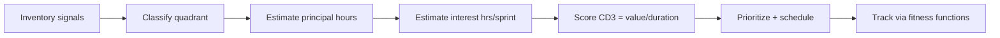

# Technical Debt Assessment

Treat tech debt as a financial instrument: each item has a principal (cost to fix), an interest rate (ongoing drag on lead time, change failure rate, or incidents), and a maturity (when it becomes blocking). Quantification turns "we need to refactor" into a defensible portfolio decision aligned with DORA metrics and business outcomes.

## Stack Baseline (2026)
| Concern | Recommended |
| --- | --- |
| Debt taxonomy | Martin Fowler quadrant + McConnell categories |
| Static signal | SonarQube 11, CodeScene, Semgrep, ArchUnit/NetArchTest |
| Runtime signal | OpenTelemetry, DORA metrics via Faros / LinearB |
| Register | Backstage TechInsights, ADRs in repo, JIRA "debt" type |
| Modeling | Monte Carlo on lead-time impact; Cost of Delay (CD3) |
| Reference | Neal Ford, "Building Evolutionary Architectures" 2e (2023) |

## When to Use
- Quarterly architecture review or pre-roadmap planning.
- Lead time, MTTR, or change-failure-rate trending the wrong way.
- Pre-acquisition or platform-migration due diligence.
- A team requests a "refactor sprint" without a quantified case.

## Prerequisites
- Source access and CI history (>= 90 days).
- DORA metrics or equivalent flow telemetry.
- Agreed definition of done for "remediated" (tests, fitness functions, docs).

## Instructions



1. **Inventory.** Pull hotspots from CodeScene, Sonar issues, ArchUnit violations, expired dependencies, and incident postmortems into one register.
2. **Classify** each item using Fowler's quadrant (reckless/prudent x deliberate/inadvertent) plus a category (code, design, architecture, test, infra, knowledge, process).
3. **Quantify principal** in engineer-days; **quantify interest** as hours lost per sprint (extra review time, repeated incidents, onboarding friction). Validate against git churn and incident logs.
4. **Score** with CD3 = (interest saved + risk reduction) / principal. For high-risk items add a probability-weighted incident cost.
5. **Allocate** a fixed capacity slice (commonly 15-20%) per iteration; map top items to ADRs and fitness functions so regressions fail the build.

```yaml
# debt-register.yaml entry
- id: DEBT-2026-014
  title: Order service couples to legacy pricing schema
  category: architecture
  quadrant: prudent-inadvertent
  principal_days: 12
  interest_hours_per_sprint: 9
  risk: "blocks EU pricing rollout Q3"
  cd3_score: 8.4
  owner: payments-platform
  fitness_function: archunit:NoLegacyPricingImports
```

## Common Pitfalls
| Pitfall | Mitigation |
| --- | --- |
| Listing debt without quantification | Require principal and interest fields; reject otherwise |
| Treating all debt as bad | Use quadrant; some prudent debt is rational |
| Big-bang rewrite proposals | Prefer strangler fig + fitness functions |
| Debt register rots | Auto-refresh from Sonar/CodeScene weekly via Backstage |
| Ignoring knowledge debt | Track bus factor and onboarding time as first-class items |

## Output Format
- `debt-register.yaml` (or Backstage TechInsights entity) with quantified items.
- One-page portfolio view: top 10 by CD3, capacity allocation, trend chart.
- ADR per architecture-level item; linked fitness function PR.

## Authoritative References
- Neal Ford et al., *Building Evolutionary Architectures*, 2e, O'Reilly, 2023.
- Martin Fowler, "TechnicalDebtQuadrant", martinfowler.com.
- Adam Tornhill, *Software Design X-Rays*, Pragmatic, 2018; CodeScene docs 2026.
- DORA, *Accelerate State of DevOps Report* 2025.
- ThoughtWorks Technology Radar, Vol. 31 (2025).
