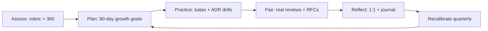

# Technical Mentoring for Architects

Architecture is a craft learned through reps, feedback, and reflection. Effective mentoring pairs explicit competency models with low-stakes practice (katas, shadowing) and high-stakes pairing (real ADRs, real reviews) so mentees internalize trade-off thinking, not just patterns.

## Stack Baseline (2026)
| Concern | Recommended |
| --- | --- |
| Competency model | Staff Engineer Archetypes (Larson) + Hohpe Architect Elevator floors |
| Growth framework | T-shaped depth + breadth across c4model.com layers |
| Practice format | Architecture Kata (Ted Neward), ADR drills, brown-bag teardowns |
| Feedback loop | Weekly 1:1 + paired ADR authoring + review shadowing |
| Reference texts | Fundamentals of Software Architecture 2e, The Software Architect Elevator |
| Tracking | Skill matrix in Markdown/Notion; quarterly calibration |

## When to Use
- Promoting senior engineers toward staff/principal/architect roles.
- Onboarding a new architect to the org's domain and decision style.
- Closing gaps surfaced in architecture reviews (e.g., weak NFR analysis).
- Building a mentoring program inside a guild or chapter.

## Prerequisites
- A published competency rubric (levels, behaviors, evidence).
- Access to live design work: ADRs, RFCs, review meetings.
- Mentor capacity (~2-3 hrs/week per mentee) and a 6-12 month horizon.
- Psychological safety: mistakes in drills must not affect performance reviews.

## Instructions



1. **Assess** with a 2026 rubric covering: systems thinking, NFR reasoning, communication (Elevator floors), influence, and tech breadth.
2. **Plan** three to five outcome-based goals per quarter (e.g., "Author 2 ADRs that survive review with <3 substantive comments").
3. **Practice** weekly: one architecture kata, one anti-pattern teardown, or one capacity estimation drill.
4. **Pair** on real artifacts: co-author an ADR, co-facilitate an ATAM-lite, shadow a vendor evaluation.
5. **Reflect** in 30-min 1:1s using the prompt: *what decision, what trade-off, what you'd change*.

```markdown
# Mentee Growth Plan — Q2 2026

Mentee: <name>          Mentor: <name>
Target level: Staff Engineer (Architecture track)

## Goals
1. Lead 1 cross-team ADR end-to-end (draft -> review -> accepted).
2. Facilitate 2 architecture reviews using ATAM-lite checklist.
3. Publish 1 internal teardown of an anti-pattern from our codebase.

## Cadence
- Weekly 1:1 (Tue 30m), paired ADR session (Thu 60m)
- Monthly review with skip-level

## Evidence
Links to ADRs, review notes, recordings.
```

## Common Pitfalls
| Pitfall | Why it hurts | Fix |
| --- | --- | --- |
| Pattern memorization over trade-offs | Produces Golden Hammer thinkers | Force "what would change your mind?" in every drill |
| Mentor monologues | Mentee never practices the muscle | Mentor talks <30% of the time; ask, don't tell |
| No artifacts | Growth is invisible at calibration | Require ADR/RFC outputs each cycle |
| One-floor mentoring | Mentee can talk to peers but not execs | Rotate across Hohpe Elevator floors quarterly |
| Skipping NFRs | Designs collapse under load/regulation | Every kata must score on 4+ quality attributes |

## Output Format
- A growth plan (Markdown) with goals, cadence, and evidence links.
- A skill-matrix delta showing pre/post scores per competency.
- A portfolio folder of mentee-authored ADRs and review notes.
- A quarterly retro summarizing wins, gaps, and next-quarter focus.

## Authoritative References
- Mark Richards & Neal Ford, *Fundamentals of Software Architecture*, 2e (O'Reilly, 2024).
- Gregor Hohpe, *The Software Architect Elevator* (O'Reilly).
- Will Larson, *Staff Engineer* — archetypes and growth paths.
- Ted Neward, Architecture Kata format — neward.net/architecturalkatas.
- ThoughtWorks Technology Radar (latest volume) — thoughtworks.com/radar.
- GitHub ADR community — github.com/joelparkerhenderson/architecture-decision-record.
