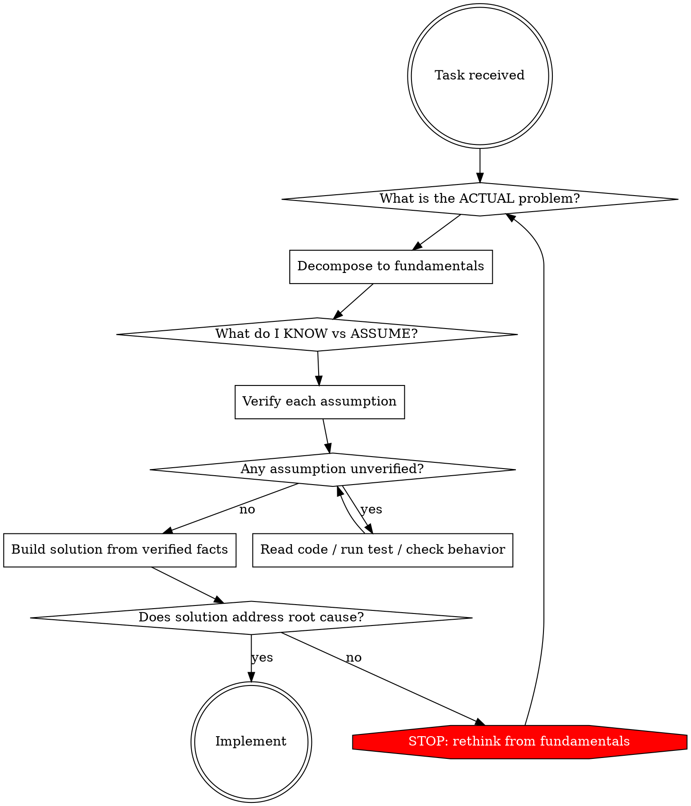

# First Principles Thinking

## Overview

**Every task starts by asking "What is actually true here?" not "What does this look like?"**

First principles thinking means decomposing a problem to its fundamental, verified truths, then reasoning upward to build a solution. It rejects reasoning by analogy ("I've seen something like this before"), convention ("this is how it's usually done"), and assumption ("it's probably X").

## The Iron Law

```
NEVER ACT ON ASSUMPTIONS. VERIFY FIRST, THEN ACT.
```

## Core Process



### Step 1: Decompose - What is the ACTUAL problem?

Strip away surface descriptions. Don't accept the problem as framed — restate it in terms of fundamental components.

| Surface framing | First principles decomposition |
|---|---|
| "This function is slow" | What does this function do? Which operations take time? What are the input sizes? Where is the actual bottleneck measured? |
| "Add a cache here" | What is the access pattern? What is the cost of a miss vs stale data? Is caching the right solution or is the underlying query wrong? |
| "Fix this nil panic" | Why is this value nil? What contract was violated? Is the nil check a fix or a band-aid over a deeper invariant violation? |
| "Copy how module X does it" | Why does module X do it that way? Do those reasons apply here? What are the actual requirements for THIS case? |

### Step 2: Separate KNOWN from ASSUMED

Before writing any code or proposing any solution, explicitly list:

- **KNOWN** (verified by reading code, running tests, checking logs): These are facts.
- **ASSUMED** (believed but not verified): These MUST be verified before acting.

**Every assumption is a potential wrong turn.** The cost of verifying is minutes. The cost of a wrong assumption is hours of debugging.

### Step 3: Verify from Ground Truth

Ground truth sources, in order of reliability:

1. **Running code** - Execute it, observe actual behavior
2. **Reading source code** - Not docs, not comments, the actual implementation
3. **Test results** - Concrete pass/fail with specific inputs
4. **Error messages + stack traces** - Actual failure points
5. **Git history** - What changed and when (but verify current state)

**NOT ground truth:** Documentation (may be stale), comments (may be wrong), memory of similar problems (may not apply), "best practices" (may not fit context).

### Step 4: Build Up from Verified Facts

Only after verification, construct a solution that:
- Addresses the **root cause**, not symptoms
- Is justified by **verified facts**, not pattern matching
- Is the **simplest** solution that solves the actual problem
- Doesn't introduce complexity for hypothetical scenarios

## Anti-Patterns: Pattern-Matching Traps

### The Analogy Trap
"I've seen a similar bug in another project, it was caused by X, so this must be X too."

**First principles response:** What is the actual error? Read the actual code path. The similarity may be superficial.

### The Convention Trap
"The standard approach is to use a mutex here."

**First principles response:** What is the actual concurrency pattern? Is there contention? Maybe the data structure can be redesigned to avoid shared state entirely.

### The Cargo Cult Trap
"Other modules use this pattern, so we should too."

**First principles response:** WHY do other modules use this pattern? Does the same reasoning apply here? Maybe those modules are wrong too.

### The Stack Overflow Trap
"The accepted answer says to do X."

**First principles response:** Does the answerer's context match ours? What are OUR constraints? Read the actual API/library code if unclear.

### The Sunk Cost Trap
"I've already spent time on approach A, let me keep going."

**First principles response:** Is approach A actually working? If the fundamentals don't support it, switching now saves more time than persisting.

## Applying to Common Tasks

### Debugging
1. **Don't guess.** Read the error. Read the stack trace. Read the code at the failure point.
2. **Reproduce first.** If you can't reproduce it, you don't understand it.
3. **Trace the actual data flow.** Don't assume what a variable contains — print/log it.
4. **Question "impossible" states.** If the data shouldn't be nil but is, trace where it was supposed to be set.

### Feature Implementation
1. **What is the actual requirement?** Not the user's proposed solution, but what problem are they solving?
2. **What are the constraints?** Performance, compatibility, existing architecture.
3. **What is the minimal change** that satisfies the actual requirement within the actual constraints?
4. **Does this solution compose** with existing code, or does it fight the architecture?

### Code Review
1. **What does this code actually do?** Trace the logic, don't skim.
2. **What invariants does it assume?** Are those invariants guaranteed?
3. **What happens at boundaries?** Empty input, max values, concurrent access, error paths.
4. **Is the complexity justified** by actual requirements, or by hypothetical ones?

### Refactoring
1. **What is wrong with the current code?** Be specific — not "it's messy" but "function X has 5 responsibilities and 3 of them are unrelated."
2. **What is the actual goal?** Readability? Performance? Testability? Each leads to different refactoring.
3. **Will the refactoring preserve behavior?** How do you verify this? Tests? If no tests exist, write them first.

## Red Flags - You're Not Thinking from First Principles

| Thought | What to do instead |
|---|---|
| "This is probably..." | Stop. Read the code. Verify. |
| "Usually this means..." | Stop. Check if "usually" applies HERE. |
| "Let me try X and see" | Stop. Understand the problem BEFORE trying solutions. |
| "I've seen this before" | Stop. Confirm the similarity is structural, not superficial. |
| "The docs say..." | Stop. Read the actual implementation. Docs may be stale. |
| "Everyone does it this way" | Stop. Ask WHY they do it this way. Does the reason apply here? |
| "It should work because..." | Stop. Run it. "Should" is an assumption. |
| "Let me just add a nil check" | Stop. Why is it nil? Fix the cause, not the symptom. |
| "This is too complex to understand fully" | Stop. Decompose further. Complexity is layers of simplicity. |

## The Fundamental Question

Before every action, ask:

**"Am I acting on verified fact, or on assumption?"**

If assumption — verify first. Always.
