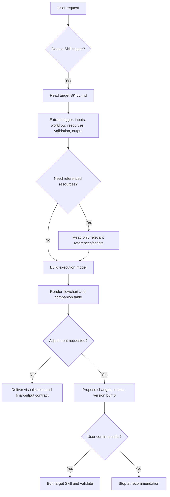

# Skill Flow Visualizer

## Version

v0.1.0

## Changelog

- 2026-05-27: v0.1.0 draft for visualizing and safely adjusting other Skill workflows.

## First Move

1. Confirm the task matches the description.
2. Identify the target Skill by name, path, or user-provided content.
3. Determine whether the user wants visualization only or visualization plus workflow adjustment.
4. Read the smallest useful set of files: the target `SKILL.md` first, then only directly referenced resources needed to understand the workflow.
5. If adjustment is requested, explain proposed changes, impact, and version bump before editing.

## Inputs

- Required: target Skill name, target Skill path, or pasted Skill content.
- Optional: user goal, current failure/pain point, preferred output format, whether edits are allowed after confirmation.

## Workflow

1. Resolve the target:
   - Prefer an explicit path when provided.
   - If only a Skill name is provided, search likely Skill roots and the local Skill registry.
   - If only content is pasted, analyze that content without filesystem reads.
2. Build the execution model:
   - Frontmatter trigger: `name` and `description`.
   - Entry steps: `First Move`, classification rules, required confirmations.
   - Inputs: required and optional data the agent must gather.
   - Resource loading: referenced `references/`, `scripts/`, `assets/`, templates, or external tools.
   - Decision points: branches, safety gates, escalation paths, user confirmations.
   - Actions: reads, analysis, tool calls, file writes, validation, final delivery.
   - Outputs: artifacts, reports, diagrams, files, commands, or user-facing summaries.
3. Separate explicit rules from inferred behavior:
   - Mark steps as `explicit` when they come directly from the Skill text.
   - Mark steps as `inferred` when they come from standard agent behavior, surrounding governance, or referenced resources.
   - Mark unknowns or missing details instead of inventing certainty.
4. Produce the visualization:
   - Use Mermaid `flowchart TD` by default.
   - Quote node labels that contain punctuation, slashes, parentheses, or nontrivial text.
   - Include trigger, resource reads, branch decisions, tool/actions, validation, and final output.
   - Keep node text short; put detail in the companion table.
5. Produce the companion analysis:
   - Step table with order, source, action, inputs, outputs, and risk level.
   - Resource map listing which files/resources are read and when.
   - Risk gate list for confirmations, writes, network, live systems, credentials, deletion, publishing, upload, SSH, database, or WordPress/admin access.
   - Final-output contract explaining what a successful run should deliver.
6. If the user requests adjustment:
   - Propose a concise change plan before editing.
   - Include target files, impact scope, risk, and version bump.
   - Ask for explicit confirmation before modifying any existing Skill.
   - After confirmation, make the smallest useful edit, update `## Version`, `## Changelog`, and registry metadata when applicable.
   - Run the repository's Skill checks after edits.

## Resources

- Target `SKILL.md`: always read first when available.
- Target `references/`: read only the files directly needed to understand or change the workflow.
- Target `scripts/`: inspect only when script behavior changes the execution path or output contract.
- Target `assets/`: list when relevant, but do not read binary or large assets unless the workflow depends on their contents.
- Local Skill registry: use to resolve names, status, version, trigger scope, and installation status.

## Output

- Mermaid flowchart showing the agent path from user request to final output.
- Companion step table.
- Resource loading map.
- Safety and confirmation gate list.
- Final-output contract.
- For requested adjustments: proposed change plan first; patch summary and validation result only after confirmation and edits.

## Mermaid Pattern

Use this structure as the default:

## Gotchas

- Do not read every Skill or every reference folder. Resolve the target first, then read only what affects the target flow.
- Do not treat Markdown order as the only execution order. Confirm branch conditions, safety gates, and referenced resources.
- Do not hide uncertainty. Label inferred steps and missing details.
- Do not modify another Skill just because the visualization reveals a problem; ask for explicit confirmation first.
- Do not turn a live website, WordPress, SSH, database, upload, publish, or deletion workflow into an action plan without preserving the original high-risk confirmation rules.

## Validation

- For visualization-only tasks, validate that the Mermaid syntax is readable and every branch has a destination.
- For Skill edits, run the repository's relevant checks from the Skill repository root.
- If this draft Skill changes, run `scripts/check.sh` and `scripts/check-drafts.sh` from the repository root.
