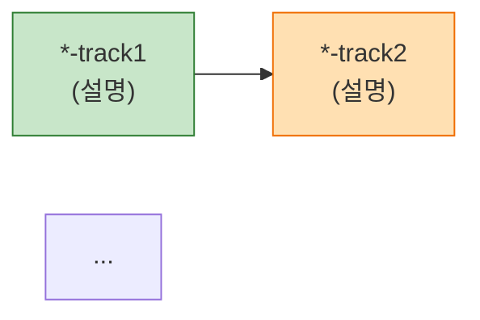
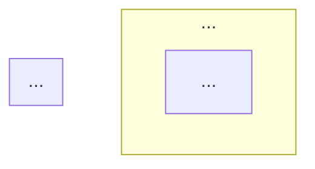

# Track Status Summary

Track의 전체 작업 내용을 시각적 대시보드(HTML)와 마크다운 요약 문서로 생성한다.
`/track-status`가 "지금 어디까지 왔나?"를 답한다면, 이 스킬은 "전체적으로 무슨 작업을 했나?"를 답한다.

## 실행 방법

```
/track-status-summary                          # Active Track 자동 감지 (단일 모드)
/track-status-summary TECH-22403-shipment      # 특정 Track 지정 (단일 모드)
/track-status-summary TECH-22840               # Jira 번호만 → 다중 Track 통합 모드 (NEW)
```

## 작업 절차

### 0단계: 모드 판별 (★ NEW)

`$ARGUMENTS` 패턴을 분석하여 모드를 결정한다:

| 인자 패턴 | 예시 | 모드 |
|----------|------|------|
| 비어있음 | `(없음)` | **단일 모드** — Active Track 자동 감지 |
| Track ID (Jira + sub-task) | `TECH-22840-apify-instagram-reels` | **단일 모드** — 해당 Track |
| **Jira 번호만** | `TECH-22840` | **다중 Track 통합 모드** |

**판별 규칙**:
- 정규식 `^[A-Z]+-\d+$` (예: TECH-22840) 매칭 시 **다중 모드**
- 그 외 (Track ID 또는 비어있음) → **단일 모드**

**다중 모드일 때**: `1단계`를 건너뛰고 `다중 모드 절차`로 진입 (본 문서 후반부).

### 1단계: Track 감지 (단일 모드)

CLAUDE.md의 `DOC_DIR 결정 규칙`을 따른다:

1. `.claude/tracks/index.md` 또는 `.claude/tracks/` 하위 디렉토리를 스캔
2. `$ARGUMENTS`가 있으면 해당 Track 사용
3. 없으면 Active Track 자동 선택 (2개+ 시 AskUserQuestion)

Track 디렉토리 경로를 `{TRACK_DIR}`로 설정한다.

### 2단계: 데이터 수집

다음 소스에서 정보를 수집한다. 각 소스가 없으면 해당 섹션을 "정보 없음"으로 표시하고 넘어간다.

#### 2-1. Track 메타데이터
- `{TRACK_DIR}/metadata.json` 읽기
- Track ID, 설명, 상태, 브랜치, 생성일, Jira 이슈

#### 2-2. Phase별 작업 내역
- `{TRACK_DIR}/plan.md` 또는 `{TRACK_DIR}/*_PLAN.md` 읽기
- Phase 이름, 완료 상태, 하위 Task 목록
- 없으면 WORK-SPEC 파일들(`*_WORK-SPEC*.md`)에서 Phase 정보 추출

#### 2-3. 작업 명세서 요약
- `{TRACK_DIR}/*_WORK-SPEC*.md` 파일들 읽기
- 각 Phase의 목표, 주요 변경사항, 핵심 결정사항 추출
- 여러 WORK-SPEC이 있으면 Phase 번호순으로 정렬

#### 2-4. 아키텍처/다이어그램
- `{TRACK_DIR}/images/*.svg` 파일 목록
- SVG 파일 내용을 읽어 HTML에 인라인할 준비

#### 2-5. Git 변경 통계
- 브랜치명을 metadata.json에서 가져옴
- `git log` + `git diff --stat`으로 커밋 수, 변경 파일, 추가/삭제 라인 수집
- 브랜치가 없거나 git 정보를 못 가져오면 이 섹션 스킵

#### 2-6. 문서 현황
- Track 디렉토리 내 모든 파일을 스캔
- 워크플로우 문서 존재 여부 체크 (WORK-SPEC, PLAN, SELF-REVIEW, QA-SCENARIOS 등)

#### 2-7. HANDOFF 정보 (있는 경우)
- `{TRACK_DIR}/HANDOFF.md` 읽기
- 완료된 작업, 남은 작업, 주의사항 추출

### 3단계: 마크다운 요약 생성

`{TRACK_DIR}/SUMMARY.md`를 생성한다. 구조:

```markdown
# {Track ID} 작업 요약

> {description}
> 생성일: {created_at} | 상태: {status} | 브랜치: {branch}

## Phase별 작업 내역

### Phase 1: {Phase명} ✅
- **목표**: {Phase 목표}
- **주요 변경**: {핵심 변경사항 2-3줄 요약}
- **변경 파일**: {파일 목록}
- **핵심 결정**: {왜 이렇게 했는지}

### Phase 2: {Phase명} 🔄
...

## 아키텍처

{다이어그램 이미지 참조}

## 변경 통계
- 커밋: {N}개
- 변경 파일: {N}개
- 추가: +{N} / 삭제: -{N}

## 문서 현황
| 문서 | 상태 |
|------|------|
| WORK-SPEC | ✅ |
| SELF-REVIEW | ❌ |
...

## 현재 상태 & 다음 단계
{HANDOFF 기반 요약}
```

### 4단계: HTML 대시보드 생성

`{TRACK_DIR}/html/summary-dashboard.html`을 생성한다.

#### HTML 생성 방법

`assets/dashboard-template.html` 템플릿을 읽고, 플레이스홀더를 실제 데이터로 교체한다:

| 플레이스홀더 | 데이터 |
|-------------|--------|
| `__TRACK_ID__` | Track ID |
| `__TRACK_DESC__` | 설명 |
| `__TRACK_STATUS__` | 상태 배지 |
| `__TRACK_BRANCH__` | 브랜치명 |
| `__TRACK_CREATED__` | 생성일 |
| `__TRACK_JIRA__` | Jira 이슈 번호 |
| `__PHASES_HTML__` | Phase별 카드 HTML |
| `__DIAGRAMS_HTML__` | SVG 다이어그램 인라인 HTML |
| `__GIT_STATS_HTML__` | Git 통계 HTML |
| `__DOCS_STATUS_HTML__` | 문서 현황 체크리스트 HTML |
| `__HANDOFF_HTML__` | 현재 상태/다음 단계 HTML |
| `__GENERATED_AT__` | 생성 시각 |

#### Phase 카드 HTML 생성 규칙

각 Phase를 카드 형태로 생성한다:

```html
<div class="phase-card {status-class}">
  <div class="phase-header">
    <span class="phase-badge">{Phase N}</span>
    <h3>{Phase명}</h3>
    <span class="status-icon">{✅/🔄/⏳}</span>
  </div>
  <div class="phase-body">
    <p class="phase-goal">{Phase 목표}</p>
    <div class="phase-changes">
      <h4>주요 변경</h4>
      <ul>{변경사항 리스트}</ul>
    </div>
    <div class="phase-files">
      <h4>변경 파일</h4>
      <ul class="file-list">{파일 목록}</ul>
    </div>
  </div>
</div>
```

- `status-class`: `completed`, `in-progress`, `pending` 중 하나
- Phase가 완료되면 배경색이 연한 초록, 진행중이면 연한 파랑, 대기중이면 회색

#### SVG 다이어그램 인라인

SVG 파일을 직접 HTML 안에 삽입한다 (외부 참조 X):

```html
<div class="diagram-card">
  <h3>{SVG 파일명에서 추출한 제목}</h3>
  <div class="diagram-container">
    {SVG 파일 내용 그대로 삽입}
  </div>
</div>
```

### 5단계: 브라우저에서 열기

생성된 HTML 파일을 브라우저에서 연다:

```bash
# Windows
start "" "{TRACK_DIR}/html/summary-dashboard.html"

# macOS
# open "{TRACK_DIR}/html/summary-dashboard.html"
```

### 6단계: 결과 안내

사용자에게 생성된 파일 경로를 안내한다:

```
## 생성 완료

- 마크다운 요약: {TRACK_DIR}/SUMMARY.md
- HTML 대시보드: {TRACK_DIR}/html/summary-dashboard.html
  → 브라우저에서 열었습니다

대시보드에서 Phase별 작업 내역, 아키텍처 다이어그램, Git 통계를 확인할 수 있습니다.
```

## 주의사항

- HTML은 외부 CDN 의존 없이 standalone으로 동작해야 한다 (단일 모드)
- 다중 모드 HTML은 Mermaid CDN 허용 (`https://cdn.jsdelivr.net/npm/mermaid/dist/mermaid.min.js`)
- SVG가 너무 크면 (100KB+) 축소하거나 별도 탭으로 분리
- `.claude/` 하위 파일이므로 git add하지 않는다
- 기존 SUMMARY.md / summary-dashboard.html / `{JIRA}-overview.{md,html}` 이 있으면 덮어쓴다

---

# 다중 Track 통합 모드 (★ NEW)

`$ARGUMENTS`가 Jira 번호 패턴(`^[A-Z]+-\d+$`)일 때 본 절차 진입.

## M1단계: Jira 번호 추출 + sub-track 검색

```bash
# 입력: TECH-22840
# 검색: .claude/tracks/TECH-22840-* 디렉토리 모두 수집
ls -d .claude/tracks/{JIRA}-*/ 2>/dev/null
```

각 sub-track 디렉토리를 `{TRACK_DIRS[]}` 배열로 관리.

해당 Jira 번호로 시작하는 Track 0개면 사용자에게 안내 후 종료.

## M2단계: Track별 데이터 수집 (병렬)

각 sub-track의 `metadata.json` + `0_INDEX.html` + `4_PLAN.html` (있다면) 수집:

| 항목 | 출처 |
|------|------|
| Track ID, description | metadata.json |
| status, current_phase, total_phases | metadata.json |
| branch, parent_track | metadata.json |
| 핵심 산출/다음 단계 | 0_INDEX.html 또는 4_PLAN.html |
| 설계 변경 노트 | metadata.json의 `design_change_note` 등 optional 필드 |

각 Track의 상태를 4가지로 분류:
- `done`: status=completed
- `progress`: status=in_progress, current_phase > 0
- `pending`: current_phase=0 또는 작업 미시작
- `cancelled`: metadata에 폐기 표시 (description에 "(폐기)" 등)

## M3단계: 통합 대시보드 데이터 모델 구성

수집된 sub-track들의 **Track 간 의존성/흐름**을 metadata.json의 `predecessor_tracks` / `parent_track` / 0_INDEX의 흐름 다이어그램에서 추출.

구성 요소:

| 섹션 | 내용 |
|------|------|
| 0. Executive Summary | 프로젝트 목표, 현재 단계, 브랜치, 빌드 상태 |
| 1. Track 흐름 (Mermaid flowchart LR) | predecessor → successor 의존 그래프 |
| 2. Track별 현황 표 | 각 sub-track 1줄씩 (단계, Phase, 상태, 다음) |
| 3. Track별 상세 | metadata.json + 0_INDEX 요약 |
| 4. 통합 데이터 흐름 (Mermaid flowchart TB) | 각 Track의 핵심 흐름을 subgraph로 묶어 한 다이어그램 (자동/수동 구분, 큐/Dispatcher 등) |
| 5. 앞으로 해야 할 일 | 즉시 + 후속 Sub-Track + 운영 모니터링 |
| 6. 위험 신호 & 미해결 | 각 Track의 R1~RN 종합 |
| 7. 본 세션/PR 변경 요약 | 옵션 — git log 또는 metadata 기반 |
| 8. 참조 링크 | 각 Track 폴더 경로 |

## M4단계: 통합 MD 생성

위치: `.claude/docs/{JIRA}-overview.md`

템플릿 패턴 (참고: `.claude/docs/TECH-22840-overview.md`):

```markdown
# {JIRA} — {프로젝트명} 통합 대시보드

> **이 문서는 무엇인가?**
> {N}개 sub-track 통합 현황 보고서.
> **마지막 갱신**: {YYYY-MM-DD} ({현재 상태})
> **상세 시각화**: [{JIRA}-overview.html]({JIRA}-overview.html)

---

## 0. Executive Summary
| 항목 | 값 |
|------|-----|
...

## 1. Track 흐름



## 2. 현재 진행 현황 (N개)
| Track | 단계 | Phase | 상태 | 핵심 산출 | 다음 단계 |
...

## 3. Track별 상세
### 3.1 {Track 1 ID}
...

## 4. 통합 데이터 흐름



## 5. 앞으로 해야 할 일
...

## 6. 위험 신호 & 미해결
...

## 7. 참조 링크
...
```

## M5단계: 통합 HTML 생성

위치: `.claude/docs/{JIRA}-overview.html`

템플릿: `assets/multi-track-template.html` (없으면 inline 생성).

핵심 스타일/구조:
- `<header>` 그라디언트 배경 + 메타 그리드
- `.tracks` grid layout (Track 카드들)
- `.track-card` 4가지 상태 클래스 (done/progress/pending/cancelled — cancelled는 점선 + 취소선)
- `.flow-zone` 흐름 박스 (auto/manual/reels 등 도메인별 색상)
- `<div class="mermaid">` 블록 (Mermaid CDN 로딩)
- `.risks` + `.risk` (high/medium/low 색상)
- `.checklist` 다음 단계

Mermaid CDN:
```html
<script src="https://cdn.jsdelivr.net/npm/mermaid/dist/mermaid.min.js"></script>
<script>
  mermaid.initialize({ startOnLoad: true, theme: 'default', flowchart: { curve: 'basis', useMaxWidth: true } });
</script>
```

참고 구현: `.claude/docs/TECH-22840-overview.html` 의 전체 구조를 모델로 사용.

## M6단계: 브라우저 열기 + 결과 안내

```bash
# Windows
start "" ".claude/docs/{JIRA}-overview.html"
```

사용자에게:
```
## 통합 대시보드 생성 완료 — {JIRA}

- 통합 MD: .claude/docs/{JIRA}-overview.md
- 통합 HTML: .claude/docs/{JIRA}-overview.html
  → 브라우저에서 열었습니다

대상 sub-track {N}개: {Track IDs}
```

## 다중 모드 주의사항

- 사용자가 명시적으로 단일 Track 모드를 원하면 (예: 인자에 `--single` 또는 정확한 Track ID 입력) 본 모드를 건너뛰고 단일 모드로 처리
- Track 간 의존성이 metadata.json 에 명시되지 않은 경우 0_INDEX.html 의 텍스트에서 추출 시도. 그래도 없으면 단순 grid 만 표시
- 통합 데이터 흐름 다이어그램(§4)은 Track 수가 5개 이상이면 가독성 위해 별도 섹션으로 분리 권장
- Mermaid 노드명 충돌 방지를 위해 Track 별 prefix 사용 (예: `P_Q1`, `R_Q2`)
