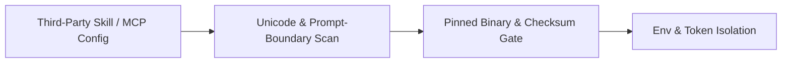

# AI Agent Skill & MCP Config Supply-Chain Auditor (`viper-agent-skill-supplychain`)

## 1. Executive Scope, Standards & CWE/OWASP Mapping
- **Frameworks & Standards:** OWASP MCP Top 10, OWASP Agentic AI Top 10 (ASI01–ASI10), OpenSSF Supply-Chain Integrity
- **Primary CWE Mapping:** CWE-829 (Inclusion of Functionality from Untrusted Control Sphere), CWE-494 (Download of Code Without Integrity Check), CWE-798 (Hardcoded Credentials)
- **ViperClaw MCP Tools:** `viper_mcp_audit`, `viper_secrets_scan`, `viper_sbom_deps`, `viper_verify_and_report`
- **ViperClaw CLI Command:** `viperclaw audit-mcp ~/.config/opencode && viperclaw audit-mcp ~/.gemini/config`

---

## 2. Threat Model & Root-Cause Architecture



### Root-Cause Analysis
Third-party AI agent skills (`SKILL.md`) and MCP configurations (`opencode.json`, `mcp_config.json`, `.mcp.json`) execute inside a developer's trusted workstation session. Unpinned `npx`/`uvx` commands, hidden Unicode tag characters, or plaintext API keys in JSON configs create immediate supply-chain risk.

---

## 3. Deterministic Discovery & Grep/AST Audit Commands

```bash
# 1. Automated ViperClaw MCP & Skill supply-chain audit
viperclaw audit-mcp .
viperclaw audit-mcp ~/.config/opencode
viperclaw audit-mcp ~/.gemini/config

# 2. Rapid static pattern discovery
rg -n "(npx|uvx|pipx|curl.*\|.*sh|wget.*\|.*sh)" skills/ .claude-plugin/
```

---

## 4. Senior Security Engineer 8-Point Audit Checklist

| Control ID | Audit Verification Target | Pass Criteria | Fail / Vulnerability Indicator |
| :---: | :--- | :--- | :--- |
| `AGSC-01` | **Pinned MCP Runner Binaries** | Local MCP servers invoke pinned installed binaries or exact versioned packages (`pkg@1.2.3`). | `npx -y some-mcp` or `uvx some-mcp` without version pinning. |
| `AGSC-02` | **No Hardcoded Tokens in MCP JSON** | `env` / `environment` blocks reference OS keychain or shell environment variables, never raw keys. | Plaintext `GITHUB_TOKEN`, `OPENAI_API_KEY`, or `AWS_SECRET_ACCESS_KEY` stored in `opencode.json` or `mcp_config.json`. |
| `AGSC-03` | **Zero Hidden Unicode Tag Characters** | `SKILL.md` files contain zero invisible Unicode tag block characters (`U+E0000`–`U+E007F`). | Invisible instructions embedded inside Markdown skill files. |
| `AGSC-04` | **No Unverified Pipe-to-Shell Steps** | Skills never instruct agents to run `curl ... \| sh` or `wget ... \| bash`. | Skill tells the agent to download and execute an unverified remote script. |
| `AGSC-05` | **Direct Exec Instead of Shell Wrapper** | MCP server configs invoke the executable directly as an argument list. | Config wraps execution inside `sh -c "..."` with interpolated strings. |
| `AGSC-06` | **Least-Privilege Filesystem Scope** | Filesystem/git MCP servers are scoped to explicit project roots, not `/` or `$HOME`. | Global root filesystem write access granted to third-party MCP server. |
| `AGSC-07` | **Prompt-Boundary Hygiene** | Skill files do not contain system-prompt override phrases or hidden external beacon URLs. | Skill attempts to override platform safety or approval boundaries. |
| `AGSC-08` | **Deterministic Versioned Provenance** | Installed skills come from reviewed Git commits or signed releases. | Unreviewed community skills copied directly into global `~/.config/opencode/skills/`. |

---

## 5. False-Positive Elimination & CVSS v3.1 Triage Rubric

### False-Positive Gate
1. Distinguish documentation examples (clearly fenced as insecure examples) from active operational instructions.
2. Confirm whether the audited MCP config file is actively loaded by Antigravity, OpenCode, Claude Code, Codex, or Cursor.

| Severity Tier | Baseline CVSS v3.1 Vector | Qualifying Security Impact |
| :--- | :--- | :--- |
| **CRITICAL (9.3)** | `CVSS:3.1/AV:N/AC:L/PR:N/UI:R/S:C/C:H/I:H/A:H` | Hidden Unicode prompt-boundary override or pipe-to-shell command in an active agent skill. |
| **HIGH (7.5)** | `CVSS:3.1/AV:L/AC:L/PR:L/UI:N/S:U/C:H/I:H/A:N` | Unpinned `npx`/`uvx` MCP server or plaintext production token in `opencode.json` / `mcp_config.json`. |
| **MEDIUM (5.3)** | `CVSS:3.1/AV:L/AC:L/PR:L/UI:N/S:U/C:L/I:L/A:N` | Overly broad shell wrapper or missing workspace scope boundary in MCP configuration. |

---

## 6. Production Remediation Patterns (Vulnerable vs. Hardened Code)

```json
// ❌ VULNERABLE: Unpinned npx runner + plaintext API token in OpenCode config
{
  "mcp": {
    "demo": {
      "type": "local",
      "command": ["npx", "-y", "unpinned-mcp-server"],
      "environment": { "API_KEY": "sk_live_hardcoded_secret_value" }
    }
  }
}

// ✅ HARDENED: Pinned local binary with zero hardcoded secrets
{
  "$schema": "https://opencode.ai/config.json",
  "mcp": {
    "viperclaw": {
      "type": "local",
      "enabled": true,
      "command": ["/usr/local/bin/viperclaw", "mcp"]
    }
  }
}
```

---

## 7. Regression Testing & Continuous Verification
1. Run `viperclaw audit-mcp` on project and global harness config directories after installing any new skill or MCP server.
2. Run `viperclaw secrets` across `.mcp.json` and `opencode.json` before committing.
3. Record verified findings via `viper_verify_and_report`.
