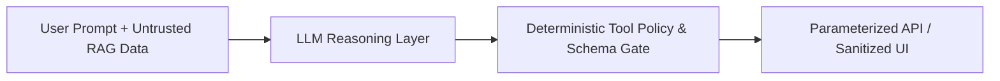

# AI, LLM & Agentic Application Guardrails Auditor (OWASP LLM Top 10) (`viper-ai-llm-guardrails`)

## 1. Executive Scope, Standards & CWE/OWASP Mapping
- **Frameworks & Standards:** OWASP Top 10 for LLM Applications (LLM01–LLM10), OWASP Agentic AI Top 10 (ASI01–ASI10), NIST AI RMF
- **Primary CWE Mapping:** CWE-77 (Command Execution via Unvalidated LLM Output), CWE-79 (XSS via Unsanitized Markdown), CWE-269 (Improper Privilege Management / Excessive Agency), CWE-200 (Sensitive Information Exposure)
- **ViperClaw MCP Tools:** `viper_taint_scan`, `viper_oob_probe`, `viper_verify_and_report`
- **ViperClaw CLI Command:** `viperclaw taint ./src --db .viperclaw/graph.db`

---

## 2. Threat Model & Root-Cause Architecture



### Root-Cause Analysis
Guardrail failures occur when applications treat model-generated strings as trusted instructions—passing unvalidated LLM output directly into SQL engines (`SQLDatabaseChain`), dynamic code runners (`PythonREPLTool`), unescaped Markdown/HTML renderers, or over-privileged internal APIs without caller-scoped authorization.

---

## 3. Deterministic Discovery & Grep/AST Audit Commands

Run the following discovery commands across the target repository before manual code review:

```bash
# 1. Automated ViperClaw analysis
viperclaw taint ./src --db .viperclaw/graph.db

# 2. Rapid static pattern discovery (ripgrep)
rg -n "(openai\.|anthropic\.|ChatCompletion|generate_content|LangChain|LlamaIndex)"
rg -n "(create_sql_agent|SQLDatabaseChain|PythonREPLTool|ShellTool|BashProcess)"
rg -n "(system_prompt|tools\s*=\s*\[|function_call|tool_choice)"
```

---

## 4. Senior Security Engineer 8-Point Audit Checklist

| Control ID | Audit Verification Target | Pass Criteria | Fail / Vulnerability Indicator |
| :---: | :--- | :--- | :--- |
| `LLM-01` | **Prompt & Untrusted Data Separation (LLM01)** | External content (emails, web pages, RAG documents) is wrapped in explicit structural delimiters and separated from system instructions. | Untrusted external text concatenated directly into the system instruction block. |
| `LLM-02` | **Output Sanitization & Safe Rendering (LLM02)** | Model output is sanitized (`DOMPurify`) before DOM rendering and never passed into `eval()`, `exec()`, or raw SQL. | Markdown output containing active `<script>`, `javascript:` links, or unapproved external image URLs rendered verbatim. |
| `LLM-03` | **Least-Privilege Agency & Tool Scoping (LLM08 / ASI03)** | Tools run under the *authenticated caller's* RBAC/tenant token, never a global admin service key. | Assistant uses a master database connection or service-role key to query tables on behalf of any user. |
| `LLM-04` | **Human-in-the-Loop (HITL) on State Changes** | Tools that send messages, transfer funds, modify permissions, or delete records require explicit user confirmation in the UI. | Untrusted document instructions automatically invoke state-mutating tool calls without confirmation. |
| `LLM-05` | **No Secrets in System Instructions (LLM06)** | API keys, database credentials, and proprietary secrets are stored outside system prompts. | System instruction text embeds API tokens or internal service credentials. |
| `LLM-06` | **Text-to-SQL Read-Only & Row-Level Isolation** | Natural-language-to-SQL features use a read-only DB role (`SELECT` only) with PostgreSQL Row-Level Security (RLS) enforced. | Model-generated SQL executed on a read-write DB connection without tenant RLS. |
| `LLM-07` | **Token Budget & Bounded Iteration Caps (LLM04)** | Per-user rate limits, `max_tokens` caps, and maximum agent tool-loop iterations (`max_steps <= 10`) enforced. | Unbounded recursive agent loops or oversized prompt inputs exhausting API budgets. |
| `LLM-08` | **Image & Markdown Egress CSP** | Chat UI enforces a strict CSP `img-src 'self' data:` so rendered Markdown cannot trigger unapproved outbound requests via query strings. | Unsanitized external Markdown image URLs auto-fetched by the browser containing session context. |

---

## 5. False-Positive Elimination & CVSS v3.1 Triage Rubric

### False-Positive Gate
1. Verify whether an upstream API Gateway, global middleware, or ORM hook already enforces the control before flagging a controller.
2. Confirm the code path is reachable from an external entrypoint (not dead code, CLI-only admin script, or unit-test fixture).

| Severity Tier | Baseline CVSS v3.1 Vector | Qualifying Security Impact |
| :--- | :--- | :--- |
| **CRITICAL (9.6)** | `CVSS:3.1/AV:N/AC:L/PR:N/UI:N/S:C/C:H/I:H/A:H` | Unvalidated model output passed to `PythonREPLTool` / `ShellTool` or raw read-write SQL connection causing unauthorized execution or DB access. |
| **HIGH (8.1)** | `CVSS:3.1/AV:N/AC:L/PR:L/UI:R/S:C/C:H/I:H/A:N` | Untrusted prompt boundary crossing causing unauthorized state changes or cross-tenant RAG data disclosure. |
| **MEDIUM (5.4)** | `CVSS:3.1/AV:N/AC:L/PR:L/UI:R/S:C/C:L/I:L/A:N` | Unsanitized model Markdown output allowing client-side script execution or external image tracking. |

---

## 6. Production Remediation Patterns (Vulnerable vs. Hardened Code)

```python
# ❌ VULNERABLE: Executes model-generated SQL using a global admin connection without RLS
def run_ai_analytics(user_question: str) -> list:
    sql_query = llm.generate_sql(prompt=user_question)
    return admin_db.execute(sql_query).fetchall()

# ✅ HARDENED: Read-only transaction + PostgreSQL session tenant RLS binding + statement timeout
def run_ai_analytics(user_question: str, session: VerifiedSession) -> list:
    sql_query = llm.generate_sql(prompt=user_question)
    with readonly_db.transaction() as conn:
        conn.execute("SET LOCAL statement_timeout = '3000ms'")
        conn.execute("SELECT set_config('app.current_tenant_id', %s, true)", (str(session.tenant_id),))
        return conn.execute(sql_query).fetchall()
```

---

## 7. Regression Testing & Continuous Verification
1. Write a **Positive Unit Test** confirming authorized, schema-valid requests succeed.
2. Write a **Negative Security Regression Test** confirming unauthorized, cross-tenant, or malformed inputs are deterministically rejected.
3. Re-run `viperclaw taint` and `viperclaw verify` to confirm zero remaining unmitigated flows in `.viperclaw/graph.db`.
