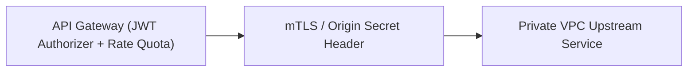

# API Gateway, BFF & Rate-Tier Policy Auditor (`viper-api-gateway-apigee-kong`)

## 1. Executive Scope, Standards & CWE/OWASP Mapping
- **Frameworks & Standards:** OWASP API Security Top 10:2023 (API2, API4, API8, API9), NIST SP 800-204B
- **Primary CWE Mapping:** CWE-284 (Improper Access Control), CWE-770 (Allocation of Resources Without Limits), CWE-636 (Not Failing Securely)
- **ViperClaw MCP Tools:** `viper_fingerprint_traffic`, `viper_iac_audit`, `viper_verify_and_report`
- **ViperClaw CLI Command:** `viperclaw fingerprint https://api.example.com && viperclaw iac .`

---

## 2. Threat Model & Root-Cause Architecture



### Root-Cause Analysis
API gateways fail to protect backends when upstream microservices remain directly reachable via public ALB/EC2 IPs (skipping the gateway entirely), when gateway plugins are attached per-route instead of globally (leaving shadow or `/v1/` routes unprotected), or when fail-open auth plugins pass requests during IdP outages.

---

## 3. Deterministic Discovery & Grep/AST Audit Commands

```bash
# 1. Inspect gateway headers and IaC definitions
viperclaw fingerprint https://api.example.com
viperclaw iac .

# 2. Rapid static pattern discovery in Kong / AWS API Gateway / Envoy configs
rg -n "(aws_apigatewayv2|kong\.yml|authorization_type|NONE|rate-limiting|jwt|ip-restriction)"
```

---

## 4. Senior Security Engineer 8-Point Audit Checklist

| Control ID | Audit Verification Target | Pass Criteria | Fail / Vulnerability Indicator |
| :---: | :--- | :--- | :--- |
| `APIGW-01` | **Backend Origin Lockdown** | Upstream services reside in private subnets or require gateway mTLS / signed origin tokens. | Direct HTTP requests to backend ALB/IP succeed without traversing the API gateway. |
| `APIGW-02` | **Default-Deny Global Auth Plugin** | Auth plugins/authorizers are enabled by default; public routes require explicit allowlisting. | New routes inherit `authorization_type = "NONE"` by default. |
| `APIGW-03` | **Fail-Closed Authorizer Behavior** | Gateway rejects requests (`401`/`503`) if JWKS fetch or external auth service times out. | Fail-open fallback forwards unauthenticated requests during IdP downtime. |
| `APIGW-04` | **Per-Tenant & Per-Route Quotas** | Distinct rate limits and burst caps enforced on auth, search, export, and AI endpoints. | Single global rate limit allows one tenant to exhaust shared backend capacity. |
| `APIGW-05` | **Trusted Header Stripping** | Gateway strips client-supplied `X-User-Id`, `X-Tenant-Id`, and `X-Forwarded-User` before setting verified claims. | Upstream trusts `X-Tenant-Id` that a caller can supply directly. |
| `APIGW-06` | **Request Size & Timeout Caps** | Gateway enforces bounded body sizes (`<= 1MB` for JSON) and upstream timeouts (`<= 30s`). | Unbounded request bodies or infinite upstream timeouts cause worker exhaustion. |
| `APIGW-07` | **Shadow & Legacy Stage Retirement** | Old stages (`/dev`, `/beta`, `/v1`) are removed or inherit identical auth and throttling policies. | Deprecated `/v1` stage remains publicly accessible without current auth rules. |
| `APIGW-08` | **Structured Access Logging Without Secrets** | Gateway logs request ID, route, status, and latency while redacting `Authorization` and query tokens. | Full query strings containing `api_key=` or `token=` written to log aggregators. |

---

## 5. False-Positive Elimination & CVSS v3.1 Triage Rubric

### False-Positive Gate
1. Confirm whether the backend service enforces independent JWT verification in addition to the gateway.
2. Verify whether `/health` or `/.well-known/*` routes are intentionally public read-only endpoints.

| Severity Tier | Baseline CVSS v3.1 Vector | Qualifying Security Impact |
| :--- | :--- | :--- |
| **CRITICAL (9.1)** | `CVSS:3.1/AV:N/AC:L/PR:N/UI:N/S:U/C:H/I:H/A:N` | Directly reachable backend origin or unsanitized `X-Tenant-Id` header trusting caller identity. |
| **HIGH (7.5)** | `CVSS:3.1/AV:N/AC:L/PR:N/UI:N/S:U/C:H/I:N/A:N` | Legacy API stage missing JWT authorizer or fail-open auth configuration. |
| **MEDIUM (5.3)** | `CVSS:3.1/AV:N/AC:L/PR:N/UI:N/S:U/C:N/I:N/A:L` | Missing per-route throttling or unbounded request body size at the gateway. |

---

## 6. Production Remediation Patterns (Vulnerable vs. Hardened Code)

```yaml
# ✅ HARDENED: Kong declarative route with explicit JWT auth, header stripping & rate limiting
services:
  - name: billing-service
    url: https://billing.internal:8443
    routes:
      - name: billing-v2
        paths: ["/api/v2/billing"]
    plugins:
      - name: jwt
      - name: request-transformer
        config:
          remove:
            headers: ["X-User-Id", "X-Tenant-Id", "X-Role"]
      - name: rate-limiting
        config:
          minute: 120
          policy: redis
```

---

## 7. Regression Testing & Continuous Verification
1. Verify unauthenticated requests to protected routes return `401` and client-supplied `X-Tenant-Id` headers are stripped.
2. Run `viperclaw iac .` to verify gateway Terraform/YAML policies.
3. Confirm direct origin access is blocked outside the gateway network boundary.
