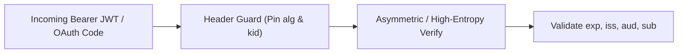

# Authentication, JWT Cryptographic Verification & OAuth 2.0 Auditor (`viper-auth-oauth-jwt`)

## 1. Executive Scope, Standards & CWE/OWASP Mapping
- **Frameworks & Standards:** RFC 8725 (JWT Best Current Practices), RFC 9700 (OAuth 2.0 Security BCP), OWASP ASVS V2/V3, CWE-347, CWE-287
- **Primary CWE Mapping:** CWE-347 (Improper Verification of Cryptographic Signature), CWE-287 (Improper Authentication), CWE-327 (Broken or Risky Crypto Algorithm), CWE-601 (Open Redirect in OAuth)
- **ViperClaw MCP Tools:** `viper_jwt_audit`, `viper_browser_ingest`, `viper_diff_oracle`, `viper_verify_and_report`
- **ViperClaw CLI Command:** `viperclaw jwt "<token>" --output jwt_audit.json`

---

## 2. Threat Model & Root-Cause Architecture



### Root-Cause Analysis
Authentication gaps arise when JWT libraries trust the token's own header (`alg`, `kid`, `jku`, `jwk`) to select the verification key or algorithm, or when OAuth account-linking flows trust unverified email addresses or loosely matched `redirect_uri` values.

---

## 3. Deterministic Discovery & Grep/AST Audit Commands

Run the following discovery commands across the target repository before manual code review:

```bash
# 1. Automated ViperClaw analysis
viperclaw jwt "<token>" --output jwt_audit.json

# 2. Rapid static pattern discovery (ripgrep)
rg -n "(jwt\.decode|jwt\.verify|jsonwebtoken|Jose\.JWT|NimbusJwtDecoder)"
rg -n "(verify_signature\s*:\s*False|options\s*=\s*\{.*verify_signature)"
rg -n "(redirect_uri|client_secret|response_type|code_verifier)"
```

---

## 4. Senior Security Engineer 8-Point Audit Checklist

| Control ID | Audit Verification Target | Pass Criteria | Fail / Vulnerability Indicator |
| :---: | :--- | :--- | :--- |
| `AUTH-01` | **Explicit JWT Algorithm Pinning** | Verification call hardcodes `algorithms=["RS256"]` (or `ES256`/`EdDSA`); never reads `header.alg` dynamically. | `alg: none` accepted or `RS256` public key usable as `HS256` HMAC secret. |
| `AUTH-02` | **HMAC Secret Entropy (>= 256 bits)** | Symmetric `HS256` keys generated via CSPRNG (`>= 32` random bytes), never dictionary words. | Weak secret (`secret`, `changeme`, app name) recoverable offline via `viperclaw jwt`. |
| `AUTH-03` | **Untrusted Header Parameters (`kid`, `jku`, `jwk`)** | `kid` matched against a strict alphanumeric allowlist of server-configured key IDs; `jku`/`x5u`/`jwk` ignored. | `kid` passed into file path (`../../../../dev/null`) or SQL query. |
| `AUTH-04` | **Mandatory Claim Validation (`exp`, `iss`, `aud`)** | Verifier enforces `require=["exp", "iss", "aud", "sub"]` with bounded clock skew. | Tokens without `exp` never expire, or tokens from a staging/sibling service (`aud` mismatch) are accepted. |
| `AUTH-05` | **Pre-ATO Email Collision Prevention** | Linking an OAuth provider to an existing password account requires `email_verified === true` AND re-authentication if the email wasn't previously verified. | An unverified account can be pre-registered before a user signs up with Google OAuth and retains active session. |
| `AUTH-06` | **Password Reset Token Security** | Reset tokens are `>= 128-bit` CSPRNG, hashed (`SHA-256`) at rest in DB, expire in `<= 15m`, and are single-use. | Predictable UUIDv1/timestamp reset tokens or tokens not invalidated after use. |
| `AUTH-07` | **Account Enumeration Resistance** | Login, registration, and password-reset endpoints return uniform response messages and status codes (using dummy bcrypt verify on missing users). | Login returns `"User not found"` vs. `"Wrong password"` or 2ms vs. 250ms timing difference. |
| `AUTH-08` | **Token Type Separation (Access vs. Refresh)** | Refresh tokens cannot be used as Bearer access tokens on API endpoints (`typ` / `token_use` claim checked). | Long-lived refresh token accepted directly by auth middleware as an access token. |

---

## 5. False-Positive Elimination & CVSS v3.1 Triage Rubric

### False-Positive Gate
1. Verify whether an upstream API Gateway, global middleware, or ORM hook already enforces the control before flagging a controller.
2. Confirm the code path is reachable from an external entrypoint (not dead code, CLI-only admin script, or unit-test fixture).

| Severity Tier | Baseline CVSS v3.1 Vector | Qualifying Security Impact |
| :--- | :--- | :--- |
| **CRITICAL (9.8)** | `CVSS:3.1/AV:N/AC:L/PR:N/UI:N/S:U/C:H/I:H/A:H` | Weak JWT HMAC secret, `alg:none` acceptance, or unvalidated `kid` path resolution allowing admin impersonation. |
| **HIGH (8.1)** | `CVSS:3.1/AV:N/AC:L/PR:N/UI:R/S:U/C:H/I:H/A:N` | OAuth `redirect_uri` validation gap or Pre-ATO unverified email collision leading to account takeover. |
| **MEDIUM (5.3)** | `CVSS:3.1/AV:N/AC:L/PR:N/UI:N/S:U/C:L/I:N/A:N` | Missing `exp` / `aud` validation or observable username enumeration on login. |

---

## 6. Production Remediation Patterns (Vulnerable vs. Hardened Code)

```python
# ❌ VULNERABLE: Trusts unverified header alg, uses weak secret, and skips aud/iss checks
def verify_user_token(token: str) -> dict:
    hdr = jwt.get_unverified_header(token)
    return jwt.decode(token, key="secret123", algorithms=[hdr["alg"]])

# ✅ HARDENED: Pins asymmetric algorithm, allowlists kid, and enforces exp/iss/aud claims
ALLOWED_KIDS = {"prod-rs256-2026-01": PUBLIC_KEY_PEM_2026}

def verify_user_token(token: str) -> dict:
    hdr = jwt.get_unverified_header(token)
    kid = hdr.get("kid")
    if hdr.get("alg") != "RS256" or kid not in ALLOWED_KIDS:
        raise ValueError("Untrusted JWT algorithm or key ID")
    return jwt.decode(
        token,
        key=ALLOWED_KIDS[kid],
        algorithms=["RS256"],
        issuer="https://auth.example.com",
        audience="https://api.example.com",
        options={"require": ["exp", "iat", "iss", "aud", "sub"]},
    )
```

---

## 7. Regression Testing & Continuous Verification
1. Write a **Positive Unit Test** confirming authorized, schema-valid requests succeed.
2. Write a **Negative Security Regression Test** confirming unauthorized, cross-tenant, or malformed inputs are deterministically rejected.
3. Re-run `viperclaw taint` and `viperclaw verify` to confirm zero remaining unmitigated flows in `.viperclaw/graph.db`.
