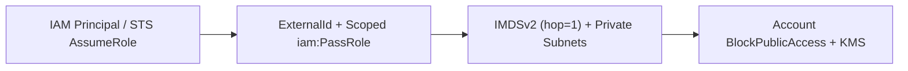

# ViperClaw Skill 48: AWS IAM, STS, S3 & Cloud Posture Auditor (`viper-aws-iam-cloud-audit`)

## 1. Standards & Open-Source Reference
- **Standards:** CIS Amazon Web Services Foundations Benchmark, `prowler-cloud/prowler`, `duo-labs/parliament`, `salesforce/cloudsplaining`.
- **Focus:** Auditing AWS IAM policies, STS trust relationships, S3 bucket policies, KMS key policies, and Lambda configurations.

---

## 2. Threat Model & Trust-Boundary Architecture



### Automated ViperClaw Command
```bash
viperclaw taint . --db .viperclaw/graph.db
```

---

## 3. Rapid Discovery Patterns
- Search for `"iam:PassRole"`, `"sts:AssumeRole"`, `"Principal": "*"`, `"Action": "*"`, `"NotAction"`, `BlockPublicAcls`, `HttpTokens`.

---

## 4. Senior Security Engineer Technical Audit Checklist
1. **IAM Privilege Escalation Path Audit:** Flag dangerous permission combinations (`iam:PassRole` + `ec2:RunInstances`/`lambda:CreateFunction`/`glue:CreateDevEndpoint`, `iam:CreatePolicyVersion`, `iam:AttachRolePolicy`, `sts:AssumeRole` with wildcard resources). Scope `iam:PassRole` to specific role ARNs and require `iam:PassedToService` conditions.
2. **Cross-Account STS `ExternalId` & Confused Deputy Defense:** Every cross-account IAM Role trust policy (`AssumeRole`) granted to a third party must enforce a `Condition` checking `sts:ExternalId` (or `aws:SourceArn` / `aws:SourceAccount` for AWS service principals).
3. **S3 Account-Level Public Access Block & Bucket Policies:** Enforce `aws_s3_account_public_access_block` (`block_public_acls = true`, `block_public_policy = true`, `ignore_public_acls = true`, `restrict_public_buckets = true`) and require `aws:SecureTransport = true` on bucket policies.
4. **EC2 / EKS IMDSv2 & Hop-Limit Hardening:** Require `http_tokens = "required"` (IMDSv2) on all EC2 instances and launch templates; on EKS worker nodes, enforce `http_put_response_hop_limit = 1` (or block `169.254.169.254` from pods via NetworkPolicy) and use IRSA / EKS Pod Identity.
5. **Lambda & KMS Least Privilege:** Assign each Lambda function a dedicated execution role (never shared across functions), never store plaintext secrets in Lambda environment variables without KMS envelope encryption, and audit KMS key policies for `Principal: "*"` without strict condition keys.

---

## 5. Production Remediation Patterns (Vulnerable vs. Hardened Code)
```hcl
# ❌ VULNERABLE: Cross-account AssumeRole trust policy without ExternalId & wildcard PassRole
statement {
  effect  = "Allow"
  actions = ["iam:PassRole"]
  resources = ["*"]
}

# ✅ HARDENED: Scoped PassRole to specific role ARN & service condition
statement {
  effect    = "Allow"
  actions   = ["iam:PassRole"]
  resources = [aws_iam_role.worker_task.arn]
  condition {
    test     = "StringEquals"
    variable = "iam:PassedToService"
    values   = ["ecs-tasks.amazonaws.com"]
  }
}
```

---

## 6. False-Positive Elimination & CVSS v3.1 Triage Rubric

### False-Positive Elimination Gate
1. **Reachability & Boundary Check:** Confirm the flagged pattern or configuration is reachable across a trust boundary in production (not an isolated unit-test mock, build-time sample, or dead code path).
2. **Upstream Control Verification:** Check whether an upstream gateway, middleware, database policy, or compiler flag already neutralizes the weakness before marking a finding as verified.
3. **Standards Reference:** `CIS AWS Benchmark, Prowler, Parliament, CWE-269, CWE-284`

| Severity Tier | Baseline CVSS v3.1 Vector | Qualifying Security Impact |
| :--- | :--- | :--- |
| **CRITICAL (9.0–10.0)** | `CVSS:3.1/AV:N/AC:L/PR:N/UI:N/S:C/C:H/I:H/A:H` | Unauthenticated remote code execution, cross-tenant authentication or isolation gap, or direct theft of funds/keys. |
| **HIGH (7.0–8.9)** | `CVSS:3.1/AV:N/AC:L/PR:L/UI:N/S:U/C:H/I:H/A:N` | Authenticated privilege escalation, unauthorized sensitive data exposure, or single-request service outage. |
| **MEDIUM (4.0–6.9)** | `CVSS:3.1/AV:N/AC:L/PR:L/UI:R/S:C/C:L/I:L/A:N` | Scoped information disclosure, non-admin state mutation, or configuration weakness requiring user interaction. |
| **LOW (0.1–3.9)** | `CVSS:3.1/AV:N/AC:H/PR:H/UI:N/S:U/C:L/I:N/A:N` | Defense-in-depth hardening gap requiring high precondition complexity and minimal direct impact. |

---

## 7. Regression Testing & Continuous Verification
1. **Positive Functional Test:** Verify that legitimate callers and valid inputs continue to succeed after applying the hardened pattern.
2. **Negative Security Regression Test:** Write an automated unit/integration test confirming that the vulnerable input, unauthenticated call, or misconfiguration is deterministically rejected.
3. **Graph & SARIF Verification:** Run `viperclaw taint . --db .viperclaw/graph.db` and `viperclaw verify` to record the verified state in `.viperclaw/graph.db`.
