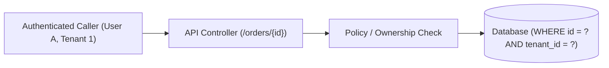

# Object, Property & Function-Level Authorization (BOLA / IDOR / BFLA) Auditor (`viper-bola-idor`)

## 1. Executive Scope, Standards & CWE/OWASP Mapping
- **Frameworks & Standards:** OWASP API1:2023 (BOLA), OWASP API3:2023 (BOPLA), OWASP API5:2023 (BFLA), OWASP ASVS V4, CWE-639, CWE-285
- **Primary CWE Mapping:** CWE-639 (Insecure Direct Object Reference via User-Controlled Key), CWE-285 (Improper Authorization), CWE-862 (Missing Authorization), CWE-863 (Incorrect Authorization)
- **ViperClaw MCP Tools:** `viper_diff_oracle`, `viper_taint_scan`, `viper_graph_upsert`, `viper_verify_and_report`
- **ViperClaw CLI Command:** `viperclaw taint ./src --db .viperclaw/graph.db`

---

## 2. Threat Model & Root-Cause Architecture



### Root-Cause Analysis
Controllers validate *authentication* (verifying the caller has a valid JWT/session) but query the database using only the client-supplied resource ID (`WHERE id = :id`) without binding the caller's `user_id` or `tenant_id`.

---

## 3. Deterministic Discovery & Grep/AST Audit Commands

Run the following discovery commands across the target repository before manual code review:

```bash
# 1. Automated ViperClaw analysis
viperclaw taint ./src --db .viperclaw/graph.db

# 2. Rapid static pattern discovery (ripgrep)
rg -n "\.(findById|find_by_id|get_object_or_404|findUnique|findOne)\("
rg -n "WHERE\s+id\s*=\s*(\?|%s|\$1|:id)"
rg -n "/api/v[0-9]+/[a-zA-Z0-9_-]+/\{?(id|uuid|user_id|org_id|account_id)\}?"
```

---

## 4. Senior Security Engineer 8-Point Audit Checklist

| Control ID | Audit Verification Target | Pass Criteria | Fail / Vulnerability Indicator |
| :---: | :--- | :--- | :--- |
| `BOLA-01` | **Query-Level Ownership Binding** | Every `SELECT`/`UPDATE`/`DELETE` query includes `AND tenant_id = :ctx_tenant AND user_id = :ctx_user`. | Resource fetched solely by primary key `findById(req.params.id)` without ownership check. |
| `BOLA-02` | **Nested & Sub-Resource Scoping** | Child resources (`/orgs/{org_id}/projects/{proj_id}/keys/{key_id}`) verify parent-child hierarchy. | Controller checks `org_id` membership but looks up `key_id` globally without verifying `key.org_id == org_id`. |
| `BOLA-03` | **Bulk & Array Endpoint Authorization** | Batch endpoints (`POST /api/items/bulk-delete` with `ids: [1,2,3]`) verify ownership of *every* ID in the array. | Controller checks ownership of `ids[0]` only and deletes the entire `WHERE id IN (...)` list. |
| `BOLA-04` | **Function-Level RBAC (BFLA)** | Administrative routes (`/admin/*`, `DELETE`, role-assignment) enforce explicit server-side role guards. | Admin endpoints rely on UI hiding or only check standard user authentication. |
| `BOLA-05` | **Foreign-Key Reference Validation on Create/Update** | Creating a resource with `project_id` or `folder_id` in the body verifies the caller owns that target container. | A caller creates a webhook or export bound to another tenant's `project_id`. |
| `BOLA-06` | **UUIDv4 vs. Access Control** | Unpredictable UUIDs are paired with server-side ownership checks (UUIDs alone are not authorization). | Publicly readable/writable objects protected solely by unauthenticated UUIDs leaked in logs/referrers. |
| `BOLA-07` | **GraphQL & gRPC Resolver AuthZ** | Every nested GraphQL field resolver and gRPC handler enforces context-based policy checks. | Top-level query checks auth, but nested edge `{ organization(id: "other") { billing } }` skips auth. |
| `BOLA-08` | **Export & Async Job Ownership** | Async report generation (`POST /reports` -> `GET /reports/{job_id}`) binds `job_id` to caller's session. | Sequential `job_id` downloadable by any authenticated user. |

---

## 5. False-Positive Elimination & CVSS v3.1 Triage Rubric

### False-Positive Gate
1. Verify whether an upstream API Gateway, global middleware, or ORM hook already enforces the control before flagging a controller.
2. Confirm the code path is reachable from an external entrypoint (not dead code, CLI-only admin script, or unit-test fixture).

| Severity Tier | Baseline CVSS v3.1 Vector | Qualifying Security Impact |
| :--- | :--- | :--- |
| **CRITICAL (9.1)** | `CVSS:3.1/AV:N/AC:L/PR:N/UI:N/S:U/C:H/I:H/A:N` | Unauthenticated BOLA/BFLA allowing read/write of arbitrary tenant accounts or API keys. |
| **HIGH (8.1)** | `CVSS:3.1/AV:N/AC:L/PR:L/UI:N/S:U/C:H/I:H/A:N` | Authenticated cross-tenant read/modify of private records, invoices, or user profiles. |
| **MEDIUM (6.5)** | `CVSS:3.1/AV:N/AC:L/PR:L/UI:N/S:U/C:H/I:N/A:N` | Authenticated horizontal read-only access to non-credential user metadata. |

---

## 6. Production Remediation Patterns (Vulnerable vs. Hardened Code)

```python
# ❌ VULNERABLE: Fetches invoice by ID alone; any logged-in user can read any tenant's invoice
@router.get("/invoices/{invoice_id}")
async def get_invoice(invoice_id: int, current_user: User = Depends(get_current_user), db: Session = Depends(get_db)):
    invoice = db.query(Invoice).filter(Invoice.id == invoice_id).first()
    if not invoice:
        raise HTTPException(status_code=404)
    return invoice

# ✅ HARDENED: Scopes query directly to authenticated user's tenant_id & verifies role
@router.get("/invoices/{invoice_id}", response_model=InvoiceReadDTO)
async def get_invoice(invoice_id: int, current_user: User = Depends(get_current_user), db: Session = Depends(get_db)):
    invoice = (
        db.query(Invoice)
        .filter(Invoice.id == invoice_id, Invoice.tenant_id == current_user.tenant_id)
        .first()
    )
    if not invoice:
        raise HTTPException(status_code=404, detail="Invoice not found")
    return invoice
```

---

## 7. Regression Testing & Continuous Verification
1. Write a **Positive Unit Test** confirming authorized, schema-valid requests succeed.
2. Write a **Negative Security Regression Test** confirming unauthorized, cross-tenant, or malformed inputs are deterministically rejected.
3. Re-run `viperclaw taint` and `viperclaw verify` to confirm zero remaining unmitigated flows in `.viperclaw/graph.db`.
