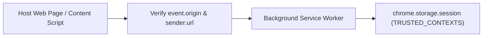

# ViperClaw Skill 57: Browser Extension (Manifest V3) Security Auditor (`viper-browser-extension-mv3`)

## 1. Standards & Open-Source Reference
- **Standards:** Chrome Extension Manifest V3 Security Best Practices, Mozilla Add-on Security Guidelines.
- **Focus:** Auditing `manifest.json`, service workers (`background.js`), content scripts, and extension popup/options pages.

---

## 2. Threat Model & Trust-Boundary Architecture



### Automated ViperClaw Command
```bash
viperclaw harvest-js . --db .viperclaw/graph.db
```

---

## 3. Rapid Discovery Patterns
- Search for `"manifest_version": 3`, `externally_connectable`, `web_accessible_resources`, `chrome.runtime.onMessageExternal`, `chrome.tabs.executeScript`, `window.addEventListener("message"`.

---

## 4. Senior Security Engineer Technical Audit Checklist
1. **Service Worker Message Sender Validation (`onMessage` & `onMessageExternal`):** Any compromised web page where a content script runs can send messages via `chrome.runtime.sendMessage`! Inside the background service worker, always verify `sender.id === chrome.runtime.id` and validate `sender.url` / `sender.origin` before performing privileged `fetch`, cookie, or storage actions.
2. **Content Script `window.postMessage` Isolation:** Content scripts share the DOM with the untrusted host webpage. Never trust `window.addEventListener("message", (e) => ...)` without checking `e.source === window` and `e.origin === expectedOrigin`, and never pass message data into `innerHTML` or `chrome.runtime.sendMessage` unchecked.
3. **`externally_connectable` & `web_accessible_resources` Minimization:** Avoid wildcard match patterns (`*://*.example.com/*` or `<all_urls>`) in `externally_connectable.matches` and `web_accessible_resources`, and enable `use_dynamic_url: true` to prevent extension fingerprinting and CSRF.
4. **Least-Privilege Permissions (`activeTab` over `<all_urls>`):** Prefer `activeTab` over broad `host_permissions: ["<all_urls>"]`, and never store plaintext user passwords or long-lived tokens in unencrypted `chrome.storage.local` accessible to content scripts (use `chrome.storage.session` with `setAccessLevel({ accessLevel: 'TRUSTED_CONTEXTS' })`).
5. **Extension Page DOM XSS Prevention:** Even with MV3's `script-src 'self'` CSP, assigning untrusted data to `innerHTML` inside `popup.html` or `options.html` can trigger unsafe DOM sinks or leak `chrome.*` storage APIs; always use `textContent`.

---

## 5. Production Remediation Patterns (Vulnerable vs. Hardened Code)
```javascript
// ❌ VULNERABLE: Background worker executes privileged cross-origin fetch for any content script
chrome.runtime.onMessage.addListener((msg, _sender, sendResponse) => {
  if (msg.type === "API_FETCH") {
    fetch(msg.url, { credentials: "include" }).then(r => r.text()).then(sendResponse);
    return true;
  }
});

// ✅ HARDENED: Restricts sender to extension's own trusted popup/options UI & pinned API host
chrome.runtime.onMessage.addListener((msg, sender, sendResponse) => {
  const trustedPrefix = `chrome-extension://${chrome.runtime.id}/`;
  if (!sender.url || !sender.url.startsWith(trustedPrefix)) return false;
  if (msg.type === "API_FETCH" && new URL(msg.url).origin === "https://api.example.com") {
    fetch(msg.url, { credentials: "include" }).then(r => r.json()).then(sendResponse);
    return true;
  }
});
```

---

## 6. False-Positive Elimination & CVSS v3.1 Triage Rubric

### False-Positive Elimination Gate
1. **Reachability & Boundary Check:** Confirm the flagged pattern or configuration is reachable across a trust boundary in production (not an isolated unit-test mock, build-time sample, or dead code path).
2. **Upstream Control Verification:** Check whether an upstream gateway, middleware, database policy, or compiler flag already neutralizes the weakness before marking a finding as verified.
3. **Standards Reference:** `Chrome/Firefox MV3 Security Guide, CWE-346, CWE-79`

| Severity Tier | Baseline CVSS v3.1 Vector | Qualifying Security Impact |
| :--- | :--- | :--- |
| **CRITICAL (9.0–10.0)** | `CVSS:3.1/AV:N/AC:L/PR:N/UI:N/S:C/C:H/I:H/A:H` | Unauthenticated remote code execution, cross-tenant authentication or isolation gap, or direct theft of funds/keys. |
| **HIGH (7.0–8.9)** | `CVSS:3.1/AV:N/AC:L/PR:L/UI:N/S:U/C:H/I:H/A:N` | Authenticated privilege escalation, unauthorized sensitive data exposure, or single-request service outage. |
| **MEDIUM (4.0–6.9)** | `CVSS:3.1/AV:N/AC:L/PR:L/UI:R/S:C/C:L/I:L/A:N` | Scoped information disclosure, non-admin state mutation, or configuration weakness requiring user interaction. |
| **LOW (0.1–3.9)** | `CVSS:3.1/AV:N/AC:H/PR:H/UI:N/S:U/C:L/I:N/A:N` | Defense-in-depth hardening gap requiring high precondition complexity and minimal direct impact. |

---

## 7. Regression Testing & Continuous Verification
1. **Positive Functional Test:** Verify that legitimate callers and valid inputs continue to succeed after applying the hardened pattern.
2. **Negative Security Regression Test:** Write an automated unit/integration test confirming that the vulnerable input, unauthenticated call, or misconfiguration is deterministically rejected.
3. **Graph & SARIF Verification:** Run `viperclaw harvest-js . --db .viperclaw/graph.db` and `viperclaw verify` to record the verified state in `.viperclaw/graph.db`.
