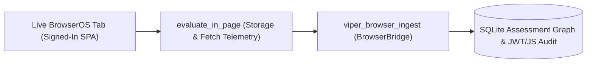

# BrowserOS Neo Live Application, Storage & DOM Security Auditor (`viper-browseros-agent`)

## 1. Executive Scope, Standards & CWE/OWASP Mapping
- **Frameworks & Standards:** OWASP WSTG-CLNT (Client-Side Testing), OWASP ASVS V3/V14, W3C CSP Level 3
- **Primary CWE Mapping:** CWE-922 (Insecure Storage of Sensitive Information in localStorage), CWE-79 (DOM XSS), CWE-614 (Missing Secure Cookie Flag)
- **ViperClaw MCP Tools:** `viper_browser_ingest`, `viper_harvest_js`, `viper_jwt_audit`, `viper_verify_and_report`
- **ViperClaw CLI Command:** `viperclaw browser --scripts && viperclaw browser --ingest snapshot.json --db .viperclaw/graph.db`

---

## 2. Threat Model & Root-Cause Architecture



### Root-Cause Analysis
Static bundle inspection misses dynamically fetched configurations, runtime `localStorage`/`sessionStorage` token leaks, `fetch`/`XHR` headers computed at runtime, and DOM state transitions that only occur inside an authenticated browser session.

---

## 3. Deterministic Discovery & Grep/AST Audit Commands

Run the following discovery commands across the target repository before manual code review:

```bash
# 1. Automated ViperClaw analysis
viperclaw browser --scripts && viperclaw browser --ingest snapshot.json --db .viperclaw/graph.db

# 2. Rapid static pattern discovery (ripgrep)
viperclaw browser --scripts
viperclaw browser --ingest snapshot.json --db .viperclaw/graph.db
```

---

## 4. Senior Security Engineer 8-Point Audit Checklist

| Control ID | Audit Verification Target | Pass Criteria | Fail / Vulnerability Indicator |
| :---: | :--- | :--- | :--- |
| `BROS-01` | **Client Storage Credential Audit** | `window.localStorage` and `window.sessionStorage` contain zero raw JWTs, refresh tokens, or PII. | Long-lived Bearer JWTs or API keys persisted in `localStorage` (accessible to any XSS). |
| `BROS-02` | **Runtime `fetch` / `XHR` Endpoint Mapping** | All background API calls captured via `install_runtime_hooks` enforce server-side authentication and tenant scoping. | Hidden `/api/internal/*` or GraphQL mutations invoked by UI components lack backend role checks. |
| `BROS-03` | **Next.js `__NEXT_DATA__` / Nuxt State Audit** | Hydration state (`window.__NEXT_DATA__`, `window.__NUXT__`) contains only fields rendered in the UI. | Full database user/organization objects (including internal IDs, emails, or role flags) serialized into page HTML. |
| `BROS-04` | **Live Cookie Attribute Verification** | Cookies visible in `document.cookie` exclude session identifiers (`HttpOnly` properly hides session cookies from JS). | Primary authentication session cookie readable via `document.cookie`. |
| `BROS-05` | **DOM Sink & Client Router Inspection** | URL query/hash changes (`?redirect=`, `#tab=`) do not trigger unescaped DOM writes or open redirects. | Client router passes URL parameters directly into `innerHTML` or `window.location.href`. |
| `BROS-06` | **CORS & Preflight Runtime Behavior** | Cross-origin API requests use explicit origin allowlists rather than reflecting the browser's `Origin` header. | API responds with `Access-Control-Allow-Origin: <arbitrary-origin>` + `Allow-Credentials: true`. |
| `BROS-07` | **Post-Logout Browser State Cleanup** | Clicking Logout clears `localStorage`, `sessionStorage`, IndexedDB caches, and invalidates the server session. | Sensitive tenant data remains in `localStorage` or browser back-button cache after logout. |
| `BROS-08` | **Visual & Telemetry Evidence Capture** | Audit findings include both `viper_browser_ingest` JSON receipts and `browseros-neo:screenshot` visual confirmation. | Client-side issues reported without runtime DOM confirmation. |

---

## 5. False-Positive Elimination & CVSS v3.1 Triage Rubric

### False-Positive Gate
1. Verify whether an upstream API Gateway, global middleware, or ORM hook already enforces the control before flagging a controller.
2. Confirm the code path is reachable from an external entrypoint (not dead code, CLI-only admin script, or unit-test fixture).

| Severity Tier | Baseline CVSS v3.1 Vector | Qualifying Security Impact |
| :--- | :--- | :--- |
| **HIGH (8.1)** | `CVSS:3.1/AV:N/AC:L/PR:L/UI:N/S:U/C:H/I:H/A:N` | Hydration state (`__NEXT_DATA__`) or background XHR leaks cross-tenant tokens or administrative APIs. |
| **MEDIUM (6.1)** | `CVSS:3.1/AV:N/AC:L/PR:N/UI:R/S:C/C:L/I:L/A:N` | Verified DOM XSS or open redirect triggered in live browser session. |
| **LOW (3.7)** | `CVSS:3.1/AV:N/AC:H/PR:L/UI:R/S:U/C:L/I:N/A:N` | Sensitive session token stored in `localStorage` instead of `HttpOnly` cookie. |

---

## 6. Production Remediation Patterns (Vulnerable vs. Hardened Code)

```bash
# 1. Retrieve BrowserOS runtime telemetry scripts (extract_auth_and_state & install_runtime_hooks)
viperclaw browser --scripts

# 2. After running extract_auth_and_state in BrowserOS evaluate_in_page, ingest snapshot into ViperClaw
viperclaw browser --ingest ./browser_snapshot.json --db .viperclaw/graph.db
```

---

## 7. Regression Testing & Continuous Verification
1. Write a **Positive Unit Test** confirming authorized, schema-valid requests succeed.
2. Write a **Negative Security Regression Test** confirming unauthorized, cross-tenant, or malformed inputs are deterministically rejected.
3. Re-run `viperclaw taint` and `viperclaw verify` to confirm zero remaining unmitigated flows in `.viperclaw/graph.db`.
