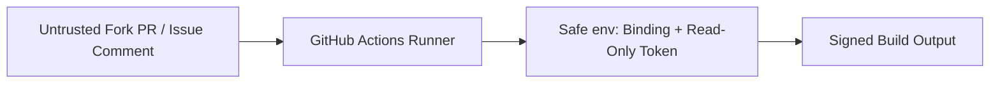

# CI/CD Pipeline & GitHub Actions Security Auditor (`viper-cicd-hardening`)

## 1. Executive Scope, Standards & CWE/OWASP Mapping
- **Frameworks & Standards:** OWASP Top 10 CI/CD Security Risks (CICD-SEC-1 to CICD-SEC-10), Zizmor / Actionlint / StepSecurity, SLSA v1.0
- **Primary CWE Mapping:** CWE-78 (Expression Injection in Workflow `run:`), CWE-250 (Execution with Unnecessary Privileges / `write-all`), CWE-829 (Unpinned Third-Party Action)
- **ViperClaw MCP Tools:** `viper_taint_scan`, `viper_verify_and_report`
- **ViperClaw CLI Command:** `viperclaw taint .github/workflows --db .viperclaw/graph.db`

---

## 2. Threat Model & Root-Cause Architecture



### Root-Cause Analysis
GitHub Actions workflows interpolate untrusted event fields (`${{ github.event.pull_request.title }}`) directly into `run:` shell scripts before bash parses the command, or check out untrusted fork code (`actions/checkout` with `ref: ${{ github.event.pull_request.head.sha }}`) inside a privileged `pull_request_target` workflow that has access to repository secrets and a `write` `GITHUB_TOKEN`.

---

## 3. Deterministic Discovery & Grep/AST Audit Commands

Run the following discovery commands across the target repository before manual code review:

```bash
# 1. Automated ViperClaw analysis
viperclaw taint .github/workflows --db .viperclaw/graph.db

# 2. Rapid static pattern discovery (ripgrep)
rg -n "pull_request_target|workflow_run" .github/workflows/
rg -n "\$\{\{\s*github\.event\.(issue|pull_request|comment|commits|head_ref)" .github/workflows/
rg -n "uses:\s*[^@]+@(main|master|v[0-9]+)" .github/workflows/
```

---

## 4. Senior Security Engineer 8-Point Audit Checklist

| Control ID | Audit Verification Target | Pass Criteria | Fail / Vulnerability Indicator |
| :---: | :--- | :--- | :--- |
| `CICD-01` | **Zero Untrusted `${{ ... }}` Shell Interpolation** | Event fields (`title`, `body`, `head_ref`, `comment.body`) passed via `env:` variables and referenced as `"$PR_TITLE"` in bash. | Direct `${{ github.event.issue.title }}` inside `run:` block (trivial command injection via PR title). |
| `CICD-02` | **`pull_request_target` Checkout Isolation** | `pull_request_target` workflows never check out or execute code/build scripts from the untrusted PR head. | `pull_request_target` runs `actions/checkout` on `pull_request.head.sha` followed by `npm test` / `pip install`. |
| `CICD-03` | **Explicit Least-Privilege `permissions:`** | Top-level `permissions: contents: read` declared in every workflow; write scopes granted per-job only. | Missing `permissions:` block inheriting default `read-write` `GITHUB_TOKEN`. |
| `CICD-04` | **40-Character Commit SHA Action Pinning** | All third-party `uses:` actions pinned to immutable 40-char commit SHAs (`uses: owner/action@a1b2c3... # v4`). | Mutable tag (`@v3`) or branch (`@main`) used for third-party actions (supply-chain mutable tag substitution risk). |
| `CICD-05` | **`workflow_run` Artifact Untrusted Handling** | `workflow_run` jobs treat downloaded artifacts from fork PR workflows as untrusted bytes (no script execution or path traversal). | `workflow_run` extracts an artifact zip and executes a script inside it with production secrets. |
| `CICD-06` | **Persist-Credentials Disabled on Checkout** | `actions/checkout` sets `persist-credentials: false` unless the job explicitly pushes git commits. |  `.git/config` retains the `GITHUB_TOKEN` on disk during untrusted test execution. |
| `CICD-07` | **Self-Hosted Runner Ephemerality** | Public repositories never attach persistent self-hosted runners to `pull_request` triggers. | Persistent non-ephemeral self-hosted runner executes fork PR jobs. |
| `CICD-08` | **`GITHUB_ENV` / `GITHUB_PATH` Injection Guard** | Untrusted output is never echoed into `$GITHUB_ENV` or `$GITHUB_PATH` (`LD_PRELOAD` / `BASH_ENV` takeover). | `echo "MSG=$UNTRUSTED" >> $GITHUB_ENV` allows multiline environment variable injection. |

---

## 5. False-Positive Elimination & CVSS v3.1 Triage Rubric

### False-Positive Gate
1. Verify whether an upstream API Gateway, global middleware, or ORM hook already enforces the control before flagging a controller.
2. Confirm the code path is reachable from an external entrypoint (not dead code, CLI-only admin script, or unit-test fixture).

| Severity Tier | Baseline CVSS v3.1 Vector | Qualifying Security Impact |
| :--- | :--- | :--- |
| **CRITICAL (9.6)** | `CVSS:3.1/AV:N/AC:L/PR:N/UI:N/S:C/C:H/I:H/A:H` | `pull_request_target` untrusted checkout or `run:` expression injection leaking write `GITHUB_TOKEN` and release secrets. |
| **HIGH (8.1)** | `CVSS:3.1/AV:N/AC:L/PR:L/UI:N/S:U/C:H/I:H/A:N` | `$GITHUB_ENV` injection or unisolated `workflow_run` artifact execution. |
| **MEDIUM (5.3)** | `CVSS:3.1/AV:N/AC:H/PR:N/UI:N/S:U/C:L/I:L/A:N` | Missing top-level `permissions: contents: read` or unpinned third-party action tags. |

---

## 6. Production Remediation Patterns (Vulnerable vs. Hardened Code)

```yaml
# ❌ VULNERABLE: Expression injection in run: block & default write permissions
on: pull_request_target
jobs:
  check:
    runs-on: ubuntu-latest
    steps:
      - run: echo "Checking PR: ${{ github.event.pull_request.title }}" 

# ✅ HARDENED: Unprivileged trigger, read-only permissions, and safe env: variable binding
on: pull_request
permissions:
  contents: read
jobs:
  check:
    runs-on: ubuntu-latest
    steps:
      - name: Safe title inspection
        env:
          PR_TITLE: ${{ github.event.pull_request.title }}
        run: printf 'Checking PR: %s\n' "$PR_TITLE" 
```

---

## 7. Regression Testing & Continuous Verification
1. Write a **Positive Unit Test** confirming authorized, schema-valid requests succeed.
2. Write a **Negative Security Regression Test** confirming unauthorized, cross-tenant, or malformed inputs are deterministically rejected.
3. Re-run `viperclaw taint` and `viperclaw verify` to confirm zero remaining unmitigated flows in `.viperclaw/graph.db`.
