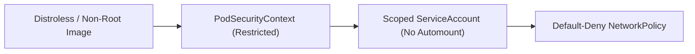

# Docker Container & Kubernetes Manifest Security Auditor (`viper-container-k8s-audit`)

## 1. Executive Scope, Standards & CWE/OWASP Mapping
- **Frameworks & Standards:** CIS Docker Benchmark, CIS Kubernetes Benchmark, Kubernetes Pod Security Standards (Restricted), NSA/CISA Kubernetes Hardening Guide
- **Primary CWE Mapping:** CWE-250 (Execution with Unnecessary Privileges / Root Container), CWE-269 (Improper RBAC Privilege Management), CWE-732
- **ViperClaw MCP Tools:** `viper_taint_scan`, `viper_verify_and_report`
- **ViperClaw CLI Command:** `viperclaw taint . --db .viperclaw/graph.db`

---

## 2. Threat Model & Root-Cause Architecture



### Root-Cause Analysis
Containers default to running as `uid=0 (root)` with writable filesystems, inherited Linux capabilities (`CAP_NET_RAW`, `CAP_SYS_ADMIN`), and auto-mounted Kubernetes ServiceAccount tokens (`/var/run/secrets/kubernetes.io/serviceaccount/token`), turning any application RCE or SSRF into a full cluster compromise.

---

## 3. Deterministic Discovery & Grep/AST Audit Commands

Run the following discovery commands across the target repository before manual code review:

```bash
# 1. Automated ViperClaw analysis
viperclaw taint . --db .viperclaw/graph.db

# 2. Rapid static pattern discovery (ripgrep)
rg -n "(privileged:\s*true|hostNetwork:\s*true|hostPID:\s*true|hostPath:|docker\.sock)"
rg -n "(allowPrivilegeEscalation|runAsNonRoot|readOnlyRootFilesystem|automountServiceAccountToken)"
rg -n "^(FROM|USER|ARG|ENV)" Dockerfile*
```

---

## 4. Senior Security Engineer 8-Point Audit Checklist

| Control ID | Audit Verification Target | Pass Criteria | Fail / Vulnerability Indicator |
| :---: | :--- | :--- | :--- |
| `K8S-01` | **Non-Root Container Execution** | Dockerfile declares non-root `USER 65532:65532` and K8s sets `runAsNonRoot: true`, `runAsUser: 65532`. | Container runs as `root` (`uid=0`) or omits `runAsNonRoot: true`. |
| `K8S-02` | **Privilege Escalation & Capability Drop** | `allowPrivilegeEscalation: false`, `privileged: false`, and `capabilities: { drop: ["ALL"] }` enforced. | `privileged: true` or default Linux capabilities retained. |
| `K8S-03` | **Read-Only Root Filesystem** | `readOnlyRootFilesystem: true` set on containers with ephemeral `emptyDir` mounted at `/tmp`. | Writable root filesystem allowing unapproved runtime binary writes or source modification. |
| `K8S-04` | **Host Namespace & `docker.sock` Isolation** | Zero use of `hostNetwork: true`, `hostPID: true`, `hostIPC: true`, or `hostPath` mounts (`/var/run/docker.sock`, `/etc`). | Pod mounts `/var/run/docker.sock` or host `/`, enabling trivial node root escape. |
| `K8S-05` | **ServiceAccount Token Automount Disabled** | Pods that do not call the K8s API set `automountServiceAccountToken: false`. | Default ServiceAccount token mounted in web application pod (leaked via LFI/SSRF). |
| `K8S-06` | **RBAC Least Privilege (No Wildcards)** | Zero `ClusterRoleBinding` to `cluster-admin` for workloads; no `verbs: ["*"]` or `resources: ["secrets"]` unless required. | Workload ServiceAccount granted `get`/`list`/`watch` on cluster-wide `secrets` or `pods/exec`. |
| `K8S-07` | **Dockerfile Secret & Layer Hygiene** | No secrets passed via `ARG` or `ENV` in Dockerfile (readable via `docker history`); use `--mount=type=secret`. | `ARG NPM_TOKEN` or `ENV DB_PASS` baked into image metadata. |
| `K8S-08` | **Resource Requests/Limits & NetworkPolicy** | CPU/memory `limits` defined on all containers and namespace enforces a default-deny ingress/egress `NetworkPolicy`. | Missing memory limits (Node OOM DoS) or flat cluster network allowing pods to reach cloud IMDS (`169.254.169.254`). |

---

## 5. False-Positive Elimination & CVSS v3.1 Triage Rubric

### False-Positive Gate
1. Verify whether an upstream API Gateway, global middleware, or ORM hook already enforces the control before flagging a controller.
2. Confirm the code path is reachable from an external entrypoint (not dead code, CLI-only admin script, or unit-test fixture).

| Severity Tier | Baseline CVSS v3.1 Vector | Qualifying Security Impact |
| :--- | :--- | :--- |
| **CRITICAL (9.6)** | `CVSS:3.1/AV:N/AC:L/PR:L/UI:N/S:C/C:H/I:H/A:H` | `privileged: true`, `hostPath: /var/run/docker.sock`, or workload bound to `cluster-admin`. |
| **HIGH (7.8)** | `CVSS:3.1/AV:L/AC:L/PR:L/UI:N/S:C/C:H/I:H/A:N` | Container running as `root` with `CAP_SYS_ADMIN` or broad RBAC `secrets` access. |
| **MEDIUM (5.3)** | `CVSS:3.1/AV:N/AC:H/PR:L/UI:N/S:U/C:L/I:L/A:N` | Missing `readOnlyRootFilesystem`, `automountServiceAccountToken: false`, or resource limits. |

---

## 6. Production Remediation Patterns (Vulnerable vs. Hardened Code)

```yaml
# ❌ VULNERABLE: Runs as root, mounts hostPath, and automounts ServiceAccount token
spec:
  containers:
    - name: api
      image: app:latest

# ✅ HARDENED: Kubernetes Restricted Pod Security Standard compliant spec
spec:
  automountServiceAccountToken: false
  securityContext:
    runAsNonRoot: true
    runAsUser: 65532
    seccompProfile:
      type: RuntimeDefault
  containers:
    - name: api
      image: app@sha256:9f86d081884c7d659a2feaa0c55ad015a3bf4f1b2b0b822cd15d6c15b0f00a08
      securityContext:
        allowPrivilegeEscalation: false
        readOnlyRootFilesystem: true
        capabilities:
          drop: ["ALL"]
```

---

## 7. Regression Testing & Continuous Verification
1. Write a **Positive Unit Test** confirming authorized, schema-valid requests succeed.
2. Write a **Negative Security Regression Test** confirming unauthorized, cross-tenant, or malformed inputs are deterministically rejected.
3. Re-run `viperclaw taint` and `viperclaw verify` to confirm zero remaining unmitigated flows in `.viperclaw/graph.db`.
