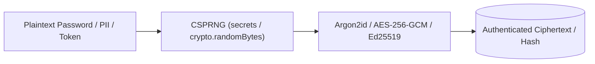

# Cryptography, Key Management & Password Hashing Auditor (`viper-crypto-tls-audit`)

## 1. Executive Scope, Standards & CWE/OWASP Mapping
- **Frameworks & Standards:** OWASP Cryptographic Storage Cheat Sheet, OWASP Password Storage Cheat Sheet, NIST SP 800-57 / SP 800-63B, Trail of Bits Crypto Rules
- **Primary CWE Mapping:** CWE-327 (Use of a Broken or Risky Cryptographic Algorithm), CWE-323 (Reusing a Nonce, Key Pair in Encryption), CWE-338 (Use of Cryptographically Weak PRNG), CWE-916 (Weak Password Hashing)
- **ViperClaw MCP Tools:** `viper_taint_scan`, `viper_verify_and_report`
- **ViperClaw CLI Command:** `viperclaw taint ./src --db .viperclaw/graph.db`

---

## 2. Threat Model & Root-Cause Architecture



### Root-Cause Analysis
Cryptographic failures occur when developers use fast general-purpose hashes (`SHA-256`, `MD5`) for passwords, unauthenticated encryption modes (`AES-ECB`, `AES-CBC` without HMAC—vulnerable to padding oracle decryption), static or reused IVs/nonces in `AES-GCM`, or non-cryptographic PRNGs (`random`, `Math.random()`) for security tokens.

---

## 3. Deterministic Discovery & Grep/AST Audit Commands

Run the following discovery commands across the target repository before manual code review:

```bash
# 1. Automated ViperClaw analysis
viperclaw taint ./src --db .viperclaw/graph.db

# 2. Rapid static pattern discovery (ripgrep)
rg -n "(hashlib\.(md5|sha1)|MD5\.Create|MessageDigest\.getInstance\(.(MD5|SHA-1).\))"
rg -n "(AES\.MODE_ECB|AES\.MODE_CBC|DES|RC4|Blowfish)"
rg -n "(random\.(randint|choice|random)|Math\.random\(|math/rand)"
```

---

## 4. Senior Security Engineer 8-Point Audit Checklist

| Control ID | Audit Verification Target | Pass Criteria | Fail / Vulnerability Indicator |
| :---: | :--- | :--- | :--- |
| `CRYP-01` | **Memory-Hard Password Hashing (`Argon2id`)** | User passwords hashed with `Argon2id` (m>=19MiB, t>=2, p=1), `bcrypt` (cost >= 12), or `scrypt`. | Passwords hashed with `MD5`, `SHA-1`, unsalted `SHA-256`, or low-iteration PBKDF2. |
| `CRYP-02` | **Authenticated Encryption (AEAD) Only** | Symmetric encryption uses `AES-256-GCM`, `ChaCha20-Poly1305`, or `Fernet` / `libsodium secretbox`. | Unauthenticated `AES-ECB` (leaks patterns) or raw `AES-CBC` (vulnerable to PKCS#7 padding oracle). |
| `CRYP-03` | **Unique CSPRNG Nonce / IV Per Encryption** | Every `AES-GCM` or `ChaCha20` encryption generates a fresh CSPRNG nonce (`os.urandom(12)`) prepended to the ciphertext. | Hardcoded/static IV (`b'\x00'*12`) or counter reuse under the same key (catastrophic key/plaintext recovery in GCM). |
| `CRYP-04` | **CSPRNG for All Security Tokens** | Reset tokens, OTPs, salts, and session IDs use `secrets` (Python), `crypto.randomBytes` (Node), or `crypto/rand` (Go). | `random.choice()`, `uuid.uuid1()` (MAC + timestamp), or `Math.random()` used for tokens. |
| `CRYP-05` | **Constant-Time Secret Comparison** | MACs, webhook signatures, and API tokens compared via `hmac.compare_digest()` / `crypto.timingSafeEqual()`. | Standard `==` string comparison leaking signature bytes via timing side channels. |
| `CRYP-06` | **Asymmetric Key Lengths & Curve Safety** | Ed25519, ECDSA `P-256`/`P-384`, or RSA `>= 2048-bit` with `RSA-OAEP` (encryption) and `RSA-PSS` (signatures). | RSA-1024 or legacy PKCS#1 v1.5 encryption padding (Bleichenbacher oracle). |
| `CRYP-07` | **Key Separation & KMS Envelope Encryption** | Signing keys and encryption keys are strictly separated (`HKDF` subkey derivation); master keys reside in KMS/HSM. | The same raw secret key is used for both JWT signing (`HS256`) and database field encryption. |
| `CRYP-08` | **TLS 1.2+ & Certificate Verification** | Outbound TLS clients verify hostname + certificate chain (`CERT_REQUIRED`) and enforce TLS 1.2/1.3. | `verify=False`, `NODE_TLS_REJECT_UNAUTHORIZED=0`, or `InsecureSkipVerify: true` enabled. |

---

## 5. False-Positive Elimination & CVSS v3.1 Triage Rubric

### False-Positive Gate
1. Verify whether an upstream API Gateway, global middleware, or ORM hook already enforces the control before flagging a controller.
2. Confirm the code path is reachable from an external entrypoint (not dead code, CLI-only admin script, or unit-test fixture).

| Severity Tier | Baseline CVSS v3.1 Vector | Qualifying Security Impact |
| :--- | :--- | :--- |
| **CRITICAL (9.1)** | `CVSS:3.1/AV:N/AC:L/PR:N/UI:N/S:U/C:H/I:H/A:N` | Predictable PRNG reset tokens, static `AES-GCM` nonce reuse, or `AES-CBC` padding oracle compromising confidentiality. |
| **HIGH (7.5)** | `CVSS:3.1/AV:N/AC:L/PR:N/UI:N/S:U/C:H/I:N/A:N` | Disabled TLS certificate verification (`verify=False`) or fast unsalted password hashes (`MD5`/`SHA1`). |
| **MEDIUM (5.3)** | `CVSS:3.1/AV:N/AC:H/PR:N/UI:N/S:U/C:H/I:N/A:N` | Non-constant-time HMAC comparison or shared key material across signing and encryption. |

---

## 6. Production Remediation Patterns (Vulnerable vs. Hardened Code)

```python
# ❌ VULNERABLE: Uses random.choices (Mersenne Twister) for OTP & fast SHA-256 for password
otp = "".join(random.choices("0123456789", k=6))
pw_hash = hashlib.sha256(password.encode()).hexdigest()

# ✅ HARDENED: CSPRNG secrets module for OTP & Argon2id for password hashing
import secrets
from argon2 import PasswordHasher

ph = PasswordHasher(time_cost=3, memory_cost=65536, parallelism=4)
otp = f"{secrets.randbelow(1_000_000):06d}"
pw_hash = ph.hash(password)
```

---

## 7. Regression Testing & Continuous Verification
1. Write a **Positive Unit Test** confirming authorized, schema-valid requests succeed.
2. Write a **Negative Security Regression Test** confirming unauthorized, cross-tenant, or malformed inputs are deterministically rejected.
3. Re-run `viperclaw taint` and `viperclaw verify` to confirm zero remaining unmitigated flows in `.viperclaw/graph.db`.
