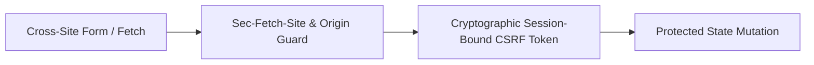

# Cross-Site Request Forgery (CSRF) & State-Change Defense Auditor (`viper-csrf-samesite-audit`)

## 1. Executive Scope, Standards & CWE/OWASP Mapping
- **Frameworks & Standards:** OWASP Cross-Site Request Forgery Prevention Cheat Sheet, OWASP ASVS V4.2, W3C Fetch Metadata (`Sec-Fetch-Site`), CWE-352
- **Primary CWE Mapping:** CWE-352 (Cross-Site Request Forgery), CWE-650 (Trusting HTTP Permission Methods on the Server Side / State-Changing GET)
- **ViperClaw MCP Tools:** `viper_taint_scan`, `viper_fingerprint_traffic`, `viper_verify_and_report`
- **ViperClaw CLI Command:** `viperclaw taint ./src --db .viperclaw/graph.db`

---

## 2. Threat Model & Root-Cause Architecture



### Root-Cause Analysis
Cookie-authenticated endpoints accept state-changing requests via `GET` (circumventing `SameSite=Lax` on top-level navigations), accept `application/x-www-form-urlencoded` or `text/plain` on `POST` endpoints without verifying an anti-CSRF token or `Origin` header, or use static/unverified CSRF tokens.

---

## 3. Deterministic Discovery & Grep/AST Audit Commands

Run the following discovery commands across the target repository before manual code review:

```bash
# 1. Automated ViperClaw analysis
viperclaw taint ./src --db .viperclaw/graph.db

# 2. Rapid static pattern discovery (ripgrep)
rg -n "(@csrf_exempt|csrf_protect|VerifyCsrfToken|csurf|SameSite)"
rg -n "(Sec-Fetch-Site|X-CSRF-Token|X-XSRF-TOKEN)"
rg -n "@(app|router)\.get\(.*(delete|remove|reset|update|approve|upgrade)"
```

---

## 4. Senior Security Engineer 8-Point Audit Checklist

| Control ID | Audit Verification Target | Pass Criteria | Fail / Vulnerability Indicator |
| :---: | :--- | :--- | :--- |
| `CSRF-01` | **Zero State-Changing `GET` / `HEAD` Routes** | All `GET` and `HEAD` endpoints are strictly idempotent and read-only (`SameSite=Lax` does NOT block cross-site top-level `GET` links!). | `GET /api/account/delete` or `GET /password/change?new_pw=...` mutates server state. |
| `CSRF-02` | **Cryptographic Session-Bound Anti-CSRF Tokens** | Every cookie-authenticated `POST`/`PUT`/`PATCH`/`DELETE` endpoint validates an HMAC-signed or session-stored CSRF token. | CSRF token checked only for presence (`if req.body.csrf`) or accepts any user's valid CSRF token. |
| `CSRF-03` | **Reject Form-Encoded Content-Types on JSON APIs** | JSON APIs relying on CORS preflight protection explicitly require `Content-Type: application/json` and reject `text/plain`, `multipart/form-data`, and `application/x-www-form-urlencoded`. | Express/FastAPI/Spring controller parses both JSON and URL-encoded form bodies without a CSRF token. |
| `CSRF-04` | **`Sec-Fetch-Site` & `Origin` Header Verification** | State-changing middleware rejects requests where `Sec-Fetch-Site` is `cross-site` or `Origin` does not match the host. | No `Origin` / `Sec-Fetch-Site` defense-in-depth validation. |
| `CSRF-05` | **Login & OAuth Connect CSRF Protection** | Login forms and OAuth account-binding callbacks (`/oauth/callback`) enforce `state` / CSRF tokens. | Missing Login CSRF or OAuth `state` check allows binding an unverified external account to another user's session. |
| `CSRF-06` | **Double-Submit Cookie Signing (`__Host-` + HMAC)** | If using stateless double-submit CSRF cookies, the cookie uses `__Host-` prefix and contains an HMAC of the user's session ID. | Unsigned double-submit cookie overwritable by a sibling subdomain (sibling-subdomain cookie overwrite). |
| `CSRF-07` | **Audit `@csrf_exempt` & Exclusion Lists** | Every `@csrf_exempt` or `VerifyCsrfToken::$except` entry is restricted to webhook endpoints that verify HMAC signatures. | `@csrf_exempt` applied to user-facing cookie-authenticated endpoints. |
| `CSRF-08` | **GraphQL `POST` CSRF Defense** | Cookie-authenticated `/graphql` endpoints require a custom header (`X-Requested-With`, `Apollo-Require-Preflight`) and reject `GET` mutations. | GraphQL accepts mutations via `GET /graphql?query=mutation...` or `POST` with `application/x-www-form-urlencoded`. |

---

## 5. False-Positive Elimination & CVSS v3.1 Triage Rubric

### False-Positive Gate
1. Verify whether an upstream API Gateway, global middleware, or ORM hook already enforces the control before flagging a controller.
2. Confirm the code path is reachable from an external entrypoint (not dead code, CLI-only admin script, or unit-test fixture).

| Severity Tier | Baseline CVSS v3.1 Vector | Qualifying Security Impact |
| :--- | :--- | :--- |
| **HIGH (8.8)** | `CVSS:3.1/AV:N/AC:L/PR:N/UI:R/S:U/C:H/I:H/A:H` | CSRF on password change, email change, API key generation, or admin role grant. |
| **MEDIUM (6.5)** | `CVSS:3.1/AV:N/AC:L/PR:N/UI:R/S:U/C:N/I:H/A:N` | CSRF on state-changing user actions (profile update, OAuth account linking, data deletion). |
| **LOW (4.3)** | `CVSS:3.1/AV:N/AC:L/PR:N/UI:R/S:U/C:N/I:L/A:N` | Login CSRF or minor preference modification. |

---

## 6. Production Remediation Patterns (Vulnerable vs. Hardened Code)

```python
# ❌ VULNERABLE: @csrf_exempt on cookie-authenticated account email update
@csrf_exempt
def update_account_email(request):
    request.user.email = request.POST["email"]
    request.user.save()
    return JsonResponse({"ok": True})

# ✅ HARDENED: Enforces POST + Django CSRF middleware + Sec-Fetch-Site defense-in-depth
@require_POST
@csrf_protect
def update_account_email(request):
    if request.headers.get("Sec-Fetch-Site") not in {None, "same-origin"}:
        return HttpResponseForbidden("Cross-site state mutation blocked")
    request.user.email = request.POST["email"]
    request.user.save()
    return JsonResponse({"ok": True})
```

---

## 7. Regression Testing & Continuous Verification
1. Write a **Positive Unit Test** confirming authorized, schema-valid requests succeed.
2. Write a **Negative Security Regression Test** confirming unauthorized, cross-tenant, or malformed inputs are deterministically rejected.
3. Re-run `viperclaw taint` and `viperclaw verify` to confirm zero remaining unmitigated flows in `.viperclaw/graph.db`.
