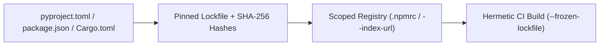

# Software Supply Chain, Lockfile Integrity & Dependency Confusion Auditor (`viper-dependency-sbom`)

## 1. Executive Scope, Standards & CWE/OWASP Mapping
- **Frameworks & Standards:** OWASP Top 10:2025 A03/A06 (Software Supply Chain Failures), SLSA v1.0, OSV Schema, CWE-1357, CWE-427
- **Primary CWE Mapping:** CWE-1357 (Reliance on Insufficiently Trustworthy Component), CWE-427 (Uncontrolled Search Path / Dependency Confusion), CWE-829 (Inclusion of Functionality from Untrusted Control Sphere)
- **ViperClaw MCP Tools:** `viper_taint_scan`, `viper_verify_and_report`
- **ViperClaw CLI Command:** `viperclaw taint . --db .viperclaw/graph.db`

---

## 2. Threat Model & Root-Cause Architecture



### Root-Cause Analysis
Supply-chain compromises occur when builds use floating version ranges (`^`, `~`, `>=`), mix public and private package indexes via `pip --extra-index-url` (allowing public PyPI/npm packages with higher version numbers to shadow internal package names), or run untrusted `postinstall` scripts.

---

## 3. Deterministic Discovery & Grep/AST Audit Commands

Run the following discovery commands across the target repository before manual code review:

```bash
# 1. Automated ViperClaw analysis
viperclaw taint . --db .viperclaw/graph.db

# 2. Rapid static pattern discovery (ripgrep)
rg -n "(extra-index-url|@.*:registry|publishConfig|replace\s+.*=>)"
rg -n "(postinstall|preinstall|install)\s*:" package.json
rg -n "(git\+https?://|http://)" pyproject.toml requirements*.txt package.json Cargo.toml
```

---

## 4. Senior Security Engineer 8-Point Audit Checklist

| Control ID | Audit Verification Target | Pass Criteria | Fail / Vulnerability Indicator |
| :---: | :--- | :--- | :--- |
| `DEP-01` | **Deterministic Lockfile Enforcement** | CI/CD and Docker builds enforce `npm ci`, `pnpm install --frozen-lockfile`, `pip install --require-hashes`, or `cargo build --locked`. | Production builds run `pip install -r requirements.txt` or `npm install` with floating versions. |
| `DEP-02` | **Dependency Confusion Prevention (`pip` / `npm`)** | Never use `pip --extra-index-url` for private packages without explicit package pinning; bind `@scope` in `.npmrc` to private registry. | `--extra-index-url` used with unclaimed internal package names on public PyPI. |
| `DEP-03` | **Unclaimed `@scope` & Internal Package Audit** | All internal `@org/pkg` scopes in `package.json`, sourcemaps, or documentation are registered/owned on public npm/PyPI. | Internal JS bundle leaks `@company-internal/auth` where `@company-internal` is unclaimed on npmjs.com. |
| `DEP-04` | **Install-Script Hardening (`--ignore-scripts`)** | Package installations disable arbitrary lifecycle hooks (`ignore-scripts=true`) or audit every `preinstall`/`postinstall` script. | Untrusted transitive dependencies allowed to execute arbitrary shell scripts during `npm install`. |
| `DEP-05` | **Git Dependency Commit SHA Pinning** | Any dependency sourced from Git (`git+https://...`) is pinned to an immutable 40-char commit SHA, not a mutable branch/tag. | `"pkg": "github:owner/repo#main"` used in `package.json` or `requirements.txt`. |
| `DEP-06` | **Reachable CVE & Abandoned Package Triage** | Zero known Critical/High CVEs (OSV / GitHub Advisory) in reachable production dependencies. | Outdated parsers/frameworks (`PyYAML < 5.4`, `lodash < 4.17.21`, `log4j`) in production lockfile. |
| `DEP-07` | **Typosquatting & Hallucinated Package Check** | Every newly added package name is verified against official repository URLs and download counts (blocking slopsquatting). | AI-hallucinated or typosquatted package name added to manifest. |
| `DEP-08` | **Runtime vs. Dev Dependency Separation** | Test runners, linters, and debug tools are placed in `[project.optional-dependencies]` / `devDependencies` and excluded from production images. | Debug/test frameworks installed into the final production container image. |

---

## 5. False-Positive Elimination & CVSS v3.1 Triage Rubric

### False-Positive Gate
1. Verify whether an upstream API Gateway, global middleware, or ORM hook already enforces the control before flagging a controller.
2. Confirm the code path is reachable from an external entrypoint (not dead code, CLI-only admin script, or unit-test fixture).

| Severity Tier | Baseline CVSS v3.1 Vector | Qualifying Security Impact |
| :--- | :--- | :--- |
| **CRITICAL (9.8)** | `CVSS:3.1/AV:N/AC:L/PR:N/UI:N/S:C/C:H/I:H/A:H` | Claimable private package name exposed via `--extra-index-url` or unclaimed `@scope` (Dependency Confusion RCE). |
| **HIGH (8.1)** | `CVSS:3.1/AV:N/AC:L/PR:N/UI:N/S:U/C:H/I:H/A:N` | Reachable High/Critical CVE in a direct or transitive runtime dependency. |
| **MEDIUM (5.3)** | `CVSS:3.1/AV:N/AC:H/PR:N/UI:N/S:U/C:N/I:H/A:N` | Unpinned floating dependencies in production build without lockfile integrity hashes. |

---

## 6. Production Remediation Patterns (Vulnerable vs. Hardened Code)

```dockerfile
# ❌ VULNERABLE: Uses --extra-index-url (Dependency Confusion) without lockfile hashes
RUN pip install --extra-index-url https://pypi.internal.example.com/simple -r requirements.txt

# ✅ HARDENED: Uses single trusted internal mirror (with upstream allowlist) + --require-hashes
RUN pip install --no-deps --require-hashes --index-url https://pypi.internal.example.com/simple -r requirements.lock
```

---

## 7. Regression Testing & Continuous Verification
1. Write a **Positive Unit Test** confirming authorized, schema-valid requests succeed.
2. Write a **Negative Security Regression Test** confirming unauthorized, cross-tenant, or malformed inputs are deterministically rejected.
3. Re-run `viperclaw taint` and `viperclaw verify` to confirm zero remaining unmitigated flows in `.viperclaw/graph.db`.
