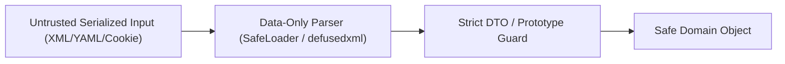

# Safe Deserialization, XML (XXE), YAML & JSON Parser Security Auditor (`viper-deserialization-parser`)

## 1. Executive Scope, Standards & CWE/OWASP Mapping
- **Frameworks & Standards:** OWASP Deserialization Cheat Sheet, OWASP XXE Prevention Cheat Sheet, CWE-502, CWE-611, CWE-1321
- **Primary CWE Mapping:** CWE-502 (Deserialization of Untrusted Data), CWE-611 (Improper Restriction of XML External Entity Reference / XXE), CWE-1321 (Prototype Pollution)
- **ViperClaw MCP Tools:** `viper_taint_scan`, `viper_verify_and_report`
- **ViperClaw CLI Command:** `viperclaw taint ./src --db .viperclaw/graph.db`

---

## 2. Threat Model & Root-Cause Architecture



### Root-Cause Analysis
Native object serialization formats (`pickle`, `yaml.load`, PHP `unserialize` / `phar://`, Java `ObjectInputStream`, Ruby `Marshal`, .NET `BinaryFormatter`) invoke arbitrary class constructors or magic methods (`__reduce__`, `__wakeup`, `readObject`) during parsing, while default XML parsers resolve external `SYSTEM` DTD entities (`file:///etc/passwd` or internal SSRF URLs).

---

## 3. Deterministic Discovery & Grep/AST Audit Commands

Run the following discovery commands across the target repository before manual code review:

```bash
# 1. Automated ViperClaw analysis
viperclaw taint ./src --db .viperclaw/graph.db

# 2. Rapid static pattern discovery (ripgrep)
rg -n "(pickle\.loads?|cPickle|dill\.loads|shelve\.|jsonpickle\.decode|yaml\.(load|unsafe_load))"
rg -n "(unserialize\(|Marshal\.load|ObjectInputStream|readObject\(|BinaryFormatter)"
rg -n "(lxml\.etree|xml\.etree|DocumentBuilderFactory|SAXParserFactory|DOMDocument)"
```

---

## 4. Senior Security Engineer 8-Point Audit Checklist

| Control ID | Audit Verification Target | Pass Criteria | Fail / Vulnerability Indicator |
| :---: | :--- | :--- | :--- |
| `DESER-01` | **Zero Native Object Deserialization on Untrusted Input** | `pickle.loads`, `dill`, `jsonpickle`, `Marshal.load`, `ObjectInputStream`, and `BinaryFormatter` are never called on network, cookie, or shared-cache inputs. | Session cookie or Redis queue entry parsed via `pickle.loads()` or `unserialize()`. |
| `DESER-02` | **YAML SafeLoader Enforcement** | All YAML parsing uses `yaml.safe_load()` / `yaml.CSafeLoader` (Python) or `js-yaml` v4+ safe defaults. | `yaml.load(data)` or `yaml.Loader` used on user/config YAML (`!!python/object/apply:os.system`). |
| `DESER-03` | **PHP `unserialize` & `phar://` Stream Wrapper Block** | PHP code uses `json_decode()` instead of `unserialize()` (or restricts `allowed_classes => false`), and file functions block `phar://` URIs. | User-supplied path passed to `file_exists('phar://upload.jpg')` triggering POP-chain deserialization. |
| `DESER-04` | **XML External Entity (XXE) & DTD Disablement** | Python uses `defusedxml`; Java sets `disallow-doctype-decl = true`; PHP avoids `LIBXML_NOENT`; .NET sets `XmlResolver = null`. | `lxml.etree.fromstring(xml, XMLParser(resolve_entities=True))` used on XML/SVG/SOAP/DOCX/XLSX inputs. |
| `DESER-05` | **JSON Prototype Pollution Guard (JS/TS)** | Recursive object merge/clone helpers strip `__proto__`, `constructor`, and `prototype` keys. | Deep merge of `req.body` pollutes `Object.prototype.isAdmin = true` or template gadget properties. |
| `DESER-06` | **Java Jackson / Fastjson Polymorphic Type Safety** | `enableDefaultTyping()` and `@JsonTypeInfo(use = Id.CLASS)` disabled; only explicit `@JsonSubTypes` allowlists used. | Arbitrary JDBC/JNDI gadget classes instantiable via `@type` or `@class` JSON properties. |
| `DESER-07` | **XML Billion Laughs (Entity Expansion Bomb) Cap** | Entity expansion and XML document depth/byte size are strictly bounded. | 1KB XML input with nested `<!ENTITY lol9 "&lol8;&lol8;...">` expands to 3GB in memory. |
| `DESER-08` | **Signed Serialization Envelopes Are Not Enough** | Even HMAC-signed cookies avoid `pickle`/`Marshal` so a leaked signing secret does not immediately escalate from session tampering to arbitrary code execution. | Framework configured with `PickleSerializer` for signed cookies. |

---

## 5. False-Positive Elimination & CVSS v3.1 Triage Rubric

### False-Positive Gate
1. Verify whether an upstream API Gateway, global middleware, or ORM hook already enforces the control before flagging a controller.
2. Confirm the code path is reachable from an external entrypoint (not dead code, CLI-only admin script, or unit-test fixture).

| Severity Tier | Baseline CVSS v3.1 Vector | Qualifying Security Impact |
| :--- | :--- | :--- |
| **CRITICAL (9.8)** | `CVSS:3.1/AV:N/AC:L/PR:N/UI:N/S:U/C:H/I:H/A:H` | Untrusted `pickle.loads`, `yaml.load`, `unserialize`, or `ObjectInputStream` leading to immediate RCE. |
| **HIGH (8.2)** | `CVSS:3.1/AV:N/AC:L/PR:N/UI:N/S:U/C:H/I:N/A:L` | XXE (`SYSTEM "file:///..."`) reading local server files or internal cloud metadata. |
| **HIGH (7.5)** | `CVSS:3.1/AV:N/AC:L/PR:N/UI:N/S:U/C:L/I:L/A:L` | Server-side Prototype Pollution altering application authorization or polluting EJS/Pug templates. |

---

## 6. Production Remediation Patterns (Vulnerable vs. Hardened Code)

```python
# ❌ VULNERABLE: Unsafe PyYAML load & lxml parser with external entity resolution
import yaml
from lxml import etree

cfg = yaml.load(user_yaml_str, Loader=yaml.Loader)
xml_doc = etree.fromstring(user_xml_bytes, etree.XMLParser(resolve_entities=True))

# ✅ HARDENED: yaml.safe_load + defusedxml (blocks DTDs, external entities & entity bombs)
import yaml
import defusedxml.ElementTree as DET

cfg = yaml.safe_load(user_yaml_str)
xml_doc = DET.fromstring(user_xml_bytes, forbid_dtd=True, forbid_entities=True, forbid_external=True)
```

---

## 7. Regression Testing & Continuous Verification
1. Write a **Positive Unit Test** confirming authorized, schema-valid requests succeed.
2. Write a **Negative Security Regression Test** confirming unauthorized, cross-tenant, or malformed inputs are deterministically rejected.
3. Re-run `viperclaw taint` and `viperclaw verify` to confirm zero remaining unmitigated flows in `.viperclaw/graph.db`.
