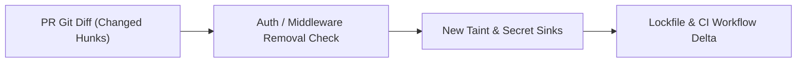

# Differential PR & Commit Security Review Auditor (`viper-diff-pr-review`)

## 1. Executive Scope, Standards & CWE/OWASP Mapping
- **Frameworks & Standards:** OWASP SAMM Verification, NIST SSDF (PW.7 Code Review), CWE-284, CWE-862
- **Primary CWE Mapping:** CWE-862 (Missing Authorization Introduced in Diff), CWE-20 (Unvalidated New Input), CWE-798 (Newly Added Secret)
- **ViperClaw MCP Tools:** `viper_taint_scan`, `viper_secrets_scan`, `viper_iac_audit`, `viper_sbom_deps`, `viper_verify_and_report`
- **ViperClaw CLI Command:** `git diff origin/main...HEAD && viperclaw taint . && viperclaw secrets .`

---

## 2. Threat Model & Root-Cause Architecture



### Root-Cause Analysis
Production security regressions frequently enter through small pull requests that remove an authentication decorator, relax a route middleware group, add a raw query helper, or introduce an unpinned dependency without triggering full-repo reviews.

---

## 3. Deterministic Discovery & Grep/AST Audit Commands

```bash
# 1. Inspect changed files and security-sensitive hunks
git diff --stat origin/main...HEAD
git diff -U3 origin/main...HEAD | rg -n "(auth|permission|role|tenant|sql|exec|secret|cors|csrf|redirect)"

# 2. Run ViperClaw static gates on the working tree
viperclaw taint . --db .viperclaw/graph.db
viperclaw secrets .
viperclaw iac .
```

---

## 4. Senior Security Engineer 8-Point Audit Checklist

| Control ID | Audit Verification Target | Pass Criteria | Fail / Vulnerability Indicator |
| :---: | :--- | :--- | :--- |
| `DIFF-01` | **No Removed Auth / RBAC Guards** | Deleted lines do not drop `@login_required`, `@PreAuthorize`, `Depends(get_current_user)`, or tenant filters. | Middleware or route guard removed during refactoring. |
| `DIFF-02` | **New Endpoints Have Input DTOs** | Every newly added route binds inputs to strict allowlisted schemas (`extra="forbid"` / `whitelist: true`). | New controller reads raw `req.body` or `request.json` directly into ORM models. |
| `DIFF-03` | **Zero New Hardcoded Secrets** | `viper_secrets_scan` returns `0` new credential findings across added lines. | API key, private key, or test credential committed in config or fixtures. |
| `DIFF-04` | **Parameterized New Queries & Commands** | All newly introduced DB, template, or subprocess calls use parameterized bindings. | String interpolation (`f"SELECT ... {x}"`) introduced in new helper function. |
| `DIFF-05` | **Dependency & Lockfile Integrity** | New packages in `package.json`/`requirements.txt`/`go.mod` are pinned and reflected in lockfiles. | Unpinned dependency or new `postinstall` script added without review. |
| `DIFF-06` | **CI/CD & IaC Delta Safety** | Changes to `.github/workflows/`, `Dockerfile`, or `*.tf` preserve least-privilege permissions. | PR adds `pull_request_target` or widens IAM/security-group rules. |
| `DIFF-07` | **Error & Logging Hygiene** | Newly added `catch`/`except` blocks do not log tokens, cookies, or raw request bodies. | Debug log prints `Authorization` header or user password. |
| `DIFF-08` | **Regression Test Coverage** | Security-sensitive diffs include both positive and negative authorization unit tests. | Auth change merged without negative unit test proving unauthorized callers receive `401`/`403`. |

---

## 5. False-Positive Elimination & CVSS v3.1 Triage Rubric

### False-Positive Gate
1. Confirm the changed hunk is reachable in production code (not test-only fixtures or docs).
2. Verify whether a global router middleware enforces the control removed at the handler level.

| Severity Tier | Baseline CVSS v3.1 Vector | Qualifying Security Impact |
| :--- | :--- | :--- |
| **CRITICAL (9.1)** | `CVSS:3.1/AV:N/AC:L/PR:N/UI:N/S:U/C:H/I:H/A:N` | PR removes authentication or tenant scoping on a production data/admin endpoint. |
| **HIGH (7.5)** | `CVSS:3.1/AV:N/AC:L/PR:L/UI:N/S:U/C:H/I:N/A:N` | PR introduces unparameterized SQL/command sink or commits a live production secret. |
| **MEDIUM (5.3)** | `CVSS:3.1/AV:N/AC:L/PR:N/UI:N/S:U/C:L/I:N/A:N` | PR relaxes CORS/CSP headers or introduces unpinned CI/dependency configuration. |

---

## 6. Production Remediation Patterns (Vulnerable vs. Hardened Code)

```python
# ❌ VULNERABLE DIFF: Refactoring drops tenant_id check from query
def get_invoice(invoice_id: str, user: User):
    return db.query(Invoice).filter(Invoice.id == invoice_id).first()

# ✅ HARDENED DIFF: Preserves tenant_id isolation and verifies ownership
def get_invoice(invoice_id: str, user: User):
    return (
        db.query(Invoice)
        .filter(Invoice.id == invoice_id, Invoice.tenant_id == user.tenant_id)
        .first()
    )
```

---

## 7. Regression Testing & Continuous Verification
1. Run `viperclaw taint .`, `viperclaw secrets .`, and `viperclaw iac .` on the PR branch.
2. Add a negative regression test covering every modified authorization boundary.
3. Export verified findings via `viper_verify_and_report` as SARIF 2.1.0 for PR code scanning.
