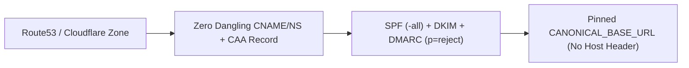

# ViperClaw Skill 55: DNS, Subdomain Takeover & Email Security Auditor (`viper-dns-email-domain`)

## 1. Standards & Open-Source Reference
- **Standards:** `EdOverflow/can-i-take-over-xyz`, RFC 7208 (SPF), RFC 6376 (DKIM), RFC 7489 (DMARC), OWASP Password Reset Cheat Sheet.
- **Focus:** Auditing DNS zone files (Terraform Route53/Cloudflare), email authentication records, and transactional email templates.

---

## 2. Threat Model & Trust-Boundary Architecture



### Automated ViperClaw Command
```bash
viperclaw taint . --db .viperclaw/graph.db
```

---

## 3. Rapid Discovery Patterns
- Search IaC / DNS configs for `CNAME`, `aws_route53_record`, `cloudflare_record`, `v=spf1`, `v=DMARC1`.
- Search application code for `sendmail`, `smtplib`, `Reply-To`, `request.host`, `X-Forwarded-Host`.

---

## 4. Senior Security Engineer Technical Audit Checklist
1. **Dangling DNS & Subdomain Takeover Prevention:** Audit all `CNAME`, `ALIAS`, and `NS` records pointing to external cloud providers (`*.s3.amazonaws.com`, `*.azurewebsites.net`, `*.github.io`, `*.herokuapp.com`, `*.cloudfront.net`, `*.fastly.net`) to confirm the target resource is actively claimed, and delete DNS records *before* deprovisioning cloud resources.
2. **SPF, DKIM & DMARC Enforcement:** Verify the root domain and all mail-sending subdomains publish an SPF record ending with hard-fail `-all` (within the 10-DNS-lookup RFC limit), 2048-bit RSA / Ed25519 DKIM keys, and a DMARC record with `v=DMARC1; p=reject; sp=reject; adkim=s; aspf=s;`.
3. **Password Reset Host-Header Injection Prevention:** Never generate password-reset, magic-link, or invitation URLs using `request.headers["Host"]` or `X-Forwarded-Host`; always construct links using a pinned `APP_BASE_URL` configuration constant.
4. **SMTP Header & Template Injection:** Strip `
` and `
` from user-supplied `Subject`, `From`, `Reply-To`, and recipient display names, and never pass user input into email template syntax before rendering.
5. **CAA (Certification Authority Authorization) Records:** Configure DNS `CAA` records restricting TLS certificate issuance to your organization's approved Certificate Authorities (e.g., `0 issue "letsencrypt.org"`).

---

## 5. Production Remediation Patterns (Vulnerable vs. Hardened Code)
```python
# ❌ VULNERABLE: Password reset link uses untrusted HTTP Host header (Untrusted Host Header Injection)
reset_url = f"https://{request.headers.get('Host')}/reset?token={token}"

# ✅ HARDENED: Uses pinned canonical base URL from immutable server config
reset_url = f"{settings.CANONICAL_BASE_URL}/reset?token={token}"
```

---

## 6. False-Positive Elimination & CVSS v3.1 Triage Rubric

### False-Positive Elimination Gate
1. **Reachability & Boundary Check:** Confirm the flagged pattern or configuration is reachable across a trust boundary in production (not an isolated unit-test mock, build-time sample, or dead code path).
2. **Upstream Control Verification:** Check whether an upstream gateway, middleware, database policy, or compiler flag already neutralizes the weakness before marking a finding as verified.
3. **Standards Reference:** `can-i-take-over-xyz, RFC 7208/6376/7489, CWE-640, CWE-93`

| Severity Tier | Baseline CVSS v3.1 Vector | Qualifying Security Impact |
| :--- | :--- | :--- |
| **CRITICAL (9.0–10.0)** | `CVSS:3.1/AV:N/AC:L/PR:N/UI:N/S:C/C:H/I:H/A:H` | Unauthenticated remote code execution, cross-tenant authentication or isolation gap, or direct theft of funds/keys. |
| **HIGH (7.0–8.9)** | `CVSS:3.1/AV:N/AC:L/PR:L/UI:N/S:U/C:H/I:H/A:N` | Authenticated privilege escalation, unauthorized sensitive data exposure, or single-request service outage. |
| **MEDIUM (4.0–6.9)** | `CVSS:3.1/AV:N/AC:L/PR:L/UI:R/S:C/C:L/I:L/A:N` | Scoped information disclosure, non-admin state mutation, or configuration weakness requiring user interaction. |
| **LOW (0.1–3.9)** | `CVSS:3.1/AV:N/AC:H/PR:H/UI:N/S:U/C:L/I:N/A:N` | Defense-in-depth hardening gap requiring high precondition complexity and minimal direct impact. |

---

## 7. Regression Testing & Continuous Verification
1. **Positive Functional Test:** Verify that legitimate callers and valid inputs continue to succeed after applying the hardened pattern.
2. **Negative Security Regression Test:** Write an automated unit/integration test confirming that the vulnerable input, unauthenticated call, or misconfiguration is deterministically rejected.
3. **Graph & SARIF Verification:** Run `viperclaw taint . --db .viperclaw/graph.db` and `viperclaw verify` to record the verified state in `.viperclaw/graph.db`.
