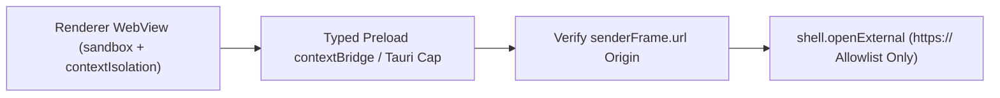

# ViperClaw Skill 56: Electron & Tauri Desktop Application Auditor (`viper-electron-tauri-desktop`)

## 1. Standards & Open-Source Reference
- **Standards:** Doyensec `electronegativity`, Official Electron Security Checklist, Tauri v2 Security & Capabilities Guide.
- **Focus:** Auditing cross-platform desktop applications built with Electron or Tauri (Rust + WebView).

---

## 2. Threat Model & Trust-Boundary Architecture



### Automated ViperClaw Command
```bash
viperclaw harvest-js . --db .viperclaw/graph.db
```

---

## 3. Rapid Discovery Patterns
- **Electron:** `nodeIntegration`, `contextIsolation`, `sandbox:`, `webSecurity`, `ipcMain.handle`, `shell.openExternal`, `will-navigate`.
- **Tauri:** `tauri.conf.json`, `capabilities`, `allowlist`, `#[tauri::command]`, `danger_disable_asset_csp_modification`.

---

## 4. Senior Security Engineer Technical Audit Checklist
1. **Electron BrowserWindow WebPreferences Hardening:** Every `BrowserWindow` and `WebContentsView` must enforce `nodeIntegration: false`, `contextIsolation: true`, `sandbox: true`, `webSecurity: true`, and `allowRunningInsecureContent: false`.
2. **Preload `contextBridge` Minimization & IPC Sender Verification:** Never expose raw `ipcRenderer` via `contextBridge.exposeInMainWorld`; expose narrow, typed wrapper functions, and inside every `ipcMain.handle` listener validate `event.senderFrame.url` against your trusted local origin.
3. **`shell.openExternal` Protocol Allowlisting:** Passing untrusted URLs (`file://`, `smb://`, `ms-msdt:`, `javascript:`) to `shell.openExternal(url)` causes instant desktop RCE! Parse with `new URL(url)` and allow only `https:` (and `mailto:` if needed).
4. **Navigation & New-Window Lockdown:** Attach `contents.on("will-navigate")` and `contents.setWindowOpenHandler()` to block navigation away from the application's bundled origin.
5. **Tauri v2 Capabilities & CSP Hardening:** In Tauri `tauri.conf.json` and `capabilities/*.json`, enforce a strict `csp`, scope `fs` permissions to specific `$APPDATA` subdirectories (no `$HOME/**`), and validate all arguments inside `#[tauri::command]` Rust functions.

---

## 5. Production Remediation Patterns (Vulnerable vs. Hardened Code)
```typescript
// ❌ VULNERABLE: Allows arbitrary protocol execution (file://, smb://, ms-msdt:)
ipcMain.handle("open-link", (_event, targetUrl: string) => {
  return shell.openExternal(targetUrl);
});

// ✅ HARDENED: Validates sender frame origin & enforces strict https:// protocol allowlist
ipcMain.handle("open-link", (event, targetUrl: string) => {
  const senderUrl = new URL(event.senderFrame.url);
  if (senderUrl.protocol !== "app:") throw new Error("Untrusted IPC sender");
  const parsed = new URL(targetUrl);
  if (parsed.protocol !== "https:") throw new Error("Blocked non-HTTPS external URL");
  return shell.openExternal(parsed.toString());
});
```

---

## 6. False-Positive Elimination & CVSS v3.1 Triage Rubric

### False-Positive Elimination Gate
1. **Reachability & Boundary Check:** Confirm the flagged pattern or configuration is reachable across a trust boundary in production (not an isolated unit-test mock, build-time sample, or dead code path).
2. **Upstream Control Verification:** Check whether an upstream gateway, middleware, database policy, or compiler flag already neutralizes the weakness before marking a finding as verified.
3. **Standards Reference:** `Electronegativity, Electron Checklist, Tauri v2, CWE-78, CWE-94`

| Severity Tier | Baseline CVSS v3.1 Vector | Qualifying Security Impact |
| :--- | :--- | :--- |
| **CRITICAL (9.0–10.0)** | `CVSS:3.1/AV:N/AC:L/PR:N/UI:N/S:C/C:H/I:H/A:H` | Unauthenticated remote code execution, cross-tenant authentication or isolation gap, or direct theft of funds/keys. |
| **HIGH (7.0–8.9)** | `CVSS:3.1/AV:N/AC:L/PR:L/UI:N/S:U/C:H/I:H/A:N` | Authenticated privilege escalation, unauthorized sensitive data exposure, or single-request service outage. |
| **MEDIUM (4.0–6.9)** | `CVSS:3.1/AV:N/AC:L/PR:L/UI:R/S:C/C:L/I:L/A:N` | Scoped information disclosure, non-admin state mutation, or configuration weakness requiring user interaction. |
| **LOW (0.1–3.9)** | `CVSS:3.1/AV:N/AC:H/PR:H/UI:N/S:U/C:L/I:N/A:N` | Defense-in-depth hardening gap requiring high precondition complexity and minimal direct impact. |

---

## 7. Regression Testing & Continuous Verification
1. **Positive Functional Test:** Verify that legitimate callers and valid inputs continue to succeed after applying the hardened pattern.
2. **Negative Security Regression Test:** Write an automated unit/integration test confirming that the vulnerable input, unauthenticated call, or misconfiguration is deterministically rejected.
3. **Graph & SARIF Verification:** Run `viperclaw harvest-js . --db .viperclaw/graph.db` and `viperclaw verify` to record the verified state in `.viperclaw/graph.db`.
