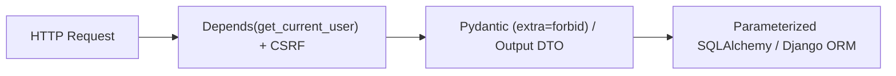

# ViperClaw Skill 38: FastAPI, Django & Flask Security Auditor (`viper-fastapi-django-flask`)

## 1. Standards & Open-Source Reference
- **Standards:** Bandit, Trail of Bits Python rules, Semgrep `p/fastapi`, `p/django`, `p/flask`, OWASP ASVS.
- **Focus:** Framework-specific authentication, ORM parameterization, serialization, and configuration auditing for Python web stacks.

---

## 2. Threat Model & Trust-Boundary Architecture



### Automated ViperClaw Command
```bash
viperclaw taint . --db .viperclaw/graph.db
```

---

## 3. Rapid Discovery Patterns
- **FastAPI:** `@app.post`, `@router.`, `Depends(`, `SQLAlchemy`, `text(`, `response_model=`.
- **Django:** `DEBUG =`, `ALLOWED_HOSTS`, `@csrf_exempt`, `.raw(`, `.extra(`, `RawSQL(`, `mark_safe`.
- **Flask:** `render_template_string`, `|safe`, `Markup(`, `session[`, `send_from_directory`.

---

## 4. Senior Security Engineer Technical Audit Checklist
1. **FastAPI Dependency Auth & Output Filtering:** Verify all protected routers declare `dependencies=[Depends(get_current_user)]` at the `APIRouter` level and every endpoint defines a strict `response_model` (excluding `hashed_password` / internal fields) plus `model_config = ConfigDict(extra="forbid")` on input models.
2. **Django ORM Escape Hatch Audit:** Audit every use of `.raw()`, `.extra()`, and `RawSQL()` to ensure parameters are passed via the `params=[]` argument rather than Python f-strings.
3. **Django & Flask CSRF / Debug Hardening:** Confirm `DEBUG = False`, non-wildcard `ALLOWED_HOSTS`, high-entropy `SECRET_KEY` loaded from environment, and verify any `@csrf_exempt` view enforces HMAC or Bearer token authentication.
4. **Jinja2 / Django Template Injection & XSS:** Never pass user input into `Flask.render_template_string()` or `jinja2.Template()` (SSTI); avoid `mark_safe()`, `Markup()`, and `|safe` unless sanitized with `nh3` / `bleach`.
5. **Async SQLAlchemy Session Isolation:** In FastAPI async routes, ensure `AsyncSession` instances are scoped per-request via `Depends(get_db)` and never shared across concurrent coroutines.

---

## 5. Production Remediation Patterns (Vulnerable vs. Hardened Code)
```python
# ❌ VULNERABLE: FastAPI route returns full ORM model & uses f-string in SQLAlchemy text()
@router.get("/users/{username}")
async def get_user(username: str, db: AsyncSession = Depends(get_db)):
    res = await db.execute(text(f"SELECT * FROM users WHERE username = '{username}'"))
    return res.mappings().first()

# ✅ HARDENED: Requires auth dependency, binds SQL parameters & filters output via response_model
@router.get("/users/me", response_model=UserPublicDTO)
async def get_user(current_user: User = Depends(get_current_active_user), db: AsyncSession = Depends(get_db)):
    stmt = select(User).where(User.id == current_user.id)
    return (await db.execute(stmt)).scalar_one()
```

---

## 6. False-Positive Elimination & CVSS v3.1 Triage Rubric

### False-Positive Elimination Gate
1. **Reachability & Boundary Check:** Confirm the flagged pattern or configuration is reachable across a trust boundary in production (not an isolated unit-test mock, build-time sample, or dead code path).
2. **Upstream Control Verification:** Check whether an upstream gateway, middleware, database policy, or compiler flag already neutralizes the weakness before marking a finding as verified.
3. **Standards Reference:** `Bandit, Trail of Bits Python, OWASP ASVS, CWE-89, CWE-915`

| Severity Tier | Baseline CVSS v3.1 Vector | Qualifying Security Impact |
| :--- | :--- | :--- |
| **CRITICAL (9.0–10.0)** | `CVSS:3.1/AV:N/AC:L/PR:N/UI:N/S:C/C:H/I:H/A:H` | Unauthenticated remote code execution, cross-tenant authentication or isolation gap, or direct theft of funds/keys. |
| **HIGH (7.0–8.9)** | `CVSS:3.1/AV:N/AC:L/PR:L/UI:N/S:U/C:H/I:H/A:N` | Authenticated privilege escalation, unauthorized sensitive data exposure, or single-request service outage. |
| **MEDIUM (4.0–6.9)** | `CVSS:3.1/AV:N/AC:L/PR:L/UI:R/S:C/C:L/I:L/A:N` | Scoped information disclosure, non-admin state mutation, or configuration weakness requiring user interaction. |
| **LOW (0.1–3.9)** | `CVSS:3.1/AV:N/AC:H/PR:H/UI:N/S:U/C:L/I:N/A:N` | Defense-in-depth hardening gap requiring high precondition complexity and minimal direct impact. |

---

## 7. Regression Testing & Continuous Verification
1. **Positive Functional Test:** Verify that legitimate callers and valid inputs continue to succeed after applying the hardened pattern.
2. **Negative Security Regression Test:** Write an automated unit/integration test confirming that the vulnerable input, unauthenticated call, or misconfiguration is deterministically rejected.
3. **Graph & SARIF Verification:** Run `viperclaw taint . --db .viperclaw/graph.db` and `viperclaw verify` to record the verified state in `.viperclaw/graph.db`.
