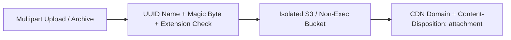

# File Upload, Archive Extraction & Object Storage Security Auditor (`viper-file-upload-storage`)

## 1. Executive Scope, Standards & CWE/OWASP Mapping
- **Frameworks & Standards:** OWASP File Upload Cheat Sheet, OWASP ASVS V12 (Files and Resources), Snyk Zip Slip Guide, CWE-434, CWE-22
- **Primary CWE Mapping:** CWE-434 (Unrestricted Upload of File with Dangerous Type), CWE-22 (Path Traversal / Zip Slip), CWE-79 (Stored XSS via SVG/HTML Upload)
- **ViperClaw MCP Tools:** `viper_taint_scan`, `viper_verify_and_report`
- **ViperClaw CLI Command:** `viperclaw taint ./src --db .viperclaw/graph.db`

---

## 2. Threat Model & Root-Cause Architecture



### Root-Cause Analysis
Applications trust `file.filename` (`../../var/www/html/shell.php`) or `file.content_type` (`image/png` header on a `.php`/`.svg`/`.html` file), store uploads inside the web root where the web server executes scripts or serves active HTML/SVG on the main application origin, or call `zip.extractall()` without checking archive member paths for `../` (Zip Slip).

---

## 3. Deterministic Discovery & Grep/AST Audit Commands

Run the following discovery commands across the target repository before manual code review:

```bash
# 1. Automated ViperClaw analysis
viperclaw taint ./src --db .viperclaw/graph.db

# 2. Rapid static pattern discovery (ripgrep)
rg -n "(UploadFile|request\.files|multer|move_uploaded_file|FormFile)"
rg -n "(zipfile\.ZipFile|tarfile\.open|extractall\()"
rg -n "(get_presigned_url|generate_presigned_post|putObject)"
```

---

## 4. Senior Security Engineer 8-Point Audit Checklist

| Control ID | Audit Verification Target | Pass Criteria | Fail / Vulnerability Indicator |
| :---: | :--- | :--- | :--- |
| `UPLD-01` | **CSPRNG UUID Filename Generation** | Server ignores client `filename` and generates a fresh ` f"{uuid.uuid4()}.{safe_ext}"` filename. | `os.path.join(UPLOAD_DIR, file.filename)` used directly (Path Traversal + extension mismatch). |
| `UPLD-02` | **Strict Extension Allowlist (No Double Extensions)** | Extension matched against a strict lowercase allowlist (`{'.png', '.jpg', '.webp', '.pdf'}`); blocks `.php`, `.phtml`, `.phar`, `.jsp`, `.aspx`, `.svg`, `.html`, `.js`. | Blacklist-only filter (`not filename.endswith('.php')`) circumvented via `.php5`, `.phtml`, `.PhP`, or `shell.php.jpg` on misconfigured Apache. |
| `UPLD-03` | **Magic-Byte & Image Re-Encoding Verification** | File header bytes verified via `libmagic` / `Pillow` (`Image.open().verify()`) and images re-encoded to strip EXIF metadata and embedded scripts. | Server only checks the client-supplied `Content-Type: image/jpeg` HTTP header. |
| `UPLD-04` | **SVG & HTML Stored XSS Prevention** | User-uploaded `.svg`, `.html`, and `.xml` files are rejected for inline rendering or served exclusively from a sandboxed static domain (`usercontent.example-cdn.com`). | Uploaded `.svg` containing `<script>fetch('/api/token')...</script>` served inline on the main app domain. |
| `UPLD-05` | **Zip Slip & Symlink Archive Extraction Guard** | Before extracting `zipfile` or `tarfile` members, every member path is resolved and verified with `.is_relative_to(dest_dir)` and symlinks/FIFOs are rejected (Python 3.12+ `tar.extractall(filter='data')`). | Unchecked `zip.extractall(dest)` or `tar.extractall(dest)` writes files to `../../../etc/cron.d/`. |
| `UPLD-06` | **Non-Executable Isolated Object Storage** | Uploads stored in S3/GCS (outside local filesystem) or in a directory with script execution disabled in Nginx/Apache. | Uploads written into `/var/www/html/uploads/` where PHP-FPM executes `.php` files. |
| `UPLD-07` | **Hardened Download Headers (`nosniff` + `attachment`)** | Downloaded files serve `X-Content-Type-Options: nosniff`, `Content-Disposition: attachment`, and `Content-Security-Policy: sandbox`. | Browser MIME-sniffs uploaded text/image file as executable HTML. |
| `UPLD-08` | **S3 Presigned POST Conditions & Size Caps** | S3 `generate_presigned_post` enforces exact key prefix (`uploads/${user_id}/`), `content-length-range` (e.g., `1..10485760`), and `Content-Type` conditions. | Unconstrained presigned PUT URL allows uploading 50GB files or overwriting other tenants' S3 keys. |

---

## 5. False-Positive Elimination & CVSS v3.1 Triage Rubric

### False-Positive Gate
1. Verify whether an upstream API Gateway, global middleware, or ORM hook already enforces the control before flagging a controller.
2. Confirm the code path is reachable from an external entrypoint (not dead code, CLI-only admin script, or unit-test fixture).

| Severity Tier | Baseline CVSS v3.1 Vector | Qualifying Security Impact |
| :--- | :--- | :--- |
| **CRITICAL (9.9)** | `CVSS:3.1/AV:N/AC:L/PR:L/UI:N/S:C/C:H/I:H/A:H` | Unrestricted executable upload (`.php`/`.jsp`/`.py`) or Zip Slip path traversal leading to RCE. |
| **HIGH (8.1)** | `CVSS:3.1/AV:N/AC:L/PR:L/UI:N/S:U/C:H/I:H/A:N` | S3 presigned key overwrite across tenants or arbitrary file overwrite via `filename` traversal. |
| **MEDIUM (6.1)** | `CVSS:3.1/AV:N/AC:L/PR:L/UI:R/S:C/C:L/I:L/A:N` | Stored XSS via uploaded `.svg` / `.html` served inline on the main origin. |

---

## 6. Production Remediation Patterns (Vulnerable vs. Hardened Code)

```python
# ❌ VULNERABLE: Trusts client filename & extracts zip archive without Zip Slip check
def handle_upload(upload_file, extract_dir: Path):
    dest = extract_dir / upload_file.filename
    upload_file.save(dest)
    with zipfile.ZipFile(dest) as zf:
        zf.extractall(extract_dir)

# ✅ HARDENED: UUID filename + Zip Slip member path confinement + size quota
def safe_extract_zip(zip_path: Path, extract_dir: Path, max_total_bytes: int = 50_000_000):
    root = extract_dir.resolve()
    total = 0
    with zipfile.ZipFile(zip_path) as zf:
        for info in zf.infolist():
            if info.is_dir():
                continue
            total += info.file_size
            if total > max_total_bytes:
                raise ValueError("Archive exceeds decompression quota (Zip Bomb guard)")
            target = (root / info.filename).resolve()
            if not target.is_relative_to(root):
                raise PermissionError(f"Blocked Zip Slip path traversal: {info.filename}")
            target.parent.mkdir(parents=True, exist_ok=True)
            with zf.open(info) as src, open(target, "wb") as dst:
                shutil.copyfileobj(src, dst)
```

---

## 7. Regression Testing & Continuous Verification
1. Write a **Positive Unit Test** confirming authorized, schema-valid requests succeed.
2. Write a **Negative Security Regression Test** confirming unauthorized, cross-tenant, or malformed inputs are deterministically rejected.
3. Re-run `viperclaw taint` and `viperclaw verify` to confirm zero remaining unmitigated flows in `.viperclaw/graph.db`.
