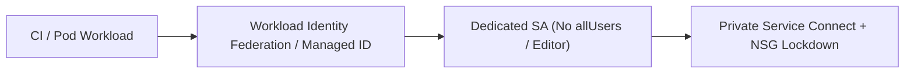

# ViperClaw Skill 49: GCP & Microsoft Azure Security Posture Auditor (`viper-gcp-azure-cloud-audit`)

## 1. Standards & Open-Source Reference
- **Standards:** CIS Google Cloud Platform & Microsoft Azure Foundations Benchmarks, NCC Group `ScoutSuite`, Prowler GCP/Azure.
- **Focus:** Auditing GCP IAM/GKE/Cloud Storage and Azure Entra ID/Managed Identities/Key Vault/NSGs.

---

## 2. Threat Model & Trust-Boundary Architecture



### Automated ViperClaw Command
```bash
viperclaw taint . --db .viperclaw/graph.db
```

---

## 3. Rapid Discovery Patterns
- **GCP:** `allUsers`, `allAuthenticatedUsers`, `iam.serviceAccountTokenCreator`, `iam.serviceAccountUser`, `google_service_account_key`.
- **Azure:** `allow_blob_public_access`, `enable_rbac_authorization`, `source_address_prefix = "*"`, `UserAssigned`, `SystemAssigned`.

---

## 4. Senior Security Engineer Technical Audit Checklist
1. **Eliminate Long-Lived Service Account Keys (Workload Identity Federation):** Flag `google_service_account_key` and Azure Service Principal client secrets; migrate CI/CD and multi-cloud workloads to **Workload Identity Federation (OIDC)** and **GKE Workload Identity / Azure Managed Identities**.
2. **GCP Default Compute Service Account & OAuth Scopes:** Never run GCE instances or GKE node pools under the default `PROJECT_NUMBER-compute@developer.gserviceaccount.com` account with `cloud-platform` full access scope; create dedicated least-privilege service accounts.
3. **Public IAM Bindings (`allUsers` / `allAuthenticatedUsers` / Anonymous Blob):** Audit Cloud Storage, BigQuery datasets, Cloud Run services, and Azure Storage Accounts to ensure `allUsers`, `allAuthenticatedUsers`, and `allow_nested_items_to_be_public` are disabled unless explicitly intended for public static assets.
4. **IAM Impersonation & Privilege Escalation Roles:** Audit bindings for `roles/iam.serviceAccountTokenCreator`, `roles/iam.serviceAccountKeyAdmin`, `roles/deploymentmanager.editor`, and Azure `Owner` / `User Access Administrator` at the subscription/project root.
5. **VPC Firewall & Azure NSG Segmentation:** Reject GCP firewall rules and Azure Network Security Groups allowing `0.0.0.0/0` ingress to management ports (`22`, `3389`, `6443`) or internal VPC subnets; enforce Cloud IAP / Azure Bastion and Private Service Connect / Private Endpoints.

---

## 5. Production Remediation Patterns (Vulnerable vs. Hardened Code)
```hcl
# ❌ VULNERABLE: Exports static GCP service account JSON key & binds Editor role
resource "google_service_account_key" "ci_key" {
  service_account_id = google_service_account.ci.name
}
resource "google_project_iam_member" "ci_editor" {
  project = var.project_id
  role    = "roles/editor"
  member  = "serviceAccount:${google_service_account.ci.email}"
}

# ✅ HARDENED: Keyless Workload Identity Pool + granular artifact registry role
resource "google_project_iam_member" "ci_Artifact_writer" {
  project = var.project_id
  role    = "roles/artifactregistry.writer"
  member  = "principalSet://iam.googleapis.com/${google_iam_workload_identity_pool.gh.name}/attribute.repository/${var.github_repo}"
}
```

---

## 6. False-Positive Elimination & CVSS v3.1 Triage Rubric

### False-Positive Elimination Gate
1. **Reachability & Boundary Check:** Confirm the flagged pattern or configuration is reachable across a trust boundary in production (not an isolated unit-test mock, build-time sample, or dead code path).
2. **Upstream Control Verification:** Check whether an upstream gateway, middleware, database policy, or compiler flag already neutralizes the weakness before marking a finding as verified.
3. **Standards Reference:** `CIS GCP & Azure Benchmarks, ScoutSuite, CWE-269, CWE-284`

| Severity Tier | Baseline CVSS v3.1 Vector | Qualifying Security Impact |
| :--- | :--- | :--- |
| **CRITICAL (9.0–10.0)** | `CVSS:3.1/AV:N/AC:L/PR:N/UI:N/S:C/C:H/I:H/A:H` | Unauthenticated remote code execution, cross-tenant authentication or isolation gap, or direct theft of funds/keys. |
| **HIGH (7.0–8.9)** | `CVSS:3.1/AV:N/AC:L/PR:L/UI:N/S:U/C:H/I:H/A:N` | Authenticated privilege escalation, unauthorized sensitive data exposure, or single-request service outage. |
| **MEDIUM (4.0–6.9)** | `CVSS:3.1/AV:N/AC:L/PR:L/UI:R/S:C/C:L/I:L/A:N` | Scoped information disclosure, non-admin state mutation, or configuration weakness requiring user interaction. |
| **LOW (0.1–3.9)** | `CVSS:3.1/AV:N/AC:H/PR:H/UI:N/S:U/C:L/I:N/A:N` | Defense-in-depth hardening gap requiring high precondition complexity and minimal direct impact. |

---

## 7. Regression Testing & Continuous Verification
1. **Positive Functional Test:** Verify that legitimate callers and valid inputs continue to succeed after applying the hardened pattern.
2. **Negative Security Regression Test:** Write an automated unit/integration test confirming that the vulnerable input, unauthenticated call, or misconfiguration is deterministically rejected.
3. **Graph & SARIF Verification:** Run `viperclaw taint . --db .viperclaw/graph.db` and `viperclaw verify` to record the verified state in `.viperclaw/graph.db`.
