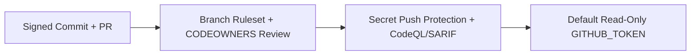

# ViperClaw Skill 58: GitHub Repository Governance & OpenSSF Scorecard Auditor (`viper-github-repo-governance`)

## 1. Standards & Open-Source Reference
- **Standards:** `ossf/scorecard` (OpenSSF Security Scorecard), SLSA Source Requirements, CIS GitHub Benchmark.
- **Focus:** Auditing GitHub repository settings, branch rulesets, `CODEOWNERS`, `SECURITY.md`, and Dependabot/CodeQL configurations.

---

## 2. Threat Model & Trust-Boundary Architecture



### Automated ViperClaw Command
```bash
viperclaw taint .github --db .viperclaw/graph.db
```

---

## 3. Rapid Discovery Patterns
- Inspect `.github/CODEOWNERS`, `.github/dependabot.yml`, `.github/workflows/codeql.yml`, `SECURITY.md`, and branch protection rulesets.

---

## 4. Senior Security Engineer Technical Audit Checklist
1. **Branch Rulesets & PR Review Enforcement:** Protect `main`/`master` and release branches with mandatory pull-request reviews (`required_approving_review_count >= 1`), `dismiss_stale_reviews_on_push = true`, `require_code_owner_review = true`, required status checks, and block force-pushes and branch deletions.
2. **Protected `.github/CODEOWNERS` Coverage:** Ensure `.github/CODEOWNERS` assigns security-team ownership to `.github/workflows/`, `Dockerfile*`, `terraform/`, authentication modules, and `CODEOWNERS` itself.
3. **Automated Dependabot, Secret Scanning & Push Protection:** Enable GitHub Secret Scanning with **Push Protection**, Dependabot security updates (`.github/dependabot.yml` covering both package ecosystems and `github-actions`), and CodeQL / ViperClaw SARIF code scanning.
4. **Commit Signing & Tag Protection:** Require cryptographic commit signing (GPG / SSH / Sigstore `gitsign`) on default branches and protect release tag patterns (`v*`) from modification or deletion by non-maintainers.
5. **GitHub Actions Organization Settings:** Configure default workflow permissions at the repository/org level to **Read repository contents and packages permissions** (`default_workflow_permissions: read`) and disable `can_approve_pull_request_reviews`.

---

## 5. Production Remediation Patterns (Vulnerable vs. Hardened Code)
```yaml
# ✅ HARDENED: .github/dependabot.yml covering both application dependencies & github-actions
version: 2
updates:
  - package-ecosystem: "pip"
    directory: "/"
    schedule:
      interval: "weekly"
  - package-ecosystem: "github-actions"
    directory: "/"
    schedule:
      interval: "weekly"
```

---

## 6. False-Positive Elimination & CVSS v3.1 Triage Rubric

### False-Positive Elimination Gate
1. **Reachability & Boundary Check:** Confirm the flagged pattern or configuration is reachable across a trust boundary in production (not an isolated unit-test mock, build-time sample, or dead code path).
2. **Upstream Control Verification:** Check whether an upstream gateway, middleware, database policy, or compiler flag already neutralizes the weakness before marking a finding as verified.
3. **Standards Reference:** `OpenSSF Scorecard, SLSA Source L3, CIS GitHub, CWE-284`

| Severity Tier | Baseline CVSS v3.1 Vector | Qualifying Security Impact |
| :--- | :--- | :--- |
| **CRITICAL (9.0–10.0)** | `CVSS:3.1/AV:N/AC:L/PR:N/UI:N/S:C/C:H/I:H/A:H` | Unauthenticated remote code execution, cross-tenant authentication or isolation gap, or direct theft of funds/keys. |
| **HIGH (7.0–8.9)** | `CVSS:3.1/AV:N/AC:L/PR:L/UI:N/S:U/C:H/I:H/A:N` | Authenticated privilege escalation, unauthorized sensitive data exposure, or single-request service outage. |
| **MEDIUM (4.0–6.9)** | `CVSS:3.1/AV:N/AC:L/PR:L/UI:R/S:C/C:L/I:L/A:N` | Scoped information disclosure, non-admin state mutation, or configuration weakness requiring user interaction. |
| **LOW (0.1–3.9)** | `CVSS:3.1/AV:N/AC:H/PR:H/UI:N/S:U/C:L/I:N/A:N` | Defense-in-depth hardening gap requiring high precondition complexity and minimal direct impact. |

---

## 7. Regression Testing & Continuous Verification
1. **Positive Functional Test:** Verify that legitimate callers and valid inputs continue to succeed after applying the hardened pattern.
2. **Negative Security Regression Test:** Write an automated unit/integration test confirming that the vulnerable input, unauthenticated call, or misconfiguration is deterministically rejected.
3. **Graph & SARIF Verification:** Run `viperclaw taint .github --db .viperclaw/graph.db` and `viperclaw verify` to record the verified state in `.viperclaw/graph.db`.
