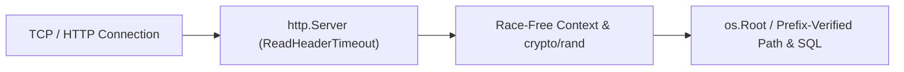

# ViperClaw Skill 40: Go (Golang) Microservice & Concurrency Auditor (`viper-go-service-audit`)

## 1. Standards & Open-Source Reference
- **Standards:** `securego/gosec`, Trail of Bits Go Semgrep rules (`p/golang`), Go Standard Library Security practices.
- **Focus:** Auditing Go HTTP services, database layers, concurrency primitives, and filesystem handlers.

---

## 2. Threat Model & Trust-Boundary Architecture



### Automated ViperClaw Command
```bash
viperclaw taint . --db .viperclaw/graph.db
```

---

## 3. Rapid Discovery Patterns
- Search for `http.ListenAndServe(`, `ReadHeaderTimeout`, `InsecureSkipVerify`, `math/rand`, `filepath.Join`, `fmt.Sprintf("SELECT`, `go func(`.

---

## 4. Senior Security Engineer Technical Audit Checklist
1. **HTTP Server Slowloris & Timeout Hardening:** Never call `http.ListenAndServe(addr, handler)` directly in production; instantiate `&http.Server{ReadHeaderTimeout: 5 * time.Second, ReadTimeout: 15 * time.Second, WriteTimeout: 30 * time.Second, IdleTimeout: 60 * time.Second, MaxHeaderBytes: 1 << 20}`.
2. **Goroutine Leak & Data Race Prevention:** Ensure every spawned goroutine binds to `ctx.Done()` with bounded channels, avoid capturing loop variables by reference in older Go versions, and verify `go test -race ./...` passes cleanly.
3. **Filesystem Traversal (`os.Root` / Prefix Verification):** Note that `filepath.Join(baseDir, userPath)` calls `filepath.Clean` and **strips** `baseDir` if `userPath` resolves to `../../etc/passwd`! Always verify `strings.HasPrefix(cleanTarget, cleanBase + string(os.PathSeparator))` or use Go 1.24+ `os.OpenRoot(baseDir)`.
4. **Cryptographic RNG & TLS Verification:** Replace `math/rand` with `crypto/rand` for all security-sensitive values, and forbid `tls.Config{InsecureSkipVerify: true}` and TLS < 1.2.
5. **Defer & Transaction Rollback Safety:** Ensure `defer rows.Close()` and `defer tx.Rollback()` are called immediately after error checks so database connections are never leaked on early returns.

---

## 5. Production Remediation Patterns (Vulnerable vs. Hardened Code)
```go
// ❌ VULNERABLE: Default http.ListenAndServe has zero timeouts (Slowloris DoS)
log.Fatal(http.ListenAndServe(":8080", mux))

// ✅ HARDENED: Explicit timeouts and header caps
srv := &http.Server{
    Addr:              ":8080",
    Handler:           mux,
    ReadHeaderTimeout: 5 * time.Second,
    ReadTimeout:       15 * time.Second,
    WriteTimeout:      30 * time.Second,
    IdleTimeout:       60 * time.Second,
}
log.Fatal(srv.ListenAndServe())
```

---

## 6. False-Positive Elimination & CVSS v3.1 Triage Rubric

### False-Positive Elimination Gate
1. **Reachability & Boundary Check:** Confirm the flagged pattern or configuration is reachable across a trust boundary in production (not an isolated unit-test mock, build-time sample, or dead code path).
2. **Upstream Control Verification:** Check whether an upstream gateway, middleware, database policy, or compiler flag already neutralizes the weakness before marking a finding as verified.
3. **Standards Reference:** `securego/gosec, Trail of Bits Go, CWE-400, CWE-22, CWE-362`

| Severity Tier | Baseline CVSS v3.1 Vector | Qualifying Security Impact |
| :--- | :--- | :--- |
| **CRITICAL (9.0–10.0)** | `CVSS:3.1/AV:N/AC:L/PR:N/UI:N/S:C/C:H/I:H/A:H` | Unauthenticated remote code execution, cross-tenant authentication or isolation gap, or direct theft of funds/keys. |
| **HIGH (7.0–8.9)** | `CVSS:3.1/AV:N/AC:L/PR:L/UI:N/S:U/C:H/I:H/A:N` | Authenticated privilege escalation, unauthorized sensitive data exposure, or single-request service outage. |
| **MEDIUM (4.0–6.9)** | `CVSS:3.1/AV:N/AC:L/PR:L/UI:R/S:C/C:L/I:L/A:N` | Scoped information disclosure, non-admin state mutation, or configuration weakness requiring user interaction. |
| **LOW (0.1–3.9)** | `CVSS:3.1/AV:N/AC:H/PR:H/UI:N/S:U/C:L/I:N/A:N` | Defense-in-depth hardening gap requiring high precondition complexity and minimal direct impact. |

---

## 7. Regression Testing & Continuous Verification
1. **Positive Functional Test:** Verify that legitimate callers and valid inputs continue to succeed after applying the hardened pattern.
2. **Negative Security Regression Test:** Write an automated unit/integration test confirming that the vulnerable input, unauthenticated call, or misconfiguration is deterministically rejected.
3. **Graph & SARIF Verification:** Run `viperclaw taint . --db .viperclaw/graph.db` and `viperclaw verify` to record the verified state in `.viperclaw/graph.db`.
