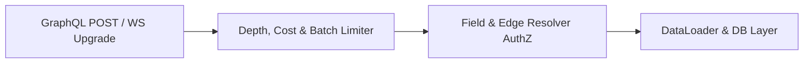

# GraphQL Schema, Resolver AuthZ & WebSocket Security Auditor (`viper-graphql-ws`)

## 1. Executive Scope, Standards & CWE/OWASP Mapping
- **Frameworks & Standards:** OWASP GraphQL Cheat Sheet, OWASP WSTG-APIT-02, OWASP WebSocket Security Cheat Sheet, CWE-400, CWE-285
- **Primary CWE Mapping:** CWE-400 (Uncontrolled Resource Consumption via Deep/Batched Queries), CWE-285 (Improper Resolver Authorization), CWE-1385 (Missing Origin Validation in WebSockets / CSWSH)
- **ViperClaw MCP Tools:** `viper_graphql_scan`, `viper_diff_oracle`, `viper_verify_and_report`
- **ViperClaw CLI Command:** `viperclaw graphql https://api.example.com/graphql --output gql_audit.json`

---

## 2. Threat Model & Root-Cause Architecture



### Root-Cause Analysis
GraphQL exposes a single HTTP endpoint where clients dictate the query structure; without per-resolver authorization, query depth/cost caps, and batching limits, untrusted callers traverse deep circular object edges (`user -> org -> members -> org`) or batch thousands of mutations in one HTTP request.

---

## 3. Deterministic Discovery & Grep/AST Audit Commands

Run the following discovery commands across the target repository before manual code review:

```bash
# 1. Automated ViperClaw analysis
viperclaw graphql https://api.example.com/graphql --output gql_audit.json

# 2. Rapid static pattern discovery (ripgrep)
rg -n "(ApolloServer|GraphQLSchema|graphene\.|strawberry\.|ariadne)"
rg -n "(introspection\s*:|NoIntrospection|depthLimit|costAnalysis)"
rg -n "(WebSocketServer|ws\.on\(|@WebSocketGateway|accept\(\))"
```

---

## 4. Senior Security Engineer 8-Point Audit Checklist

| Control ID | Audit Verification Target | Pass Criteria | Fail / Vulnerability Indicator |
| :---: | :--- | :--- | :--- |
| `GQL-01` | **Production Introspection & Clairvoyance Control** | Introspection (`__schema`, `__type`) and verbose `'Did you mean...?'` field suggestions disabled in production for unprivileged callers. | Full schema or field-suggestion hints exposed on production `/graphql`. |
| `GQL-02` | **Query Depth & Cyclical Edge Limit** | `graphql-depth-limit` (e.g., `max_depth = 7`) enforced before query execution. | Circular relationships (`User -> Posts -> Author -> Posts`) queryable to depth 50+ causing CPU/DB exhaustion. |
| `GQL-03` | **Alias & Array Batching Caps** | JSON array batching (`[{query}, ...]`) and field alias count per operation capped (e.g., `<= 10` aliases). | 1,000 `login` or `verifyOtp` mutations batched via aliases in a single HTTP request, circumventing per-request rate limits. |
| `GQL-04` | **Field & Edge-Level Authorization** | Every object resolver (`User.email`, `Organization.billing`, nested edges) checks caller permissions. | Auth checked only on top-level `Query` while nested edges leak cross-tenant fields. |
| `GQL-05` | **Persisted Queries / Operation Allowlisting** | Production first-party apps use Automatic Persisted Queries (APQ) or strict operation allowlists. | Arbitrary ad-hoc GraphQL ASTs accepted from untrusted clients. |
| `GQL-06` | **WebSocket Handshake `Origin` Validation (CSWSH)** | WebSocket `Upgrade` handler strictly validates the `Origin` header against an exact allowlist. | Cookie-authenticated WebSocket accepts connections from any `Origin` (Cross-Site WebSocket reuse / CSWSH). |
| `GQL-07` | **WebSocket Subscription Tenant Scoping** | `graphql-ws` / Socket.IO subscription channels verify caller authorization for the subscribed topic/tenant ID. | Any connected client can subscribe to `orderUpdated(orgId: "other_org")`. |
| `GQL-08` | **Error Masking in Resolvers** | Unhandled resolver exceptions are masked (`formatError`) so SQL errors and internal paths are not returned in `errors[].extensions`. | Raw stack traces and database constraint errors exposed in GraphQL `errors` array. |

---

## 5. False-Positive Elimination & CVSS v3.1 Triage Rubric

### False-Positive Gate
1. Verify whether an upstream API Gateway, global middleware, or ORM hook already enforces the control before flagging a controller.
2. Confirm the code path is reachable from an external entrypoint (not dead code, CLI-only admin script, or unit-test fixture).

| Severity Tier | Baseline CVSS v3.1 Vector | Qualifying Security Impact |
| :--- | :--- | :--- |
| **HIGH (8.1)** | `CVSS:3.1/AV:N/AC:L/PR:L/UI:N/S:U/C:H/I:H/A:N` | Missing nested resolver authorization allowing cross-tenant data access or mutation. |
| **HIGH (7.5)** | `CVSS:3.1/AV:N/AC:L/PR:N/UI:N/S:U/C:N/I:N/A:H` | Uncapped alias amplification or recursive depth bomb causing single-request service outage. |
| **MEDIUM (6.5)** | `CVSS:3.1/AV:N/AC:L/PR:N/UI:R/S:U/C:H/I:N/A:N` | Cross-Site WebSocket origin validation gap (CSWSH) due to missing `Origin` validation on cookie-authenticated WS. |

---

## 6. Production Remediation Patterns (Vulnerable vs. Hardened Code)

```typescript
// ❌ VULNERABLE: Introspection enabled, no depth/alias limits, and WS accepts any Origin
const server = new ApolloServer({
  typeDefs,
  resolvers,
  introspection: true,
});

// ✅ HARDENED: Disables introspection in prod, enforces depth/alias caps & masks internal errors
import depthLimit from "graphql-depth-limit";
const server = new ApolloServer({
  typeDefs,
  resolvers,
  introspection: process.env.NODE_ENV !== "production",
  validationRules: [depthLimit(6)],
  formatError: (formattedError) => ({
    message: formattedError.message,
    code: formattedError.extensions?.code || "INTERNAL_ERROR",
  }),
});
```

---

## 7. Regression Testing & Continuous Verification
1. Write a **Positive Unit Test** confirming authorized, schema-valid requests succeed.
2. Write a **Negative Security Regression Test** confirming unauthorized, cross-tenant, or malformed inputs are deterministically rejected.
3. Re-run `viperclaw taint` and `viperclaw verify` to confirm zero remaining unmitigated flows in `.viperclaw/graph.db`.
