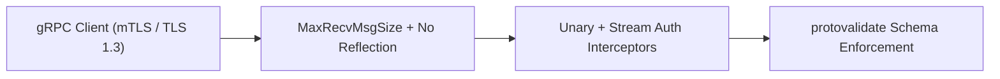

# ViperClaw Skill 45: gRPC, Protobuf & Internal RPC Security Auditor (`viper-grpc-protobuf-audit`)

## 1. Standards & Open-Source Reference
- **Standards:** OWASP gRPC Security Cheat Sheet, Semgrep gRPC rules, Protobuf `protovalidate` / `protoc-gen-validate`.
- **Focus:** Auditing gRPC servers/clients across Go, Rust (`tonic`), Python (`grpcio`), Node.js, and Java.

---

## 2. Threat Model & Trust-Boundary Architecture



### Automated ViperClaw Command
```bash
viperclaw taint . --db .viperclaw/graph.db
```

---

## 3. Rapid Discovery Patterns
- Search for `grpc.WithInsecure()`, `insecure.NewCredentials()`, `grpc.insecure_channel`, `reflection.Register(`, `UnaryInterceptor`, `StreamInterceptor`, `MaxRecvMsgSize`.

---

## 4. Senior Security Engineer Technical Audit Checklist
1. **Mutual TLS (mTLS) Transport Security:** Forbid `grpc.WithInsecure()`, `insecure.NewCredentials()`, and `grpc.insecure_channel` in production; require TLS 1.3 or SPIFFE mTLS credentials for all service-to-service channels.
2. **Both Unary & Stream Auth Interceptors:** A common flaw is registering a `UnaryInterceptor` for authentication while forgetting `StreamInterceptor`, leaving bidirectional or server-streaming RPCs unauthenticated. Always register both!
3. **Protobuf Field Validation (`protovalidate`):** Protobuf wire types enforce data types (`int64`, `string`) but **do not** validate bounds, UUID formats, or negative numbers; enforce `bufbuild/protovalidate` rules in the server interceptor.
4. **Message Size & Concurrency Quotas:** Configure explicit `MaxRecvMsgSize` (e.g., 4 MB), `MaxSendMsgSize`, and `MaxConcurrentStreams` to prevent memory exhaustion DoS.
5. **Disable Unauthenticated gRPC Reflection & Channelz:** Disable `reflection.Register(s)` and `channelz` in production environments so internal service definitions and method names are not publicly enumerable.

---

## 5. Production Remediation Patterns (Vulnerable vs. Hardened Code)
```go
// ❌ VULNERABLE: Only UnaryInterceptor registered; streaming RPCs omit auth & reflection is enabled
s := grpc.NewServer(grpc.UnaryInterceptor(authUnaryInterceptor))
reflection.Register(s)

// ✅ HARDENED: TLS credentials + both Unary and Stream auth interceptors + message size cap
s := grpc.NewServer(
    grpc.Creds(tlsCreds),
    grpc.MaxRecvMsgSize(4 * 1024 * 1024),
    grpc.UnaryInterceptor(authUnaryInterceptor),
    grpc.StreamInterceptor(authStreamInterceptor),
)
```

---

## 6. False-Positive Elimination & CVSS v3.1 Triage Rubric

### False-Positive Elimination Gate
1. **Reachability & Boundary Check:** Confirm the flagged pattern or configuration is reachable across a trust boundary in production (not an isolated unit-test mock, build-time sample, or dead code path).
2. **Upstream Control Verification:** Check whether an upstream gateway, middleware, database policy, or compiler flag already neutralizes the weakness before marking a finding as verified.
3. **Standards Reference:** `OWASP gRPC Cheat Sheet, protovalidate, CWE-306, CWE-400`

| Severity Tier | Baseline CVSS v3.1 Vector | Qualifying Security Impact |
| :--- | :--- | :--- |
| **CRITICAL (9.0–10.0)** | `CVSS:3.1/AV:N/AC:L/PR:N/UI:N/S:C/C:H/I:H/A:H` | Unauthenticated remote code execution, cross-tenant authentication or isolation gap, or direct theft of funds/keys. |
| **HIGH (7.0–8.9)** | `CVSS:3.1/AV:N/AC:L/PR:L/UI:N/S:U/C:H/I:H/A:N` | Authenticated privilege escalation, unauthorized sensitive data exposure, or single-request service outage. |
| **MEDIUM (4.0–6.9)** | `CVSS:3.1/AV:N/AC:L/PR:L/UI:R/S:C/C:L/I:L/A:N` | Scoped information disclosure, non-admin state mutation, or configuration weakness requiring user interaction. |
| **LOW (0.1–3.9)** | `CVSS:3.1/AV:N/AC:H/PR:H/UI:N/S:U/C:L/I:N/A:N` | Defense-in-depth hardening gap requiring high precondition complexity and minimal direct impact. |

---

## 7. Regression Testing & Continuous Verification
1. **Positive Functional Test:** Verify that legitimate callers and valid inputs continue to succeed after applying the hardened pattern.
2. **Negative Security Regression Test:** Write an automated unit/integration test confirming that the vulnerable input, unauthenticated call, or misconfiguration is deterministically rejected.
3. **Graph & SARIF Verification:** Run `viperclaw taint . --db .viperclaw/graph.db` and `viperclaw verify` to record the verified state in `.viperclaw/graph.db`.
