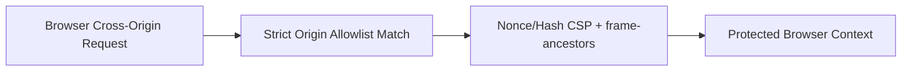

# HTTP Security Headers, CSP & CORS Configuration Auditor (`viper-headers-csp-cors`)

## 1. Executive Scope, Standards & CWE/OWASP Mapping
- **Frameworks & Standards:** OWASP Secure Headers Project, W3C Content Security Policy Level 3, Fetch Standard (CORS), CWE-942, CWE-1021
- **Primary CWE Mapping:** CWE-942 (Overly Permissive Cross-domain Whitelist / CORS), CWE-1021 (Improper Restriction of Rendered UI Layers / Clickjacking), CWE-693
- **ViperClaw MCP Tools:** `viper_fingerprint_traffic`, `viper_verify_and_report`
- **ViperClaw CLI Command:** `viperclaw fingerprint ./traffic.har --output headers_audit.json`

---

## 2. Threat Model & Root-Cause Architecture



### Root-Cause Analysis
Permissive configurations weaken browser Same-Origin Policy protections by reflecting the incoming `Origin` header into `Access-Control-Allow-Origin` alongside `Access-Control-Allow-Credentials: true`, or weaken CSP with `'unsafe-inline'`, `'unsafe-eval'`, and broad CDN wildcards.

---

## 3. Deterministic Discovery & Grep/AST Audit Commands

Run the following discovery commands across the target repository before manual code review:

```bash
# 1. Automated ViperClaw analysis
viperclaw fingerprint ./traffic.har --output headers_audit.json

# 2. Rapid static pattern discovery (ripgrep)
rg -n "(Access-Control-Allow-Origin|Access-Control-Allow-Credentials|CORSMiddleware|cors\()"
rg -n "(Content-Security-Policy|unsafe-inline|unsafe-eval|frame-ancestors)"
rg -n "(Strict-Transport-Security|X-Frame-Options|X-Content-Type-Options|Referrer-Policy)"
```

---

## 4. Senior Security Engineer 8-Point Audit Checklist

| Control ID | Audit Verification Target | Pass Criteria | Fail / Vulnerability Indicator |
| :---: | :--- | :--- | :--- |
| `HDR-01` | **Zero Arbitrary CORS Origin Reflection** | When `Access-Control-Allow-Credentials: true` is present, `Access-Control-Allow-Origin` is validated against an exact-match set of trusted origins. | Server reflects `req.headers.origin` or uses regex `.endswith('example.com')` (matched improperly by `evilexample.com`). |
| `HDR-02` | **Block `Origin: null` in Credentialed CORS** | `Origin: null` is never allowed on credentialed endpoints. | `Access-Control-Allow-Origin: null` + `Allow-Credentials: true` (reachable via sandboxed `<iframe sandbox>`). |
| `HDR-03` | **Vary: Origin Shared-Cache Isolation** | Dynamic `Access-Control-Allow-Origin` responses always include `Vary: Origin`. | Missing `Vary: Origin` causes CDN to cache Origin A's CORS header and serve it to Origin B. |
| `HDR-04` | **CSP `script-src` Hardening (No `unsafe-inline`/`eval`)** | CSP uses cryptographic nonces (`'nonce-...'`) + `'strict-dynamic'` or hashes, with `object-src 'none'` and `base-uri 'self'`. | `script-src * 'unsafe-inline' 'unsafe-eval' data:` rendering CSP ineffective against XSS. |
| `HDR-05` | **Clickjacking Defense (`frame-ancestors` & `X-Frame-Options`)** | CSP includes `frame-ancestors 'none'` (or `'self'`) paired with `X-Frame-Options: DENY` on HTML routes. | Authenticated state-changing UI pages frameable by external origins. |
| `HDR-06` | **HSTS Preload Readiness** | `Strict-Transport-Security: max-age=63072000; includeSubDomains; preload` served over HTTPS. | `max-age` < 1 year (`31536000`) or missing `includeSubDomains`. |
| `HDR-07` | **Referrer-Policy & Permissions-Policy** | `Referrer-Policy: strict-origin-when-cross-origin` (or `no-referrer`) and `Permissions-Policy: camera=(), microphone=(), geolocation=()` set. | `unsafe-url` referrer policy leaking sensitive URL paths/tokens to third-party links. |
| `HDR-08` | **Cross-Origin Isolation Headers (`COOP` / `CORP`)** | `Cross-Origin-Opener-Policy: same-origin` and `Cross-Origin-Resource-Policy: same-origin` configured. | Window references retained across cross-origin popups (`window.opener` tabnabbing). |

---

## 5. False-Positive Elimination & CVSS v3.1 Triage Rubric

### False-Positive Gate
1. Verify whether an upstream API Gateway, global middleware, or ORM hook already enforces the control before flagging a controller.
2. Confirm the code path is reachable from an external entrypoint (not dead code, CLI-only admin script, or unit-test fixture).

| Severity Tier | Baseline CVSS v3.1 Vector | Qualifying Security Impact |
| :--- | :--- | :--- |
| **HIGH (8.1)** | `CVSS:3.1/AV:N/AC:L/PR:N/UI:R/S:U/C:H/I:H/A:N` | Reflected `Access-Control-Allow-Origin` + `Allow-Credentials: true` on authenticated API leaking tokens/PII. |
| **MEDIUM (6.1)** | `CVSS:3.1/AV:N/AC:L/PR:N/UI:R/S:C/C:L/I:L/A:N` | Clickjacking on sensitive account-settings UI due to missing `frame-ancestors` / `X-Frame-Options`. |
| **LOW (3.7)** | `CVSS:3.1/AV:N/AC:H/PR:N/UI:R/S:U/C:L/I:N/A:N` | Permissive `Referrer-Policy` or missing `Vary: Origin` header. |

---

## 6. Production Remediation Patterns (Vulnerable vs. Hardened Code)

```python
# ❌ VULNERABLE: FastAPI CORSMiddleware with wildcard origin reflection + allow_credentials=True
app.add_middleware(
    CORSMiddleware,
    allow_origin_regex=r"https://.*example\.com",  # Matches https://evilexample.com!
    allow_credentials=True,
    allow_methods=["*"],
    allow_headers=["*"],
)

# ✅ HARDENED: Exact-match origin allowlist + restricted methods and headers
app.add_middleware(
    CORSMiddleware,
    allow_origins=["https://app.example.com", "https://admin.example.com"],
    allow_credentials=True,
    allow_methods=["GET", "POST", "PUT", "DELETE"],
    allow_headers=["Authorization", "Content-Type", "X-CSRF-Token"],
)
```

---

## 7. Regression Testing & Continuous Verification
1. Write a **Positive Unit Test** confirming authorized, schema-valid requests succeed.
2. Write a **Negative Security Regression Test** confirming unauthorized, cross-tenant, or malformed inputs are deterministically rejected.
3. Re-run `viperclaw taint` and `viperclaw verify` to confirm zero remaining unmitigated flows in `.viperclaw/graph.db`.
