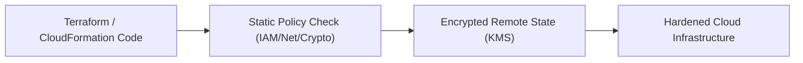

# Infrastructure-as-Code (Terraform, CloudFormation & Pulumi) Auditor (`viper-iac-terraform-audit`)

## 1. Executive Scope, Standards & CWE/OWASP Mapping
- **Frameworks & Standards:** Checkov / Trivy IaC / tfsec Rulesets, CIS Cloud Foundations Benchmarks, CWE-284, CWE-311
- **Primary CWE Mapping:** CWE-284 (Overly Permissive Security Groups / Public Buckets), CWE-311 (Missing Encryption of Sensitive Cloud Storage), CWE-798 (Plaintext Secrets in Terraform State)
- **ViperClaw MCP Tools:** `viper_taint_scan`, `viper_verify_and_report`
- **ViperClaw CLI Command:** `viperclaw taint ./terraform --db .viperclaw/graph.db`

---

## 2. Threat Model & Root-Cause Architecture



### Root-Cause Analysis
IaC templates often copy quickstart defaults—setting `0.0.0.0/0` on security groups, omitting `storage_encrypted = true` on RDS/EBS, leaving S3 buckets without public access blocks, or storing plaintext secrets in unencrypted `.tfstate` files.

---

## 3. Deterministic Discovery & Grep/AST Audit Commands

Run the following discovery commands across the target repository before manual code review:

```bash
# 1. Automated ViperClaw analysis
viperclaw taint ./terraform --db .viperclaw/graph.db

# 2. Rapid static pattern discovery (ripgrep)
rg -n "cidr_blocks\s*=\s*\[.*0\.0\.0\.0/0" *.tf
rg -n "publicly_accessible\s*=\s*true|acl\s*=\s*.public-read." *.tf
rg -n "encrypted\s*=\s*false|storage_encrypted\s*=\s*false" *.tf
```

---

## 4. Senior Security Engineer 8-Point Audit Checklist

| Control ID | Audit Verification Target | Pass Criteria | Fail / Vulnerability Indicator |
| :---: | :--- | :--- | :--- |
| `IAC-01` | **Zero Wide-Open Admin/DB Ingress (`0.0.0.0/0`)** | Security groups never allow `0.0.0.0/0` or `::/0` on SSH (`22`), RDP (`3389`), PostgreSQL (`5432`), MySQL (`3306`), Redis (`6379`), or K8s (`6443`). | Database or bastion security group open to `0.0.0.0/0`. |
| `IAC-02` | **Private Subnet Placement for Data Stores** | `aws_db_instance`, ElastiCache, and OpenSearch set `publicly_accessible = false` inside private subnets. | `publicly_accessible = true` set on production RDS instance. |
| `IAC-03` | **Encryption at Rest (KMS CMK)** | `encrypted = true` / `storage_encrypted = true` enabled across EBS volumes, RDS, S3, DynamoDB, SQS, and SNS. | Unencrypted EBS snapshots or RDS storage. |
| `IAC-04` | **Storage Bucket Public Access Lockdown** | `aws_s3_bucket_public_access_block` sets all 4 block flags to `true`; `acl = "public-read"` forbidden. | Public S3/GCS bucket exposing backups, logs, or user uploads. |
| `IAC-05` | **IAM Policy Wildcard Elimination** | No IAM policy documents contain `"Action": "*"` and `"Resource": "*"`. | Terraform provisioning administrative `*:*` roles for application workloads. |
| `IAC-06` | **Terraform State Security & `sensitive = true`** | Remote state backend (`s3`/`gcs`) enforces KMS encryption and locking; secret outputs mark `sensitive = true`. | Local `terraform.tfstate` committed to Git or stored in an unencrypted bucket. |
| `IAC-07` | **VPC Flow Logs & CloudTrail Audit Logging** | Multi-region CloudTrail with log file validation (`enable_log_file_validation = true`) and VPC Flow Logs enabled. | Cloud environment deployed without audit trail or network flow logging. |
| `IAC-08` | **Deletion Protection & Backup Retention** | Production databases and KMS keys enable `deletion_protection = true` and `backup_retention_period >= 7`. | Single `terraform destroy` or accidental drift can permanently wipe production databases. |

---

## 5. False-Positive Elimination & CVSS v3.1 Triage Rubric

### False-Positive Gate
1. Verify whether an upstream API Gateway, global middleware, or ORM hook already enforces the control before flagging a controller.
2. Confirm the code path is reachable from an external entrypoint (not dead code, CLI-only admin script, or unit-test fixture).

| Severity Tier | Baseline CVSS v3.1 Vector | Qualifying Security Impact |
| :--- | :--- | :--- |
| **CRITICAL (9.8)** | `CVSS:3.1/AV:N/AC:L/PR:N/UI:N/S:U/C:H/I:H/A:H` | `terraform.tfstate` committed to repo or RDS/Redis exposed to `0.0.0.0/0` with `publicly_accessible = true`. |
| **HIGH (7.5)** | `CVSS:3.1/AV:N/AC:L/PR:N/UI:N/S:U/C:H/I:N/A:N` | Publicly readable S3/GCS bucket or wildcard `*:*` IAM workload role. |
| **MEDIUM (5.3)** | `CVSS:3.1/AV:N/AC:L/PR:N/UI:N/S:U/C:L/I:N/A:N` | Missing KMS encryption at rest on EBS/RDS or disabled CloudTrail log validation. |

---

## 6. Production Remediation Patterns (Vulnerable vs. Hardened Code)

```hcl
# ❌ VULNERABLE: Publicly accessible unencrypted RDS instance
resource "aws_db_instance" "prod" {
  engine              = "postgres"
  instance_class      = "db.t4g.medium"
  publicly_accessible = true
  storage_encrypted   = false
}

# ✅ HARDENED: Private subnet only, KMS encrypted, IAM DB auth & deletion protection enabled
resource "aws_db_instance" "prod" {
  engine                              = "postgres"
  instance_class                      = "db.t4g.medium"
  publicly_accessible                 = false
  storage_encrypted                   = true
  kms_key_id                          = aws_kms_key.db.arn
  iam_database_authentication_enabled = true
  deletion_protection                 = true
  backup_retention_period             = 14
}
```

---

## 7. Regression Testing & Continuous Verification
1. Write a **Positive Unit Test** confirming authorized, schema-valid requests succeed.
2. Write a **Negative Security Regression Test** confirming unauthorized, cross-tenant, or malformed inputs are deterministically rejected.
3. Re-run `viperclaw taint` and `viperclaw verify` to confirm zero remaining unmitigated flows in `.viperclaw/graph.db`.
