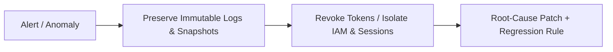

# Cloud & Application Security Incident Triage & Containment Auditor (`viper-incident-forensics-triage`)

## 1. Executive Scope, Standards & CWE/OWASP Mapping
- **Frameworks & Standards:** NIST SP 800-61 Rev. 3 (Incident Response), Cloud Security Alliance (CSA) Incident Response Guide
- **Primary CWE Mapping:** CWE-778 (Insufficient Logging), CWE-613 (Insufficient Session Expiration), CWE-798 (Exposed Credentials)
- **ViperClaw MCP Tools:** `viper_secrets_scan`, `viper_iac_audit`, `viper_taint_scan`, `viper_verify_and_report`
- **ViperClaw CLI Command:** `viperclaw secrets . && viperclaw iac . && viperclaw taint .`

---

## 2. Threat Model & Root-Cause Architecture



### Root-Cause Analysis
Incident response stalls when teams rotate a leaked key without revoking active sessions/refresh tokens, overwrite volatile logs before capturing evidence, or miss secondary persistence vectors (new IAM users, OAuth app grants, SSH keys, or CI workflow edits).

---

## 3. Deterministic Discovery & Grep/AST Audit Commands

```bash
# 1. Scan repository for exposed secrets and misconfigured CI/IaC
viperclaw secrets .
viperclaw iac .

# 2. Audit recent high-risk commits across auth, IAM, and CI files
git log --since="14 days ago" --stat -- .github/ terraform/ auth/
```

---

## 4. Senior Security Engineer 8-Point Audit Checklist

| Control ID | Audit Verification Target | Pass Criteria | Fail / Vulnerability Indicator |
| :---: | :--- | :--- | :--- |
| `IR-01` | **Evidence Preservation First** | CloudTrail, audit logs, container stdout, and DB query logs are exported to immutable storage before remediation alters state. | Hosts terminated or logs overwritten before timeline reconstruction. |
| `IR-02` | **Full Credential & Session Revocation** | Rotating a compromised key also invalidates active JWT signing keys, refresh tokens, and OAuth grants. | Old sessions remain valid after password or API key rotation. |
| `IR-03` | **Blast-Radius & Principal Enumeration** | Audit all actions by affected IAM roles, service accounts, and API tokens over the full exposure window. | Only the initial alert timestamp is checked without reviewing earlier access. |
| `IR-04` | **Persistence Mechanism Sweep** | Verify no unauthorized IAM access keys, GitHub deploy keys, webhooks, or CI workflow triggers were added. | Secondary access key or rogue webhook left active after containment. |
| `IR-05` | **Git History & Artifact Scrubbing** | Leaked credentials are rotated immediately (assuming compromise) and blocked via pre-commit secret scanning. | Secret only deleted in a new commit while still valid and present in Git history. |
| `IR-06` | **Root-Cause Code & Config Fix** | Underlying vulnerability (taint sink, IAM wildcard, missing auth check) is patched before re-enabling service. | Service restarted without closing the entry vector. |
| `IR-07` | **Detection Rule & Regression Test** | New CI guardrail (`viperclaw secrets`, Semgrep rule, or CloudWatch alarm) prevents recurrence. | Incident closed with manual runbook note only. |
| `IR-08` | **Blameless Postmortem & Timeline** | Document exact UTC timeline, affected assets, root cause, and tracked remediation tickets. | Incomplete handoff or unowned follow-up actions. |

---

## 5. False-Positive Elimination & CVSS v3.1 Triage Rubric

### False-Positive Gate
1. Correlate anomalous IPs/principals against authorized CI runners, health checks, and scheduled automation.
2. Verify exact UTC timestamps across edge proxy, application, and cloud audit logs.

| Severity Tier | Baseline CVSS v3.1 Vector | Qualifying Security Impact |
| :--- | :--- | :--- |
| **CRITICAL (9.8)** | `CVSS:3.1/AV:N/AC:L/PR:N/UI:N/S:U/C:H/I:H/A:H` | Active compromise of production cloud IAM credentials, signing keys, or customer database. |
| **HIGH (7.5)** | `CVSS:3.1/AV:N/AC:L/PR:L/UI:N/S:U/C:H/I:N/A:N` | Confirmed exposure of scoped service tokens or non-admin tenant records. |
| **MEDIUM (5.3)** | `CVSS:3.1/AV:N/AC:L/PR:L/UI:N/S:U/C:L/I:N/A:N` | Insufficient audit logging preventing timeline reconstruction. |

---

## 6. Production Remediation Patterns (Vulnerable vs. Hardened Code)

```python
# ✅ HARDENED: Atomic session & refresh-token revocation on security incident / password reset
def revoke_all_user_sessions(user_id: str, db_session) -> None:
    db_session.execute(
        "UPDATE refresh_tokens SET revoked_at = NOW() WHERE user_id = %s AND revoked_at IS NULL",
        (user_id,),
    )
    db_session.execute(
        "UPDATE users SET token_version = token_version + 1 WHERE id = %s",
        (user_id,),
    )
    db_session.commit()
```

---

## 7. Regression Testing & Continuous Verification
1. Verify revoked tokens and rotated keys are immediately rejected (`401`) in integration tests.
2. Re-run `viperclaw secrets .`, `viperclaw iac .`, and `viperclaw taint .` to confirm clean posture.
3. Archive the verified SARIF 2.1.0 report and postmortem checklist.
