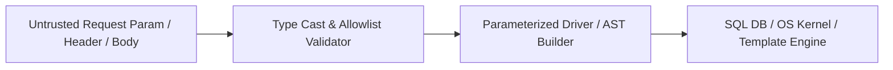

# SQL, NoSQL, Command & Template Injection Parameterization Auditor (`viper-injection-oracle`)

## 1. Executive Scope, Standards & CWE/OWASP Mapping
- **Frameworks & Standards:** OWASP Top 10:2025 A05 (Injection), OWASP ASVS V5, CWE-89, CWE-78, CWE-943, CWE-1336
- **Primary CWE Mapping:** CWE-89 (SQL Injection), CWE-78 (OS Command Injection), CWE-943 (NoSQL Injection), CWE-1336 (Server-Side Template Injection)
- **ViperClaw MCP Tools:** `viper_taint_scan`, `viper_diff_oracle`, `viper_verify_and_report`
- **ViperClaw CLI Command:** `viperclaw taint ./src --db .viperclaw/graph.db --output injection_audit.json`

---

## 2. Threat Model & Root-Cause Architecture



### Root-Cause Analysis
Injection flaws occur when untrusted data is concatenated into a command or query string before parsing, allowing data values to alter the syntax tree (AST) of the target interpreter.

---

## 3. Deterministic Discovery & Grep/AST Audit Commands

Run the following discovery commands across the target repository before manual code review:

```bash
# 1. Automated ViperClaw analysis
viperclaw taint ./src --db .viperclaw/graph.db --output injection_audit.json

# 2. Rapid static pattern discovery (ripgrep)
rg -n "(execute|query|raw|exec)\(\s*f."
rg -n "subprocess\.(Popen|run|call|check_output)\(.*shell\s*=\s*True"
rg -n "(render_template_string|jinja2\.Template\(|new Function\(|eval\()"
```

---

## 4. Senior Security Engineer 8-Point Audit Checklist

| Control ID | Audit Verification Target | Pass Criteria | Fail / Vulnerability Indicator |
| :---: | :--- | :--- | :--- |
| `INJ-01` | **SQL Value Parameterization** | 100% of SQL data values bound via prepared statements (`?`, `$1`, `%s`, `:name`). | String interpolation (`f"..."`, `fmt.Sprintf`, `+`, `.format()`) inside SQL strings. |
| `INJ-02` | **Dynamic SQL Identifier Allowlisting** | Dynamic column/table/sort names (`ORDER BY`, `GROUP BY`) mapped through a hardcoded allowlist dictionary. | User input concatenated into `ORDER BY ${req.query.sort}` (cannot be parameterized by `?`). |
| `INJ-03` | **Second-Order SQL Taint Tracking** | Database-stored values (usernames, webhook event bodies) are also parameterized when reused in later queries. | Stored user metadata concatenated into reporting or batch-job SQL queries. |
| `INJ-04` | **Zero-Shell Subprocess Execution** | OS commands executed via `subprocess.run([bin, arg1], shell=False)` or `execFile` with `--` option terminator. | Use of `os.system`, `popen`, `shell=True`, or passing unvalidated `-option` flags to CLI binaries (Argument Injection, CWE-88). |
| `INJ-05` | **NoSQL Scalar Type Enforcement** | MongoDB/CouchDB query inputs validated as primitive strings/numbers; `$where` disabled. | Raw JSON objects (`{"$ne": null}`, `{"$gt": ""}`) passed from `req.body` into `.findOne()`. |
| `INJ-06` | **Static Template Compilation (SSTI Defense)** | Templates loaded exclusively from static files; user data passed only in the context dictionary. | User strings passed into `Template(user_str).render()` or `render_template_string()`. |
| `INJ-07` | **LDAP / XPath / ORM Filter Escaping** | LDAP filters escaped with `ldap3.utils.conv.escape_filter_chars`; ORM `.extra()`/`.raw()` avoided. | String concatenation in LDAP `(&(uid=${user}))` or Django `extra(where=[...])`. |
| `INJ-08` | **CRLF & Header Injection Prevention** | HTTP response headers and log lines strip `\r` and `\n` characters. | Unvalidated user strings written into `Location` or `Set-Cookie` headers. |

---

## 5. False-Positive Elimination & CVSS v3.1 Triage Rubric

### False-Positive Gate
1. Verify whether an upstream API Gateway, global middleware, or ORM hook already enforces the control before flagging a controller.
2. Confirm the code path is reachable from an external entrypoint (not dead code, CLI-only admin script, or unit-test fixture).

| Severity Tier | Baseline CVSS v3.1 Vector | Qualifying Security Impact |
| :--- | :--- | :--- |
| **CRITICAL (9.8)** | `CVSS:3.1/AV:N/AC:L/PR:N/UI:N/S:U/C:H/I:H/A:H` | Unauthenticated OS Command Injection, SSTI RCE, or SQLi with database read/write. |
| **HIGH (8.8)** | `CVSS:3.1/AV:N/AC:L/PR:L/UI:N/S:U/C:H/I:H/A:H` | Authenticated SQLi, NoSQL operator auth gap, or argument injection leading to code execution. |
| **MEDIUM (6.5)** | `CVSS:3.1/AV:N/AC:L/PR:L/UI:N/S:U/C:H/I:N/A:N` | Read-only boolean/time-based blind SQLi in a restricted reporting query. |

---

## 6. Production Remediation Patterns (Vulnerable vs. Hardened Code)

```python
# ❌ VULNERABLE: Dynamic ORDER BY concatenation & shell=True subprocess call
def list_logs(sort_col: str, grep_term: str):
    rows = cursor.execute(f"SELECT * FROM audit_logs ORDER BY {sort_col} DESC").fetchall()
    out = subprocess.check_output(f"grep {grep_term} /var/log/app.log", shell=True)
    return rows, out

# ✅ HARDENED: Strict identifier allowlist + shell=False with '--' argument terminator
ALLOWED_SORT_COLS = {"created_at": "created_at", "severity": "severity", "actor_id": "actor_id"}

def list_logs(sort_col: str, grep_term: str):
    safe_col = ALLOWED_SORT_COLS.get(sort_col, "created_at")
    rows = cursor.execute(f"SELECT * FROM audit_logs ORDER BY {safe_col} DESC").fetchall()
    out = subprocess.run(["grep", "--fixed-strings", "--", grep_term, "/var/log/app.log"], capture_output=True, text=True, check=False).stdout
    return rows, out
```

---

## 7. Regression Testing & Continuous Verification
1. Write a **Positive Unit Test** confirming authorized, schema-valid requests succeed.
2. Write a **Negative Security Regression Test** confirming unauthorized, cross-tenant, or malformed inputs are deterministically rejected.
3. Re-run `viperclaw taint` and `viperclaw verify` to confirm zero remaining unmitigated flows in `.viperclaw/graph.db`.
