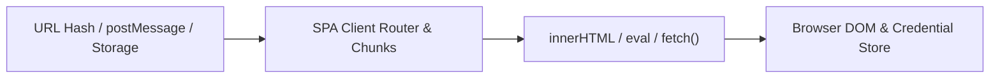

# Client-Side Bundle, SPA Manifest & DOM Security Auditor (`viper-js-harvester`)

## 1. Executive Scope, Standards & CWE/OWASP Mapping
- **Frameworks & Standards:** OWASP WSTG-CLNT (Client-Side Testing), OWASP Top 10:2025 A03/A05, CWE-79, CWE-798, CWE-540
- **Primary CWE Mapping:** CWE-79 (DOM-Based XSS), CWE-798 (Hardcoded Credentials in Client Bundle), CWE-540 (Inclusion of Sensitive Information in Source Code), CWE-345 (Insufficient Verification of Data Authenticity in postMessage)
- **ViperClaw MCP Tools:** `viper_harvest_js`, `viper_browser_ingest`, `viper_graph_upsert`, `viper_verify_and_report`
- **ViperClaw CLI Command:** `viperclaw harvest-js ./dist --base-url https://app.example.com/ --db .viperclaw/graph.db --output js_audit.json`

---

## 2. Threat Model & Root-Cause Architecture



### Root-Cause Analysis
Modern bundlers (Webpack, Vite, Next.js, Rollup) inline `NEXT_PUBLIC_*` / `VITE_*` environment variables at build time and emit code-split chunk manifests (`webpackChunk`, `_buildManifest.js`) that expose internal routes, unreleased admin views, and unvalidated DOM sinks.

---

## 3. Deterministic Discovery & Grep/AST Audit Commands

Run the following discovery commands across the target repository before manual code review:

```bash
# 1. Automated ViperClaw analysis
viperclaw harvest-js ./dist --base-url https://app.example.com/ --db .viperclaw/graph.db --output js_audit.json

# 2. Rapid static pattern discovery (ripgrep)
rg -n "(dangerouslySetInnerHTML|innerHTML\s*=|outerHTML\s*=|document\.write\()"
rg -n "addEventListener\(\s*.message."
rg -n "(NEXT_PUBLIC_|VITE_|REACT_APP_)[A-Z0-9_]*(KEY|SECRET|TOKEN|PRIVATE)"
```

---

## 4. Senior Security Engineer 8-Point Audit Checklist

| Control ID | Audit Verification Target | Pass Criteria | Fail / Vulnerability Indicator |
| :---: | :--- | :--- | :--- |
| `JS-01` | **Build-Time Env Leak Audit** | No private keys or backend tokens prefixed with `NEXT_PUBLIC_`, `VITE_`, or `REACT_APP_`. | Service-role keys, Stripe secret keys, or internal tokens embedded in `.js` bundles. |
| `JS-02` | **Production Source Map Hygiene** | `.js.map` source maps disabled in public production builds or restricted to internal error trackers. | Publicly downloadable `.js.map` files exposing full proprietary TypeScript source and comments. |
| `JS-03` | **Lazy-Chunk Route Authorization** | All administrative or debug routes referenced in lazy chunks enforce server-side RBAC. | Client-side-only route guards (`if (user.isAdmin)`) protecting sensitive API endpoints. |
| `JS-04` | **DOM HTML Sink Sanitization** | Uses of `innerHTML` / `dangerouslySetInnerHTML` sanitize inputs via `DOMPurify.sanitize()`. | Raw user/API HTML injected directly into DOM nodes. |
| `JS-05` | **postMessage Origin & Source Checks** | `window.addEventListener('message')` validates exact `event.origin` and schema. | Wildcard or substring `.includes()` origin check on incoming `postMessage` events. |
| `JS-06` | **Client Redirect & `javascript:` URI Guard** | Dynamic `href` / `window.location.assign` values validate `http:`/`https:` protocol. | Unvalidated `redirect_url` allowing `javascript:` execution in `<a href={url}>`. |
| `JS-07` | **Client Token Storage Security** | Session tokens stored in `HttpOnly; Secure; SameSite` cookies rather than `localStorage`. | Long-lived JWTs or refresh tokens stored in `window.localStorage`. |
| `JS-08` | **Subresource Integrity (SRI)** | External third-party `<script>` tags include `integrity="sha384-..."` and `crossorigin`. | Unpinned third-party CDN scripts loaded without SRI hashes. |

---

## 5. False-Positive Elimination & CVSS v3.1 Triage Rubric

### False-Positive Gate
1. Verify whether an upstream API Gateway, global middleware, or ORM hook already enforces the control before flagging a controller.
2. Confirm the code path is reachable from an external entrypoint (not dead code, CLI-only admin script, or unit-test fixture).

| Severity Tier | Baseline CVSS v3.1 Vector | Qualifying Security Impact |
| :--- | :--- | :--- |
| **CRITICAL (9.1)** | `CVSS:3.1/AV:N/AC:L/PR:N/UI:N/S:U/C:H/I:H/A:N` | Production cloud/database service-role secret key hardcoded in public JS bundle. |
| **HIGH (7.5)** | `CVSS:3.1/AV:N/AC:L/PR:N/UI:N/S:U/C:H/I:N/A:N` | Unloaded admin lazy chunk reveals unauthenticated internal API endpoints leaking PII. |
| **MEDIUM (6.1)** | `CVSS:3.1/AV:N/AC:L/PR:N/UI:R/S:C/C:L/I:L/A:N` | DOM-based XSS via unvalidated `window.postMessage` or `location.search` into `innerHTML`. |
| **LOW (3.7)** | `CVSS:3.1/AV:N/AC:H/PR:N/UI:N/S:U/C:L/I:N/A:N` | Public `.js.map` source maps exposed without sensitive credentials. |

---

## 6. Production Remediation Patterns (Vulnerable vs. Hardened Code)

```typescript
// ❌ VULNERABLE: Substring origin check & direct innerHTML sink in postMessage handler
window.addEventListener("message", (event) => {
  if (event.origin.indexOf("example.com") !== -1) {
    document.getElementById("preview")!.innerHTML = event.data.html;
  }
});

// ✅ HARDENED: Strict origin allowlist + DOMPurify sanitization
import DOMPurify from "dompurify";
const ALLOWED_ORIGINS = new Set(["https://app.example.com", "https://portal.example.com"]);

window.addEventListener("message", (event: MessageEvent) => {
  if (!ALLOWED_ORIGINS.has(event.origin)) return;
  if (typeof event.data?.html === "string") {
    const clean = DOMPurify.sanitize(event.data.html, { USE_PROFILES: { html: true } });
    document.getElementById("preview")!.innerHTML = clean;
  }
});
```

---

## 7. Regression Testing & Continuous Verification
1. Write a **Positive Unit Test** confirming authorized, schema-valid requests succeed.
2. Write a **Negative Security Regression Test** confirming unauthorized, cross-tenant, or malformed inputs are deterministically rejected.
3. Re-run `viperclaw taint` and `viperclaw verify` to confirm zero remaining unmitigated flows in `.viperclaw/graph.db`.
